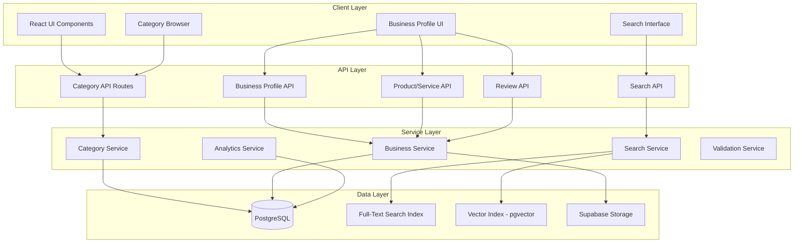

# Design Document: Advanced Category Taxonomy System with Business Profiles

## Overview

This document provides the technical design for implementing an Advanced Category Taxonomy System with comprehensive Business Profiles for the FindAm marketplace platform. The system upgrades the existing browse-by-category functionality to support a hierarchical taxonomy with 23 main categories and their respective subcategories, enabling businesses to create rich profiles with multi-category tagging, product/service listings, reviews, and monetization features.

### Key Features

- **Hierarchical Taxonomy**: 23 main categories with 289 total subcategories organized in a parent-child structure
- **Business Profiles**: Comprehensive business entities with primary/secondary category tagging, photos, verification status, and premium features
- **Product & Service Listings**: Separate management of physical/digital products and service offerings
- **Advanced Search**: PostgreSQL full-text search with optional pgvector semantic search for AI-powered recommendations
- **Multi-Dimensional Filtering**: Location-based (radius search), rating, price range, and service type filters
- **Review System**: User-generated reviews with business owner responses and aggregate rating calculations
- **Monetization**: Verified badges and premium listing subscriptions with enhanced visibility
- **Multi-Language Support**: Category names and descriptions in English, Yoruba, Igbo, and Hausa
- **Analytics**: Category usage tracking, business performance metrics, and administrative insights

### Technology Stack

- **Database**: PostgreSQL 14+ with PostGIS extension for geospatial queries
- **Vector Search** (Optional): pgvector extension for semantic similarity matching
- **API**: Next.js 14 App Router API routes with TypeScript
- **ORM**: Supabase client for database operations
- **Authentication**: Supabase Auth (existing)
- **File Storage**: Supabase Storage for images and media
- **Search**: Native PostgreSQL full-text search (tsvector/tsquery)
- **Frontend**: React 18+ with TypeScript

## Architecture

### System Components



### Data Flow

1. **Category Browsing**: User → Category Browser → Category API → Category Service → PostgreSQL → Return hierarchical data
2. **Business Search**: User → Search UI → Search API → Search Service → Full-Text/Vector Index → Ranked results
3. **Business Profile Creation**: Business Owner → Business Profile UI → Business API → Business Service → Validation → PostgreSQL → Confirmation
4. **Product Listing**: Business Owner → Product Form → Product API → Business Service → PostgreSQL + Storage (images)
5. **Review Submission**: User → Review Form → Review API → Business Service → PostgreSQL → Update aggregate ratings

### Architecture Decisions

**1. Hierarchical Category Model**
- Use self-referencing `parent_id` foreign key for category hierarchy
- Limit to 2 levels (main categories + subcategories) for UI simplicity
- Store translations in JSON columns for multi-language support

**2. Multi-Category Tagging**
- Primary category stored in `business_profiles.primary_category_id`
- Secondary categories stored in junction table `business_category_tags`
- Distinction enables search ranking (primary categories weighted higher)

**3. Search Implementation**
- **Phase 1**: PostgreSQL full-text search using tsvector/tsquery (immediate implementation)
- **Phase 2** (Optional): pgvector for semantic search (requires embedding generation)
- Hybrid approach: combine text relevance with semantic similarity when vector search enabled

**4. Location-Based Filtering**
- Store coordinates as PostGIS GEOGRAPHY type (POINT)
- Use ST_DWithin for radius-based queries (efficient spatial index usage)
- Support common radius values: 5km, 10km, 25km, 50km, 80km

**5. Rating Aggregation**
- Store individual reviews in `business_reviews` table
- Maintain denormalized `average_rating` and `review_count` in `business_profiles`
- Update aggregates using database triggers for consistency

**6. Premium Features**
- Use `is_premium` boolean flag and `premium_expires_at` timestamp
- Premium businesses ranked higher in search results via scoring algorithm
- Separate `verified_badge` from premium status (verification is trust-based, premium is paid)

## Components and Interfaces

### Database Schema

#### Enhanced Categories Table

```sql
CREATE TABLE categories (
  id UUID PRIMARY KEY DEFAULT gen_random_uuid(),
  name TEXT NOT NULL,
  name_translations JSONB DEFAULT '{}', -- {"yo": "Yoruba name", "ig": "Igbo name", "ha": "Hausa name"}
  description TEXT,
  description_translations JSONB DEFAULT '{}',
  icon TEXT NOT NULL,
  parent_id UUID REFERENCES categories(id) ON DELETE CASCADE,
  display_order INTEGER NOT NULL DEFAULT 0,
  is_hidden BOOLEAN DEFAULT FALSE,
  created_at TIMESTAMPTZ DEFAULT NOW(),
  updated_at TIMESTAMPTZ DEFAULT NOW(),
  UNIQUE(name, parent_id) -- Prevent duplicate names at same hierarchy level
);

CREATE INDEX idx_categories_parent_id ON categories(parent_id);
CREATE INDEX idx_categories_display_order ON categories(display_order);
CREATE INDEX idx_categories_name_translations ON categories USING GIN(name_translations);


-- Trigger to update updated_at
CREATE TRIGGER update_categories_updated_at
  BEFORE UPDATE ON categories
  FOR EACH ROW EXECUTE FUNCTION update_updated_at_column();
```

#### Business Profiles Table

```sql
CREATE TABLE business_profiles (
  id UUID PRIMARY KEY DEFAULT gen_random_uuid(),
  user_id UUID NOT NULL REFERENCES auth.users(id) ON DELETE CASCADE,
  
  -- Basic information
  business_name TEXT NOT NULL,
  display_name TEXT,
  description TEXT NOT NULL,
  business_type TEXT CHECK (business_type IN ('product', 'service', 'both')),
  
  -- Category relationships
  primary_category_id UUID NOT NULL REFERENCES categories(id),
  primary_subcategory_ids UUID[] DEFAULT '{}', -- Array of subcategory IDs
  
  -- Location with PostGIS
  address TEXT,
  city TEXT NOT NULL,
  state TEXT NOT NULL,
  postal_code TEXT,
  coordinates GEOGRAPHY(POINT, 4326), -- PostGIS type for lat/long
  
  -- Contact information
  phone TEXT,
  email TEXT,
  website TEXT,
  
  -- Business hours (JSON for flexibility)
  business_hours JSONB DEFAULT '{}', -- {"monday": {"open": "09:00", "close": "17:00"}, ...}
  
  -- Service type attributes (for filtering)
  service_attributes JSONB DEFAULT '{}', -- {"delivery_available": true, "online_service": true, ...}
  
  -- Price range indicator
  price_range TEXT CHECK (price_range IN ('$', '$$', '$$$', '$$$$')),
  
  -- Media
  primary_photo_url TEXT,
  photo_urls TEXT[] DEFAULT '{}', -- Up to 50 photos
  
  -- Status and verification
  is_verified BOOLEAN DEFAULT FALSE,
  verified_at TIMESTAMPTZ,
  verification_documents JSONB, -- Stores references to uploaded docs
  
  is_premium BOOLEAN DEFAULT FALSE,
  premium_tier TEXT CHECK (premium_tier IN ('basic', 'pro', 'enterprise')),
  premium_expires_at TIMESTAMPTZ,
  
  is_active BOOLEAN DEFAULT TRUE,
  
  -- Ratings (denormalized for performance)
  average_rating DECIMAL(3,2) DEFAULT 0.0,
  review_count INTEGER DEFAULT 0,
  
  -- Profile completeness
  completeness_percentage INTEGER DEFAULT 0,
  
  -- Full-text search
  search_vector TSVECTOR,
  
  -- Vector embeddings (optional, for semantic search)
  embedding VECTOR(1536), -- OpenAI ada-002 dimension
  
  -- Metadata
  view_count INTEGER DEFAULT 0,
  created_at TIMESTAMPTZ DEFAULT NOW(),
  updated_at TIMESTAMPTZ DEFAULT NOW(),
  
  UNIQUE(user_id) -- One business profile per user
);

-- Indexes
CREATE INDEX idx_business_profiles_user_id ON business_profiles(user_id);
CREATE INDEX idx_business_profiles_primary_category ON business_profiles(primary_category_id);
CREATE INDEX idx_business_profiles_city_state ON business_profiles(city, state);
CREATE INDEX idx_business_profiles_coordinates ON business_profiles USING GIST(coordinates);
CREATE INDEX idx_business_profiles_premium ON business_profiles(is_premium, premium_expires_at) WHERE is_premium = TRUE;
CREATE INDEX idx_business_profiles_rating ON business_profiles(average_rating DESC);
CREATE INDEX idx_business_profiles_search ON business_profiles USING GIN(search_vector);
CREATE INDEX idx_business_profiles_embedding ON business_profiles USING ivfflat(embedding vector_cosine_ops) WITH (lists = 100);


-- Trigger to update search_vector
CREATE OR REPLACE FUNCTION update_business_search_vector()
RETURNS TRIGGER AS $$
BEGIN
  NEW.search_vector := 
    setweight(to_tsvector('english', COALESCE(NEW.business_name, '')), 'A') ||
    setweight(to_tsvector('english', COALESCE(NEW.description, '')), 'B') ||
    setweight(to_tsvector('english', COALESCE(NEW.city, '')), 'C') ||
    setweight(to_tsvector('english', COALESCE(NEW.state, '')), 'C');
  RETURN NEW;
END;
$$ LANGUAGE plpgsql;

CREATE TRIGGER business_profiles_search_vector_update
  BEFORE INSERT OR UPDATE ON business_profiles
  FOR EACH ROW EXECUTE FUNCTION update_business_search_vector();

-- Trigger to update updated_at
CREATE TRIGGER update_business_profiles_updated_at
  BEFORE UPDATE ON business_profiles
  FOR EACH ROW EXECUTE FUNCTION update_updated_at_column();
```

#### Business Category Tags (Junction Table)

```sql
CREATE TABLE business_category_tags (
  id UUID PRIMARY KEY DEFAULT gen_random_uuid(),
  business_profile_id UUID NOT NULL REFERENCES business_profiles(id) ON DELETE CASCADE,
  category_id UUID NOT NULL REFERENCES categories(id) ON DELETE CASCADE,
  subcategory_ids UUID[] DEFAULT '{}',
  is_primary BOOLEAN DEFAULT FALSE, -- Distinguish primary from secondary
  created_at TIMESTAMPTZ DEFAULT NOW(),
  
  UNIQUE(business_profile_id, category_id)
);

CREATE INDEX idx_business_category_tags_business ON business_category_tags(business_profile_id);
CREATE INDEX idx_business_category_tags_category ON business_category_tags(category_id);
```


#### Product Listings Table

```sql
CREATE TABLE product_listings (
  id UUID PRIMARY KEY DEFAULT gen_random_uuid(),
  business_profile_id UUID NOT NULL REFERENCES business_profiles(id) ON DELETE CASCADE,
  
  -- Product details
  title TEXT NOT NULL,
  description TEXT NOT NULL,
  product_type TEXT CHECK (product_type IN ('physical', 'digital')) NOT NULL,
  
  -- Pricing
  price DECIMAL(12,2) NOT NULL CHECK (price >= 0),
  currency TEXT DEFAULT 'NGN',
  
  -- Inventory (for physical products)
  stock_quantity INTEGER DEFAULT 0 CHECK (stock_quantity >= 0),
  low_stock_threshold INTEGER DEFAULT 5,
  is_in_stock BOOLEAN GENERATED ALWAYS AS (stock_quantity > 0) STORED,
  
  -- Media
  image_urls TEXT[] NOT NULL CHECK (array_length(image_urls, 1) BETWEEN 1 AND 10),
  primary_image_url TEXT NOT NULL,
  
  -- Status
  is_active BOOLEAN DEFAULT TRUE,
  is_featured BOOLEAN DEFAULT FALSE,
  
  -- Metadata
  created_at TIMESTAMPTZ DEFAULT NOW(),
  updated_at TIMESTAMPTZ DEFAULT NOW()
);

CREATE INDEX idx_product_listings_business ON product_listings(business_profile_id);
CREATE INDEX idx_product_listings_active ON product_listings(is_active) WHERE is_active = TRUE;
CREATE INDEX idx_product_listings_featured ON product_listings(is_featured, business_profile_id) WHERE is_featured = TRUE;

CREATE TRIGGER update_product_listings_updated_at
  BEFORE UPDATE ON product_listings
  FOR EACH ROW EXECUTE FUNCTION update_updated_at_column();
```


#### Service Listings Table

```sql
CREATE TABLE service_listings (
  id UUID PRIMARY KEY DEFAULT gen_random_uuid(),
  business_profile_id UUID NOT NULL REFERENCES business_profiles(id) ON DELETE CASCADE,
  
  -- Service details
  title TEXT NOT NULL,
  description TEXT NOT NULL,
  
  -- Pricing
  pricing_model TEXT CHECK (pricing_model IN ('fixed', 'hourly', 'custom')) NOT NULL,
  price DECIMAL(12,2) CHECK (price >= 0),
  currency TEXT DEFAULT 'NGN',
  
  -- Service duration
  duration_text TEXT, -- e.g., "2-3 hours", "1 week"
  
  -- Media
  image_urls TEXT[] NOT NULL CHECK (array_length(image_urls, 1) BETWEEN 1 AND 5),
  primary_image_url TEXT NOT NULL,
  
  -- Status
  is_active BOOLEAN DEFAULT TRUE,
  is_featured BOOLEAN DEFAULT FALSE,
  
  -- Metadata
  created_at TIMESTAMPTZ DEFAULT NOW(),
  updated_at TIMESTAMPTZ DEFAULT NOW()
);

CREATE INDEX idx_service_listings_business ON service_listings(business_profile_id);
CREATE INDEX idx_service_listings_active ON service_listings(is_active) WHERE is_active = TRUE;
CREATE INDEX idx_service_listings_featured ON service_listings(is_featured, business_profile_id) WHERE is_featured = TRUE;

CREATE TRIGGER update_service_listings_updated_at
  BEFORE UPDATE ON service_listings
  FOR EACH ROW EXECUTE FUNCTION update_updated_at_column();
```


#### Business Reviews Table

```sql
CREATE TABLE business_reviews (
  id UUID PRIMARY KEY DEFAULT gen_random_uuid(),
  business_profile_id UUID NOT NULL REFERENCES business_profiles(id) ON DELETE CASCADE,
  reviewer_id UUID NOT NULL REFERENCES auth.users(id) ON DELETE CASCADE,
  
  -- Review content
  rating INTEGER NOT NULL CHECK (rating BETWEEN 1 AND 5),
  comment TEXT NOT NULL CHECK (length(comment) BETWEEN 10 AND 1000),
  
  -- Business owner response
  owner_response TEXT CHECK (owner_response IS NULL OR length(owner_response) <= 1000),
  responded_at TIMESTAMPTZ,
  
  -- Moderation
  is_flagged BOOLEAN DEFAULT FALSE,
  flagged_reason TEXT,
  flagged_at TIMESTAMPTZ,
  
  -- Metadata
  created_at TIMESTAMPTZ DEFAULT NOW(),
  updated_at TIMESTAMPTZ DEFAULT NOW(),
  
  UNIQUE(business_profile_id, reviewer_id) -- One review per user per business
);

CREATE INDEX idx_business_reviews_business ON business_reviews(business_profile_id);
CREATE INDEX idx_business_reviews_reviewer ON business_reviews(reviewer_id);
CREATE INDEX idx_business_reviews_rating ON business_reviews(rating);
CREATE INDEX idx_business_reviews_created ON business_reviews(created_at DESC);

CREATE TRIGGER update_business_reviews_updated_at
  BEFORE UPDATE ON business_reviews
  FOR EACH ROW EXECUTE FUNCTION update_updated_at_column();
```


-- Trigger to update business aggregate ratings
CREATE OR REPLACE FUNCTION update_business_rating_aggregates()
RETURNS TRIGGER AS $$
BEGIN
  UPDATE business_profiles
  SET 
    average_rating = (
      SELECT ROUND(AVG(rating)::numeric, 2)
      FROM business_reviews
      WHERE business_profile_id = COALESCE(NEW.business_profile_id, OLD.business_profile_id)
      AND is_flagged = FALSE
    ),
    review_count = (
      SELECT COUNT(*)
      FROM business_reviews
      WHERE business_profile_id = COALESCE(NEW.business_profile_id, OLD.business_profile_id)
      AND is_flagged = FALSE
    ),
    updated_at = NOW()
  WHERE id = COALESCE(NEW.business_profile_id, OLD.business_profile_id);
  
  RETURN COALESCE(NEW, OLD);
END;
$$ LANGUAGE plpgsql;

CREATE TRIGGER business_reviews_update_aggregates
  AFTER INSERT OR UPDATE OR DELETE ON business_reviews
  FOR EACH ROW EXECUTE FUNCTION update_business_rating_aggregates();
```

#### Category Analytics Table

```sql
CREATE TABLE category_analytics (
  id UUID PRIMARY KEY DEFAULT gen_random_uuid(),
  category_id UUID NOT NULL REFERENCES categories(id) ON DELETE CASCADE,
  
  -- Metrics
  business_count INTEGER DEFAULT 0,
  search_count INTEGER DEFAULT 0,
  view_count INTEGER DEFAULT 0,
  
  -- Time period
  period_date DATE NOT NULL,
  period_type TEXT CHECK (period_type IN ('daily', 'weekly', 'monthly')) NOT NULL,
  
  -- Metadata
  created_at TIMESTAMPTZ DEFAULT NOW(),
  updated_at TIMESTAMPTZ DEFAULT NOW(),
  
  UNIQUE(category_id, period_date, period_type)
);

CREATE INDEX idx_category_analytics_category ON category_analytics(category_id);
CREATE INDEX idx_category_analytics_period ON category_analytics(period_date DESC, period_type);
```


### TypeScript Interfaces

```typescript
// Extended Category types
export interface Category {
  id: string;
  name: string;
  name_translations?: {
    yo?: string; // Yoruba
    ig?: string; // Igbo
    ha?: string; // Hausa
  };
  description?: string;
  description_translations?: Record<string, string>;
  icon: string;
  parent_id?: string | null;
  display_order: number;
  is_hidden: boolean;
  created_at: string;
  subcategories?: Category[]; // For hierarchical queries
  business_count?: number; // For display in UI
}

// Business Profile types
export interface BusinessProfile {
  id: string;
  user_id: string;
  business_name: string;
  display_name?: string;
  description: string;
  business_type: 'product' | 'service' | 'both';
  
  // Category relationships
  primary_category_id: string;
  primary_subcategory_ids: string[];
  
  // Location
  address?: string;
  city: string;
  state: string;
  postal_code?: string;
  coordinates?: { lat: number; lng: number };
  
  // Contact
  phone?: string;
  email?: string;
  website?: string;
  business_hours?: Record<string, { open: string; close: string }>;
  
  // Service attributes
  service_attributes?: {
    delivery_available?: boolean;
    online_service?: boolean;
    in_person_service?: boolean;
    availability_24_7?: boolean;
    emergency_service?: boolean;
  };
  
  price_range?: '$' | '$$' | '$$$' | '$$$$';
  
  // Media
  primary_photo_url?: string;
  photo_urls: string[];
  
  // Status
  is_verified: boolean;
  verified_at?: string;
  is_premium: boolean;
  premium_tier?: 'basic' | 'pro' | 'enterprise';
  premium_expires_at?: string;
  is_active: boolean;
  
  // Ratings
  average_rating: number;
  review_count: number;
  
  // Metadata
  completeness_percentage: number;
  view_count: number;
  created_at: string;
  updated_at: string;
  
  // Relations (populated in queries)
  user?: User;
  primary_category?: Category;
  secondary_categories?: Category[];
  products?: ProductListing[];
  services?: ServiceListing[];
  reviews?: BusinessReview[];
}

export interface ProductListing {
  id: string;
  business_profile_id: string;
  title: string;
  description: string;
  product_type: 'physical' | 'digital';
  price: number;
  currency: string;
  stock_quantity: number;
  low_stock_threshold: number;
  is_in_stock: boolean;
  image_urls: string[];
  primary_image_url: string;
  is_active: boolean;
  is_featured: boolean;
  created_at: string;
  updated_at: string;
}

export interface ServiceListing {
  id: string;
  business_profile_id: string;
  title: string;
  description: string;
  pricing_model: 'fixed' | 'hourly' | 'custom';
  price?: number;
  currency: string;
  duration_text?: string;
  image_urls: string[];
  primary_image_url: string;
  is_active: boolean;
  is_featured: boolean;
  created_at: string;
  updated_at: string;
}


export interface BusinessReview {
  id: string;
  business_profile_id: string;
  reviewer_id: string;
  rating: number;
  comment: string;
  owner_response?: string;
  responded_at?: string;
  is_flagged: boolean;
  flagged_reason?: string;
  created_at: string;
  updated_at: string;
  reviewer?: User;
}

// Search and filter types
export interface BusinessSearchFilters {
  query?: string;
  category_id?: string;
  subcategory_id?: string;
  location?: {
    lat: number;
    lng: number;
    radius_km: 5 | 10 | 25 | 50 | 80;
  };
  city?: string;
  state?: string;
  min_rating?: 3.0 | 3.5 | 4.0 | 4.5 | 5.0;
  price_range?: '$' | '$$' | '$$$' | '$$$$';
  service_attributes?: {
    delivery_available?: boolean;
    online_service?: boolean;
    in_person_service?: boolean;
    availability_24_7?: boolean;
    emergency_service?: boolean;
  };
  sort_by?: 'relevance' | 'rating' | 'review_count' | 'distance' | 'name';
  only_verified?: boolean;
  only_premium?: boolean;
}

export interface BusinessSearchResult {
  businesses: BusinessProfile[];
  total: number;
  page: number;
  limit: number;
  hasMore: boolean;
}

// Category-specific field types
export interface FoodBeverageFields {
  cuisine_types: string[];
  dietary_options: string[]; // vegan, vegetarian, halal, etc.
  delivery_radius_km?: number;
}

export interface HealthMedicalFields {
  specializations: string[];
  accepted_insurance: string[];
  appointment_booking_url?: string;
}

export interface RealEstateFields {
  property_types: string[]; // residential, commercial, land
  transaction_types: string[]; // sale, rent, lease
  service_areas: string[];
}

export interface AutomotiveFields {
  brands_serviced: string[];
  certifications: string[];
  warranty_offered: boolean;
}
```


### API Endpoints

#### Category Endpoints

```typescript
// GET /api/categories
// Get all categories with subcategories and business counts
interface GetCategoriesResponse {
  categories: Category[];
}

// GET /api/categories/:id
// Get single category with subcategories
interface GetCategoryResponse {
  category: Category;
  subcategories: Category[];
  business_count: number;
}

// GET /api/categories/:id/businesses
// Get businesses in a category with filtering
interface GetCategoryBusinessesRequest {
  category_id: string;
  subcategory_id?: string;
  page?: number;
  limit?: number;
  sort_by?: 'rating' | 'review_count' | 'name';
}

interface GetCategoryBusinessesResponse {
  businesses: BusinessProfile[];
  total: number;
  page: number;
  limit: number;
  hasMore: boolean;
}

// POST /api/categories/import (Admin only)
// Bulk import categories from CSV
interface ImportCategoriesRequest {
  csv_data: string; // CSV content as string
}

interface ImportCategoriesResponse {
  imported: number;
  skipped: number;
  errors: Array<{ line: number; error: string }>;
}

// PATCH /api/categories/:id/reorder (Admin only)
// Update display order
interface ReorderCategoryRequest {
  display_order: number;
}
```


#### Business Profile Endpoints

```typescript
// POST /api/business-profiles
// Create new business profile
interface CreateBusinessProfileRequest {
  business_name: string;
  description: string;
  business_type: 'product' | 'service' | 'both';
  primary_category_id: string;
  primary_subcategory_ids: string[];
  secondary_categories?: Array<{
    category_id: string;
    subcategory_ids: string[];
  }>;
  city: string;
  state: string;
  address?: string;
  postal_code?: string;
  coordinates?: { lat: number; lng: number };
  phone?: string;
  email?: string;
  website?: string;
  business_hours?: Record<string, { open: string; close: string }>;
  service_attributes?: Record<string, boolean>;
  price_range?: '$' | '$$' | '$$$' | '$$$$';
}

interface CreateBusinessProfileResponse {
  business_profile: BusinessProfile;
}

// GET /api/business-profiles/:id
// Get single business profile with all relations
interface GetBusinessProfileResponse {
  business_profile: BusinessProfile;
  products: ProductListing[];
  services: ServiceListing[];
  reviews: BusinessReview[];
  rating_breakdown: {
    five_star: number;
    four_star: number;
    three_star: number;
    two_star: number;
    one_star: number;
  };
}

// PATCH /api/business-profiles/:id
// Update business profile
interface UpdateBusinessProfileRequest {
  // All fields from CreateBusinessProfileRequest are optional here
  [key: string]: any;
}

// POST /api/business-profiles/:id/photos
// Upload photos to business profile
interface UploadBusinessPhotosRequest {
  photos: File[]; // Multipart form data
  primary_photo_index?: number;
}

interface UploadBusinessPhotosResponse {
  photo_urls: string[];
  primary_photo_url: string;
}


// POST /api/business-profiles/:id/verify (Admin only)
// Verify a business profile
interface VerifyBusinessProfileRequest {
  verification_notes?: string;
}

// POST /api/business-profiles/:id/premium
// Upgrade to premium listing
interface UpgradeToPremiumRequest {
  tier: 'basic' | 'pro' | 'enterprise';
  duration_months: 1 | 3 | 6 | 12;
  payment_method: string;
}

interface UpgradeToPremiumResponse {
  payment_url: string;
  subscription_id: string;
}
```

#### Product Listing Endpoints

```typescript
// POST /api/business-profiles/:id/products
// Create product listing
interface CreateProductRequest {
  title: string;
  description: string;
  product_type: 'physical' | 'digital';
  price: number;
  stock_quantity?: number;
  low_stock_threshold?: number;
  images: File[]; // Multipart form data
}

interface CreateProductResponse {
  product: ProductListing;
}

// GET /api/business-profiles/:id/products
// List all products for a business
interface ListProductsResponse {
  products: ProductListing[];
  total: number;
}

// PATCH /api/products/:id
// Update product listing
interface UpdateProductRequest {
  title?: string;
  description?: string;
  price?: number;
  stock_quantity?: number;
  is_active?: boolean;
  is_featured?: boolean;
}

// DELETE /api/products/:id
// Delete product listing
```


#### Service Listing Endpoints

```typescript
// POST /api/business-profiles/:id/services
// Create service listing
interface CreateServiceRequest {
  title: string;
  description: string;
  pricing_model: 'fixed' | 'hourly' | 'custom';
  price?: number;
  duration_text?: string;
  images: File[];
}

interface CreateServiceResponse {
  service: ServiceListing;
}

// GET /api/business-profiles/:id/services
// List all services for a business
interface ListServicesResponse {
  services: ServiceListing[];
  total: number;
}

// PATCH /api/services/:id
// Update service listing

// DELETE /api/services/:id
// Delete service listing
```

#### Review Endpoints

```typescript
// POST /api/business-profiles/:id/reviews
// Submit a review
interface CreateReviewRequest {
  rating: number; // 1-5
  comment: string; // 10-1000 characters
}

interface CreateReviewResponse {
  review: BusinessReview;
  updated_business_rating: {
    average_rating: number;
    review_count: number;
  };
}

// GET /api/business-profiles/:id/reviews
// Get reviews for a business
interface GetReviewsRequest {
  page?: number;
  limit?: number;
  sort_by?: 'recent' | 'rating_high' | 'rating_low';
}

interface GetReviewsResponse {
  reviews: BusinessReview[];
  total: number;
  page: number;
  limit: number;
  rating_breakdown: {
    five_star: number;
    four_star: number;
    three_star: number;
    two_star: number;
    one_star: number;
  };
}


// POST /api/reviews/:id/respond
// Business owner responds to review
interface RespondToReviewRequest {
  response: string; // Max 1000 characters
}

// POST /api/reviews/:id/flag (Admin only)
// Flag a review for moderation
interface FlagReviewRequest {
  reason: string;
}
```

#### Search Endpoints

```typescript
// GET /api/search/businesses
// Search businesses with filters
interface SearchBusinessesRequest extends BusinessSearchFilters {
  page?: number;
  limit?: number;
}

interface SearchBusinessesResponse extends BusinessSearchResult {
  search_metadata: {
    query_time_ms: number;
    total_results: number;
    using_vector_search: boolean;
  };
}

// GET /api/search/autocomplete
// Autocomplete suggestions for search
interface AutocompleteRequest {
  query: string;
  limit?: number;
}

interface AutocompleteResponse {
  suggestions: Array<{
    text: string;
    type: 'business' | 'category' | 'location';
    id?: string;
  }>;
}

// GET /api/recommendations
// Get personalized business recommendations (vector search)
interface GetRecommendationsRequest {
  user_id?: string;
  location?: { lat: number; lng: number };
  limit?: number;
}

interface GetRecommendationsResponse {
  businesses: BusinessProfile[];
  reason: 'browsing_history' | 'location_based' | 'popular';
}
```


#### Analytics Endpoints (Admin)

```typescript
// GET /api/admin/analytics/categories
// Get category usage analytics
interface GetCategoryAnalyticsRequest {
  start_date?: string;
  end_date?: string;
  period_type?: 'daily' | 'weekly' | 'monthly';
}

interface GetCategoryAnalyticsResponse {
  top_categories: Array<{
    category: Category;
    business_count: number;
    search_count: number;
    view_count: number;
  }>;
  empty_categories: Category[];
  trending_categories: Array<{
    category: Category;
    growth_percentage: number;
  }>;
}

// GET /api/admin/analytics/businesses
// Get business profile analytics
interface GetBusinessAnalyticsResponse {
  total_businesses: number;
  verified_businesses: number;
  premium_businesses: number;
  average_completeness: number;
  businesses_by_category: Array<{
    category_name: string;
    count: number;
  }>;
  businesses_by_state: Array<{
    state: string;
    count: number;
  }>;
}
```

## Data Models

### Category Hierarchy

The 23 main categories with their subcategory structure:

1. **Home & Construction** (15 subcategories)
   - Plumbing, Electrical, Carpentry, Painting, Roofing, HVAC, Masonry, Landscaping, Interior Design, Architecture, General Contracting, Home Security, Pest Control, Cleaning Services, Moving Services

2. **Health & Medical** (18 subcategories)
   - Hospitals, Clinics, Pharmacies, Dentistry, Optometry, Physical Therapy, Mental Health, Nutrition, Alternative Medicine, Home Healthcare, Medical Equipment, Laboratory Services, Radiology, Pediatrics, Geriatrics, Emergency Services, Telemedicine, Veterinary

3. **Retail & Shopping** (19 subcategories)
   - Supermarkets, Electronics, Fashion, Furniture, Appliances, Jewelry, Books, Sports Equipment, Toys, Beauty Products, Groceries, Hardware, Office Supplies, Pet Supplies, Art Supplies, Music Instruments, Party Supplies, Gift Shops, Convenience Stores


4. **Education & Training** (15 subcategories)
   - Primary Schools, Secondary Schools, Universities, Vocational Training, Language Schools, Tutoring, Music Lessons, Dance Classes, Driving Schools, Cooking Classes, Professional Certifications, Online Courses, Special Education, Daycare, Test Preparation

5. **Food & Beverage** (16 subcategories)
   - Restaurants, Cafes, Bars, Fast Food, Catering, Bakeries, Food Trucks, Grocery Delivery, Meal Prep, Breweries, Wineries, Ice Cream Shops, Juice Bars, Food Wholesale, Butcher Shops, Seafood Markets

6. **Finance & Insurance** (15 subcategories)
   - Banking, Investment Services, Insurance, Accounting, Tax Services, Financial Planning, Mortgage Services, Currency Exchange, Microfinance, Pension Services, Credit Services, Crowdfunding, Payment Processing, Cryptocurrency, Stock Brokerage

7. **Technology & IT** (16 subcategories)
   - Software Development, Web Design, IT Support, Mobile App Development, Cybersecurity, Cloud Services, Data Analytics, AI/ML Services, Hardware Repair, Network Installation, Tech Consulting, Digital Marketing, SEO Services, E-commerce Solutions, System Integration, Database Management

8. **Professional Services** (17 subcategories)
   - Legal Services, Consulting, Marketing, HR Services, Public Relations, Event Planning, Translation, Business Formation, Project Management, Quality Assurance, Research Services, Copywriting, Graphic Design, Video Production, Photography, Auditing, Compliance

9. **Automotive** (13 subcategories)
   - Car Sales, Auto Repair, Car Wash, Towing, Auto Parts, Car Rental, Tire Services, Oil Change, Body Shop, Window Tinting, Vehicle Inspection, Motorcycle Services, Auto Insurance

10. **Travel & Tourism** (15 subcategories)
    - Hotels, Travel Agencies, Tour Operators, Car Rentals, Airlines, Vacation Rentals, Cruises, Adventure Tourism, Eco-Tourism, Cultural Tourism, Business Travel, Travel Insurance, Visa Services, Airport Services, Tourist Information

11. **Fashion & Beauty** (15 subcategories)
    - Salons, Barbershops, Spas, Nail Studios, Makeup Artists, Fashion Design, Tailoring, Dry Cleaning, Boutiques, Shoe Repair, Accessories, Bridal Services, Skincare, Massage Therapy, Cosmetic Surgery


12. **Agriculture & Farming** (15 subcategories)
    - Crop Farming, Livestock, Poultry, Fisheries, Agricultural Equipment, Seeds & Fertilizers, Irrigation, Agro-Processing, Farm Consulting, Organic Farming, Greenhouses, Veterinary Services, Agricultural Finance, Farm Produce Sales, Agricultural Training

13. **Energy & Environment** (15 subcategories)
    - Solar Energy, Renewable Energy, Waste Management, Recycling, Water Treatment, Environmental Consulting, Oil & Gas, Electrical Generation, Energy Efficiency, Sustainability Services, Carbon Offsetting, Environmental Testing, Green Building, Pollution Control, Climate Services

14. **Manufacturing & Industrial** (16 subcategories)
    - Food Processing, Textile Manufacturing, Metal Fabrication, Plastics, Chemical Manufacturing, Packaging, Printing, Industrial Equipment, Quality Control, Supply Chain, Factory Services, Machinery Repair, Industrial Design, Process Automation, Production Consulting, Welding Services

15. **Media & Entertainment** (16 subcategories)
    - Radio Stations, TV Production, Music Production, Publishing, Advertising, Film Production, Animation, Game Development, Content Creation, Social Media Management, Podcasting, Live Events, Theater, Comedy, DJ Services, Broadcasting

16. **Logistics & Supply Chain** (14 subcategories)
    - Freight Forwarding, Warehousing, Courier Services, Distribution, Import/Export, Customs Brokerage, Fleet Management, Inventory Management, Last-Mile Delivery, Cold Chain, Packaging Services, Shipping, Tracking Systems, Logistics Consulting

17. **Real Estate & Property** (16 subcategories)
    - Property Sales, Property Rentals, Property Management, Real Estate Development, Commercial Real Estate, Land Sales, Mortgage Brokerage, Property Valuation, Property Inspection, Real Estate Investment, Facility Management, Property Law, Architecture, Construction, Interior Design, Property Insurance

18. **Non-Profit & Social** (16 subcategories)
    - Charities, NGOs, Community Centers, Religious Organizations, Youth Programs, Women's Organizations, Health Advocacy, Education Foundations, Environmental Organizations, Human Rights, Disaster Relief, Social Enterprises, Volunteer Services, Fundraising, Grant Writing, Impact Assessment


19. **Events & Hospitality** (17 subcategories)
    - Wedding Planning, Corporate Events, Conferences, Concerts, Festivals, Catering, Venue Rental, Event Equipment, Entertainment Services, Decorators, Audio/Visual Services, Security Services, Event Staffing, Ticketing, Exhibitions, Sports Events, Party Planning

20. **Crafts & Creative Services** (6 subcategories)
    - Handmade Crafts, Art Studios, Pottery, Woodworking, Jewelry Making, Custom Printing

21. **Childcare & Family** (14 subcategories)
    - Daycare Centers, Preschools, After-School Programs, Nanny Services, Child Tutoring, Birthday Party Services, Family Counseling, Parenting Classes, Child Photography, Children's Entertainment, Babysitting, Child Transportation, Summer Camps, Youth Sports

22. **Pets & Animals** (4 subcategories)
    - Veterinary Services, Pet Grooming, Pet Boarding, Pet Supplies

23. **Other / Miscellaneous** (5 subcategories)
    - General Services, Unclassified Businesses, Emerging Industries, Specialized Services, Multiple Categories

### Search Ranking Algorithm

Business search results are ranked using a weighted scoring system:

```
Total Score = (Text Relevance × 0.4) + (Rating Score × 0.2) + (Category Match × 0.15) + 
              (Premium Boost × 0.1) + (Verification Boost × 0.1) + (Freshness × 0.05)

Where:
- Text Relevance: Full-text search score (0-1) based on ts_rank
- Rating Score: (average_rating / 5.0) normalized to 0-1
- Category Match: 1.0 if primary category match, 0.5 if secondary category match
- Premium Boost: 1.0 if premium and not expired, 0 otherwise
- Verification Boost: 1.0 if verified, 0 otherwise  
- Freshness: Recency score based on updated_at (0-1)
```

If multiple businesses have the same score, tiebreaker order:
1. Review count (descending)
2. View count (descending)
3. Created date (descending)


### Profile Completeness Calculation

```typescript
function calculateProfileCompleteness(profile: BusinessProfile): number {
  const fields = [
    { key: 'business_name', weight: 10 },
    { key: 'description', weight: 10, minLength: 50 },
    { key: 'primary_category_id', weight: 10 },
    { key: 'primary_subcategory_ids', weight: 5, minLength: 1 },
    { key: 'city', weight: 5 },
    { key: 'state', weight: 5 },
    { key: 'coordinates', weight: 5 },
    { key: 'phone', weight: 5 },
    { key: 'email', weight: 5 },
    { key: 'business_hours', weight: 5 },
    { key: 'primary_photo_url', weight: 10 },
    { key: 'photo_urls', weight: 10, minLength: 3 },
    { key: 'products_or_services', weight: 15, minLength: 1 }, // At least 1 product or service
  ];
  
  let score = 0;
  fields.forEach(field => {
    const value = profile[field.key];
    if (value !== null && value !== undefined) {
      if (field.minLength) {
        if (Array.isArray(value) && value.length >= field.minLength) {
          score += field.weight;
        } else if (typeof value === 'string' && value.length >= field.minLength) {
          score += field.weight;
        }
      } else {
        score += field.weight;
      }
    }
  });
  
  return score; // Max 100
}
```

## Correctness Properties

This section assesses property-based testing (PBT) applicability for the Advanced Category Taxonomy System. The feature includes:
- Database schema and CRUD operations for categories, business profiles, products, services, and reviews
- Search and filtering functionality using PostgreSQL full-text and spatial queries
- Multi-language support with JSON translation storage
- CSV import/export for categories and business profiles

**PBT Assessment**: This feature is primarily IaC-like (database schema definitions) and CRUD operations with complex search queries. While there are data transformation operations (CSV parsing, JSON serialization), most acceptance criteria relate to database operations, UI rendering, and infrastructure configuration rather than pure algorithmic logic.

**PBT IS appropriate** for:
- Requirements 22 & 23: CSV parsing and JSON serialization have clear round-trip properties
- Search ranking algorithm validation (ensuring consistent scoring)
- Profile completeness calculation (deterministic function with clear invariants)

**PBT IS NOT appropriate** for:
- Database schema validation (use migration tests and schema checks)
- CRUD operations (use example-based integration tests)
- UI rendering of categories and business profiles (use snapshot tests)
- Location-based filtering with PostGIS (use example-based tests with known coordinates)
- Full-text search behavior (PostgreSQL-specific, use example-based tests)

Given the mixed nature, I will use the prework tool to analyze the testable requirements.

### Prework Reflection

After analyzing the acceptance criteria, the following properties were identified as suitable for property-based testing:

**Serialization Properties (Requirements 22 & 23)**:
- 22.1, 22.3: CSV parsing and formatting (can be combined into round-trip)
- 22.4: CSV round-trip property ✓ (comprehensive, keep)
- 22.2, 22.5, 22.6: Validation properties (separate concerns, keep)
- 23.1, 23.3: JSON serialization and deserialization (can be combined into round-trip)
- 23.4: JSON round-trip property ✓ (comprehensive, keep)
- 23.2: Validation property (keep)
- 23.5, 23.6: Data preservation properties (redundant with round-trip, remove)

**Search and Ranking Properties**:
- 2.5: Primary category weighting in search (keep)
- 2.6: Business appears in all tagged category queries (keep)
- 17.1, 17.2: Profile completeness calculation (combine into single property)
- 17.5: Completeness affects ranking (keep separate, different concern)
- 11.4: Review average calculation (keep)

**Consolidated Property List** (after removing redundancies):
1. CSV round-trip preservation (22.4)
2. CSV validation for parent references (22.5)
3. CSV validation for display order uniqueness (22.6)
4. CSV parser error handling (22.2)
5. JSON round-trip preservation (23.4)
6. JSON validation for invalid data (23.2)
7. Primary category weighted higher in search ranking (2.5)
8. Business appears in all tagged category queries (2.6)
9. Profile completeness calculation (17.1, 17.2 combined)
10. Review average rating calculation (11.4)
11. Completeness boosts search ranking (17.5)

### Property 1: CSV Round-Trip Preservation

*For any* valid collection of category objects with name, parent_id, display_order, and description fields, converting to CSV then parsing back to objects then converting to CSV again SHALL produce equivalent CSV output.

**Validates: Requirement 22.4**

### Property 2: CSV Parent Reference Validation

*For any* collection of category objects where some have parent_id values, the CSV parser SHALL reject the collection if any parent_id references a non-existent category ID.

**Validates: Requirement 22.5**

### Property 3: CSV Display Order Uniqueness Validation

*For any* collection of category objects grouped by parent_id, the CSV parser SHALL reject the collection if any two categories with the same parent_id have identical display_order values.

**Validates: Requirement 22.6**

### Property 4: CSV Parser Error Messages

*For any* invalid CSV input (malformed structure, missing required fields, type mismatches), the CSV parser SHALL return error messages that include the line number and specific validation failure.

**Validates: Requirement 22.2**

### Property 5: Business Profile JSON Round-Trip Preservation

*For any* valid Business_Profile object containing all fields (business_id, name, description, categories, products, services, reviews, metadata), serializing to JSON then deserializing back to an object then serializing to JSON again SHALL produce equivalent JSON output.

**Validates: Requirement 23.4**

### Property 6: Business Profile JSON Validation

*For any* invalid Business_Profile data (missing required fields, invalid field types, constraint violations), the Profile_Serializer SHALL return validation errors with field-specific error messages identifying which fields failed validation.

**Validates: Requirement 23.2**

### Property 7: Primary Category Search Weighting

*For any* business profile with both a primary category and secondary categories, when calculating search ranking scores, the primary category match SHALL contribute a weight of 1.0 while secondary category matches SHALL contribute a weight of 0.5 or less.

**Validates: Requirement 2.5**

### Property 8: Multi-Category Query Inclusion

*For any* business profile tagged with a primary category P and secondary categories S1, S2, ..., Sn, querying for businesses in category P SHALL return the business, and querying for businesses in any category Si SHALL also return the business.

**Validates: Requirement 2.6**

### Property 9: Profile Completeness Calculation

*For any* business profile, the completeness percentage SHALL be calculated as the sum of weights for all non-null/non-empty required fields (business_name, description, primary_category_id, subcategories, location, photos, business_hours, contact info, products/services), with the total capped at 100%.

**Validates: Requirements 17.1, 17.2**

### Property 10: Review Average Rating Calculation

*For any* set of reviews for a business (where each review has a rating between 1 and 5), the business average_rating SHALL equal the sum of all review ratings divided by the count of reviews, rounded to 2 decimal places.

**Validates: Requirement 11.4**

### Property 11: Completeness Search Ranking Boost

*For any* two business profiles with identical search relevance scores, if one profile has completeness_percentage > 80 and the other has completeness_percentage ≤ 80, the more complete profile SHALL rank higher in search results.

**Validates: Requirement 17.5**

## Error Handling

### Validation Errors

**Category Validation**:
- Duplicate category names at same hierarchy level: Return 409 Conflict with message "Category name already exists at this level"
- Invalid parent_id reference: Return 400 Bad Request with message "Parent category does not exist"
- Invalid display_order (negative): Return 400 Bad Request with message "Display order must be non-negative"
- Missing required fields: Return 400 Bad Request with field-specific messages

**Business Profile Validation**:
- Missing required fields (name, description, primary_category_id, city, state): Return 400 Bad Request
- Invalid coordinates (out of valid lat/lng range): Return 400 Bad Request with message "Invalid coordinates"
- Invalid price_range value: Return 400 Bad Request with message "Price range must be $, $$, $$$, or $$$$"
- Duplicate business profile for user: Return 409 Conflict with message "User already has a business profile"
- Too many photos (>50): Return 400 Bad Request with message "Maximum 50 photos allowed"
- Invalid photo format: Return 400 Bad Request with message "Photos must be JPEG, PNG, or WebP format"
- Photo file size too large (>5MB): Return 413 Payload Too Large

**Product/Service Listing Validation**:
- Invalid price (negative or more than 2 decimal places): Return 400 Bad Request
- Invalid stock_quantity (negative): Return 400 Bad Request
- Too many images (products >10, services >5): Return 400 Bad Request
- Missing required fields: Return 400 Bad Request with field-specific messages

**Review Validation**:
- Invalid rating (not 1-5): Return 400 Bad Request with message "Rating must be between 1 and 5"
- Comment too short (<10 chars) or too long (>1000 chars): Return 400 Bad Request
- Duplicate review (user already reviewed business): Return 409 Conflict with message "You have already reviewed this business"
- Reviewer is business owner: Return 403 Forbidden with message "Cannot review your own business"


### Search and Filter Errors

**Search Errors**:
- Query too short (<3 characters for partial matching): Return 400 Bad Request
- Invalid sort_by value: Return 400 Bad Request with valid options
- Search timeout (>5 seconds): Return 504 Gateway Timeout with message "Search request timed out"

**Location Filter Errors**:
- Invalid coordinates format: Return 400 Bad Request
- Invalid radius value (not one of 5, 10, 25, 50, 80): Return 400 Bad Request
- Location string not found (geocoding failure): Return 404 Not Found with message "Location not found"
- Missing coordinates when radius specified: Return 400 Bad Request

### Database Errors

**Connection Errors**:
- Database connection failure: Return 503 Service Unavailable with retry-after header
- Query timeout: Return 504 Gateway Timeout
- Connection pool exhausted: Return 503 Service Unavailable

**Constraint Violations**:
- Foreign key violation: Return 400 Bad Request with message identifying the missing reference
- Unique constraint violation: Return 409 Conflict
- Check constraint violation: Return 400 Bad Request with constraint details

### File Upload Errors

**Storage Errors**:
- Upload failure to Supabase Storage: Return 500 Internal Server Error with retry guidance
- Storage quota exceeded: Return 507 Insufficient Storage
- Invalid file type: Return 415 Unsupported Media Type
- File too large: Return 413 Payload Too Large

### Authorization Errors

**Permission Errors**:
- Unauthenticated request to protected endpoint: Return 401 Unauthorized
- User not owner of business profile: Return 403 Forbidden
- Non-admin attempting admin operation: Return 403 Forbidden
- Suspended user attempting operation: Return 403 Forbidden with message "Account suspended"

### Rate Limiting

- Too many requests from IP: Return 429 Too Many Requests with retry-after header
- Exceeded daily API quota: Return 429 Too Many Requests with quota reset time

## Testing Strategy

### Unit Testing

**Target**: Individual functions, validators, and transformers

**Approach**: Example-based unit tests using Vitest

**Key Test Suites**:

1. **Category Validation Tests**
   - Test display order uniqueness checking
   - Test parent reference validation
   - Test name uniqueness within hierarchy level
   - Test translation object validation

2. **Business Profile Validation Tests**
   - Test coordinates validation (valid lat/lng ranges)
   - Test price range validation
   - Test service attributes validation
   - Test phone/email format validation

3. **Search Ranking Algorithm Tests**
   - Test score calculation with known inputs
   - Test tiebreaker logic
   - Test premium/verification boost application
   - Test freshness score calculation


4. **Profile Completeness Calculation Tests**
   - Test with empty profile (0%)
   - Test with partially filled profile
   - Test with fully complete profile (100%)
   - Test field weight contributions

5. **Rating Aggregation Tests**
   - Test average calculation with various review sets
   - Test rounding to 2 decimal places
   - Test with single review
   - Test rating breakdown calculation

### Property-Based Testing

**Target**: Serialization, parsing, and algorithmic properties

**Library**: fast-check (for TypeScript/JavaScript)

**Configuration**: Minimum 100 iterations per property test

**Test Suites**:

1. **CSV Parsing Properties** (Requirement 22)
   - Property 1: Round-trip preservation
     - Generate arbitrary category collections
     - Verify CSV → objects → CSV equivalence
   - Property 2: Parent reference validation
     - Generate categories with invalid parent references
     - Verify parser rejects with appropriate errors
   - Property 3: Display order uniqueness
     - Generate categories with duplicate display orders
     - Verify parser rejects within same parent
   - Property 4: Error message quality
     - Generate various malformed CSV inputs
     - Verify error messages include line numbers and specifics

2. **JSON Serialization Properties** (Requirement 23)
   - Property 5: Round-trip preservation
     - Generate arbitrary business profiles with nested data
     - Verify JSON → object → JSON equivalence
   - Property 6: Validation error messages
     - Generate invalid business profile data
     - Verify field-specific error messages

3. **Search and Ranking Properties** (Requirements 2, 17)
   - Property 7: Primary category weighting
     - Generate businesses with primary and secondary categories
     - Verify search score calculation applies correct weights
   - Property 8: Multi-category query inclusion
     - Generate businesses with multiple categories
     - Verify appearance in all category queries
   - Property 9: Completeness calculation
     - Generate profiles with various field combinations
     - Verify completeness percentage calculation
   - Property 11: Completeness ranking boost
     - Generate pairs of businesses with different completeness
     - Verify ranking order

4. **Review Properties** (Requirement 11)
   - Property 10: Average rating calculation
     - Generate arbitrary sets of reviews (1-5 stars)
     - Verify average calculation and rounding

**Tag Format for Property Tests**:
```typescript
// Feature: advanced-category-taxonomy, Property 1: CSV round-trip preservation
test('csv parsing round-trip preserves data', () => {
  fc.assert(
    fc.property(fc.array(arbitraryCategoryObject()), (categories) => {
      const csv = formatCategoriesToCSV(categories);
      const parsed = parseCSVToCategories(csv);
      const csv2 = formatCategoriesToCSV(parsed);
      expect(csv2).toEqual(csv);
    }),
    { numRuns: 100 }
  );
});
```


### Integration Testing

**Target**: Database operations, API endpoints, and external service integrations

**Approach**: Example-based integration tests with real PostgreSQL database and Supabase client

**Key Test Suites**:

1. **Category CRUD Operations**
   - Create categories with valid data
   - Test parent-child relationships
   - Test category hierarchy queries
   - Test duplicate name prevention
   - Test category hiding (soft delete)

2. **Business Profile CRUD**
   - Create business profile with all fields
   - Test unique constraint (one profile per user)
   - Test coordinate storage and retrieval
   - Test search_vector trigger updates
   - Test profile update operations

3. **Multi-Category Tagging**
   - Assign primary and secondary categories
   - Query businesses by category
   - Verify businesses appear in multiple category results
   - Test category tag deletion cascades

4. **Product and Service Listings**
   - Create product with images
   - Test stock quantity updates
   - Create service with pricing models
   - Test listing activation/deactivation

5. **Review System**
   - Submit reviews with various ratings
   - Test duplicate review prevention
   - Verify rating aggregate trigger updates business_profiles
   - Test business owner response
   - Test review flagging

6. **Search Functionality**
   - Full-text search on business names
   - Full-text search on descriptions
   - Test result ranking
   - Test search highlighting
   - Test pagination

7. **Location-Based Filtering**
   - Test radius queries with ST_DWithin
   - Test distance calculation
   - Test coordinate indexing performance
   - Test multiple location formats (city, state, postal code)

8. **Rating and Price Filtering**
   - Filter by minimum rating thresholds
   - Filter by price range categories
   - Combine multiple filters
   - Test zero results scenario

9. **File Upload Integration**
   - Upload business photos to Supabase Storage
   - Upload product images
   - Test file size validation
   - Test file format validation
   - Test storage bucket permissions

10. **Premium and Verification**
    - Award verified badge
    - Activate premium subscription
    - Test premium expiration
    - Verify premium ranking boost in search

### End-to-End Testing

**Target**: Complete user workflows across UI and API

**Approach**: Example-based E2E tests using Playwright or Cypress

**Key Workflows**:

1. **Business Owner Journey**
   - Register account
   - Create business profile
   - Select categories and subcategories
   - Upload photos
   - Add products/services
   - Monitor profile completeness
   - Respond to reviews
   - Upgrade to premium

2. **Customer Journey**
   - Browse categories
   - Search for businesses
   - Apply location filter
   - Apply rating/price filters
   - View business profile
   - Read reviews
   - Submit review

3. **Admin Journey**
   - Import categories from CSV
   - Reorder categories
   - Verify business profiles
   - View category analytics
   - Flag inappropriate reviews
   - Merge duplicate categories


### Performance Testing

**Target**: Database query performance, search response times, and scalability

**Approach**: Load testing with realistic data volumes

**Key Metrics**:

1. **Category Queries**
   - Load all 23 categories with subcategories: < 100ms
   - Query single category with business count: < 50ms

2. **Business Search**
   - Full-text search across 10,000 businesses: < 2 seconds (Requirement 4.3)
   - Location-based search with radius: < 2 seconds
   - Combined filters: < 2 seconds

3. **Rating Aggregation**
   - Update business rating after review submission: < 5 seconds (Requirement 11.4)
   - Trigger execution time: < 500ms

4. **Concurrent Operations**
   - 100 concurrent search requests: Average response < 3 seconds
   - 50 concurrent business profile updates: No deadlocks

5. **Database Indexes**
   - Verify all foreign keys are indexed
   - Verify GIN index on search_vector
   - Verify GIST index on coordinates
   - Verify indexes on frequently filtered columns (is_premium, average_rating)

### Snapshot Testing

**Target**: Database schema structure, API response formats

**Approach**: Schema snapshot tests and API contract tests

**Key Snapshots**:

1. **Database Schema**
   - Snapshot table structure for categories, business_profiles, reviews, etc.
   - Detect unintended schema changes in migrations

2. **API Response Formats**
   - Snapshot category list response structure
   - Snapshot business profile response structure
   - Snapshot search results structure
   - Ensure backward compatibility

### Security Testing

**Target**: Authentication, authorization, input validation

**Key Tests**:

1. **Authorization**
   - Verify non-owners cannot update business profiles
   - Verify non-admins cannot access admin endpoints
   - Verify suspended users are blocked

2. **Input Validation**
   - SQL injection attempts in search queries
   - XSS attempts in business descriptions
   - Path traversal attempts in file uploads
   - Oversized payload handling

3. **Rate Limiting**
   - Verify rate limits prevent abuse
   - Test rate limit headers
   - Test IP-based throttling

4. **Data Privacy**
   - Verify user data is properly scoped
   - Verify deleted reviews are actually removed
   - Verify private fields not exposed in API responses
