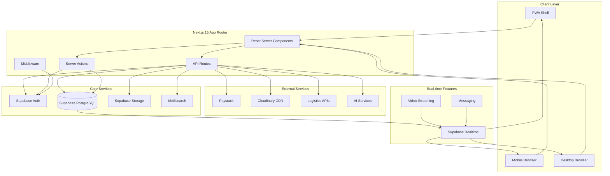

# Design Document: FindAm Marketplace Enhancements

## Overview

This design document outlines the technical architecture and implementation approach for enhancing the FindAm marketplace platform with 29 comprehensive features plus 4 unique innovations. The enhancements transform FindAm from a basic marketplace into a comprehensive, engaging, and trusted platform optimized for Nigerian youth.

### Technology Stack

**Core Framework:**

- Next.js 15 (App Router) - Latest stable version with React Server Components
- React 19 - Latest stable version
- TypeScript 5+ - Type-safe development

**Required Libraries:**

- **sharp** - Server-side image optimization and processing
- **Meilisearch** - Fast, typo-tolerant search engine with faceted filtering
- **nuqs** - Type-safe URL search params management
- **embla-carousel-react** - Touch-friendly, performant carousels
- **yet-another-react-lightbox** - Accessible image galleries with zoom
- **react-dropzone** - Drag-and-drop file upload handling
- **react-image-zoom** - Product image zoom functionality
- **Aceternity UI** - Modern, animated UI components
- **Magic UI** - Beautiful UI components with animations
- **Lucide Icons** - Consistent icon library
- **party.js** - Celebration effects and confetti animations
- **particles.js** - Particle effects for backgrounds and interactions

**Existing Stack:**

- Supabase - Database, authentication, and storage
- Paystack - Payment processing
- Meilisearch - Full-text search with typo tolerance
- Cloudinary - Image CDN and transformation
- TanStack Query - Server state management
- Zustand - Client state management
- Tailwind CSS - Utility-first styling
- Radix UI - Accessible component primitives

### Design Principles

1. **Mobile-First Responsive Design**: All components designed for mobile screens first, then enhanced for larger viewports
2. **Accessibility (WCAG 2.1 AA)**: Keyboard navigation, screen reader support, proper ARIA labels, color contrast compliance
3. **Secure Input Handling**: All user inputs validated, sanitized using DOMPurify, and protected against XSS/injection attacks
4. **SEO-Friendly**: Proper meta tags, semantic HTML, Open Graph tags, structured data
5. **Performance**: Image optimization with sharp, lazy loading, code splitting, edge caching
6. **Progressive Enhancement**: Core functionality works without JavaScript, enhanced with interactivity

## Architecture

### System Architecture



```

### Application Structure

```

app/
├── (main)/ # Main marketplace routes
│ ├── feed/ # Video feed (Req 1)
│ ├── live/ # Live commerce (Req 2)
│ ├── compare/ # Product comparison (Req 3)
│ ├── requests/ # Product requests (Req 19)
│ ├── guides/ # Buying guides (Req 22)
│ └── store/[username]/ # Seller storefront (Req 9)
├── (auth)/ # Authentication routes
├── (admin)/ # Admin dashboard
├── api/ # API routes
│ ├── video/ # Video processing
│ ├── live/ # Live streaming
│ ├── escrow/ # Escrow payments (Req 4)
│ ├── wallet/ # Wallet system (Req 5)
│ ├── moderation/ # AI moderation (Req 6, 24)
│ ├── recommendations/ # Personalized recs (Req 7)
│ ├── logistics/ # Delivery tracking (Req 8)
│ ├── analytics/ # Seller analytics (Req 10)
│ ├── inventory/ # Inventory management (Req 11)
│ ├── barter/ # Barter system (Req 12)
│ ├── alerts/ # Smart alerts (Req 13)
│ ├── boost/ # Listing boosts (Req 14)
│ ├── verification/ # Seller verification (Req 15)
│ ├── subscription/ # Subscriptions (Req 16)
│ ├── referral/ # Referrals (Req 17)
│ ├── meetup/ # Safe meetups (Req 21)
│ ├── qa/ # Product Q&A (Req 23)
│ ├── social/ # Social sharing (Req 25)
│ ├── gamification/ # Badges & rewards (Req 26)
│ └── pricing/ # Smart pricing (Req 27)
├── actions/ # Server actions
└── components/ # React components

components/
├── video/ # Video components
│ ├── VideoFeed.tsx # TikTok-style feed
│ ├── VideoPlayer.tsx # Optimized player
│ └── VideoUploader.tsx # Upload with compression
├── live/ # Live streaming
│ ├── LiveStream.tsx # Broadcast component
│ ├── LiveChat.tsx # Real-time chat
│ └── ProductPins.tsx # Pinned products
├── comparison/ # Comparison tool
│ ├── ComparisonGrid.tsx # Side-by-side view
│ └── ComparisonSelector.tsx # Product selector
├── escrow/ # Escrow components
│ ├── EscrowCheckout.tsx # Payment flow
│ └── EscrowStatus.tsx # Transaction status
├── wallet/ # Wallet components
│ ├── WalletBalance.tsx # Balance display
│ └── WithdrawalForm.tsx # Withdrawal interface
├── search/ # Search components
│ ├── MeilisearchSearch.tsx # Meilisearch integration
│ └── SearchFilters.tsx # Faceted filters
├── carousel/ # Carousel components
│ └── ProductCarousel.tsx # Embla carousel
├── gallery/ # Image gallery
│ ├── ImageGallery.tsx # Lightbox gallery
│ └── ImageZoom.tsx # Zoom functionality
├── upload/ # File upload
│ └── FileDropzone.tsx # Drag-drop upload
├── ui/ # UI components
│ ├── aceternity/ # Aceternity UI components
│ ├── magic/ # Magic UI components
│ └── icons/ # Lucide Icons
├── effects/ # Visual effects
│ ├── Confetti.tsx # party.js celebrations
│ └── ParticleBackground.tsx # particles.js backgrounds
└── shared/ # Shared components
├── ResponsiveImage.tsx # Optimized images
└── SEOHead.tsx # SEO meta tags

```

### Data Flow Architecture

**Video Feed Flow (Requirement 1):**
```

User Scroll → Intersection Observer → Preload Next Videos →
Auto-play Current → Track View Duration → Update Analytics

```

**Live Commerce Flow (Requirement 2):**
```

Seller Starts Stream → WebRTC/HLS Broadcast → Supabase Realtime →
Notify Followers → Display Live Chat → Pin Products →
Enable Purchases → Record Stream → Store 24h

```

**Escrow Payment Flow (Requirement 4):**
```

Buyer Initiates Purchase → Paystack Payment → Funds to Escrow →
Notify Seller → Seller Ships → Buyer Confirms Delivery →
Release Funds (24h) → Credit Wallet → Send Notifications

```

**AI Moderation Flow (Requirements 6, 24):**
```

Content Submitted → Extract Features → ML Model Inference →
Risk Score Calculation → Auto-reject (>85%) / Flag (60-85%) /
Approve (<60%) → Update Fraud Database → Learn from Reviews

````

## Components and Interfaces

### 1. Video Feed System (Requirement 1)

**Component: VideoFeed**
```typescript
interface VideoFeedProps {
  initialVideos: VideoListing[];
  userId?: string;
  category?: string;
}

interface VideoListing {
  id: string;
  videoUrl: string;
  thumbnailUrl: string;
  duration: number; // 15-60 seconds
  product: {
    id: string;
    title: string;
    price: number;
    currency: string;
  };
  seller: {
    id: string;
    username: string;
    avatar: string;
    verified: boolean;
  };
  views: number;
  likes: number;
}
````

**Implementation Approach:**

- Use Intersection Observer API for auto-play detection
- Implement virtual scrolling for performance with large lists
- Preload next 2 videos using `<link rel="prefetch">`
- Use HTML5 Video API with `muted` and `loop` attributes
- Track view duration with `timeupdate` event
- Optimize videos with sharp for thumbnail generation
- Store videos in Supabase Storage with CDN caching
- Mobile-first: Full-screen vertical layout, swipe gestures

**Accessibility:**

- Keyboard controls: Space (play/pause), Arrow keys (navigate)
- Screen reader announcements for video changes
- Captions support via WebVTT
- Reduced motion preference support

**SEO:**

- Video schema markup (VideoObject)
- Meta tags with og:video
- Descriptive alt text for thumbnails

### 2. Live Commerce System (Requirement 2)

**Component: LiveStream**

```typescript
interface LiveStreamProps {
  streamId: string;
  sellerId: string;
  isHost: boolean;
}

interface LiveSession {
  id: string;
  sellerId: string;
  title: string;
  startedAt: Date;
  viewerCount: number;
  pinnedProducts: PinnedProduct[];
  chatMessages: ChatMessage[];
  status: "live" | "ended" | "recorded";
}

interface PinnedProduct {
  id: string;
  listingId: string;
  title: string;
  price: number;
  imageUrl: string;
  pinnedAt: Date;
}
```

**Implementation Approach:**

- Use WebRTC for low-latency streaming (<3s delay)
- Fallback to HLS for broader compatibility
- Supabase Realtime for chat and viewer count
- Maximum 5 pinned products displayed as overlay
- 120-minute session limit enforced server-side
- Record streams to Supabase Storage, auto-delete after 24h
- Push notifications via Supabase Edge Functions
- Mobile-first: Portrait mode, floating product cards

**Accessibility:**

- Live region announcements for chat messages
- Keyboard navigation for pinned products
- High contrast mode for overlays
- Captions for recorded streams

**SEO:**

- BroadcastEvent schema markup
- Dynamic meta tags during live sessions
- Social sharing with live badge

### 3. Product Comparison Tool (Requirement 3)

**Component: ComparisonGrid**

```typescript
interface ComparisonGridProps {
  products: ComparisonProduct[];
  onRemove: (productId: string) => void;
  maxProducts?: number; // 2-4
}

interface ComparisonProduct {
  id: string;
  title: string;
  price: number;
  condition: string;
  location: string;
  seller: {
    rating: number;
    responseTime: string;
  };
  specifications: Record<string, string>;
  images: string[];
}

interface ComparisonHighlight {
  field: string;
  bestProductId: string;
  reason: string;
}
```

**Implementation Approach:**

- Store comparison state in URL params using nuqs
- Desktop: CSS Grid with sticky headers
- Mobile: Horizontal scroll with embla-carousel-react
- Highlight best values with color coding (green)
- Persist selections in localStorage
- Category validation on server-side
- Mobile-first: Swipeable cards, sticky product names

**Accessibility:**

- Table semantics with proper headers
- Keyboard navigation between products
- Screen reader table navigation
- Focus management for add/remove actions

**SEO:**

- Comparison schema markup
- Canonical URLs for comparison sets
- Meta descriptions with compared products

### 4. Escrow Payment System (Requirement 4)

**API Route: /api/escrow/create**

```typescript
interface EscrowCreateRequest {
  listingId: string;
  buyerId: string;
  sellerId: string;
  amount: number;
  deliveryAddress: string;
}

interface EscrowTransaction {
  id: string;
  listingId: string;
  buyerId: string;
  sellerId: string;
  amount: number;
  fee: number; // 2.5%
  status: "pending" | "held" | "released" | "refunded" | "disputed";
  paystackReference: string;
  createdAt: Date;
  estimatedDeliveryDate: Date;
  autoReleaseDate: Date; // +7 days from estimated
  disputeReason?: string;
}
```

**Implementation Approach:**

- Integrate Paystack for payment capture
- Store transaction in Supabase with RLS policies
- Schedule auto-release with Supabase Edge Functions (cron)
- Dispute resolution workflow with admin review
- Email/SMS notifications at each stage
- Transaction fee calculated server-side
- Refund processing via Paystack API
- 12-month audit log retention

**Security:**

- Input validation with Zod schemas
- DOMPurify for user-provided text
- Rate limiting on payment endpoints
- CSRF protection with Next.js tokens
- Encrypted sensitive data at rest

**Accessibility:**

- Clear status indicators with icons and text
- Progress stepper for transaction stages
- Error messages with actionable guidance

**SEO:**

- No indexing for transaction pages (noindex)
- Secure HTTPS only

### 5. In-App Wallet System (Requirement 5)

**Component: WalletDashboard**

```typescript
interface WalletBalance {
  userId: string;
  availableBalance: number;
  pendingBalance: number;
  totalEarnings: number;
  currency: string;
}

interface WalletTransaction {
  id: string;
  type: "credit" | "debit";
  amount: number;
  fee: number;
  description: string;
  status: "pending" | "completed" | "failed";
  createdAt: Date;
  reference?: string;
}

interface WithdrawalRequest {
  amount: number;
  bankCode: string;
  accountNumber: string;
  accountName: string;
}
```

**Implementation Approach:**

- Real-time balance updates via Supabase Realtime
- Withdrawal processing with Paystack Transfer API
- Fee structure: ₦100 (<₦10k), ₦50 (₦10k-₦20k), ₦0 (≥₦20k)
- Additional verification for ≥₦100k (NIN check)
- Transaction history with infinite scroll
- Export to CSV for premium users
- Mobile-first: Card-based layout, quick actions

**Security:**

- Two-factor authentication for withdrawals
- Bank account verification via Paystack
- Rate limiting on withdrawal requests
- Audit logging for all transactions
- Encrypted bank details

**Accessibility:**

- Clear balance announcements
- Transaction history table with proper headers
- Form validation with error messages
- Loading states for async operations

**SEO:**

- No indexing for wallet pages (noindex)
- Secure pages only

### 6. AI Content Moderation (Requirements 6, 24)

**API Route: /api/moderation/scan**

```typescript
interface ModerationRequest {
  content: {
    title: string;
    description: string;
    images: string[];
    price: number;
    category: string;
  };
  userId: string;
}

interface ModerationResult {
  approved: boolean;
  confidence: number; // 0-100
  flags: ModerationFlag[];
  action: "approve" | "flag" | "reject";
  reason?: string;
}

interface ModerationFlag {
  type:
    | "prohibited_item"
    | "scam_indicator"
    | "duplicate"
    | "inappropriate_image"
    | "suspicious_pricing";
  severity: "low" | "medium" | "high";
  details: string;
}

interface FraudScore {
  userId: string;
  score: number; // 0-100
  factors: {
    accountAge: number;
    failedTransactions: number;
    complaints: number;
    velocityAbuse: boolean;
    networkRisk: number;
  };
  riskLevel: "low" | "medium" | "high" | "critical";
}
```

**Implementation Approach:**

- Text analysis: Pattern matching for scam keywords
- Image analysis: Cloud Vision API or AWS Rekognition
- Duplicate detection: Perceptual hashing (pHash)
- Price anomaly detection: Statistical analysis vs category average
- Behavior analysis: Time-series analysis of user actions
- Network analysis: Graph database for account connections
- ML model: TensorFlow.js or external API
- Learning pipeline: Store decisions, retrain monthly
- Admin dashboard for manual review queue

**Security:**

- Sanitize all inputs with DOMPurify
- Rate limiting on scan endpoints
- Secure API keys in environment variables
- Audit logging for all moderation actions

**Accessibility:**

- Clear rejection reasons for sellers
- Appeal process with form
- Status notifications

**SEO:**

- No direct SEO impact (internal system)

### 7. Personalized Recommendations (Requirement 7)

**API Route: /api/recommendations/generate**

```typescript
interface RecommendationRequest {
  userId: string;
  limit: number;
  excludeIds?: string[];
}

interface UserProfile {
  userId: string;
  viewedCategories: Record<string, number>;
  priceRangePreference: { min: number; max: number };
  locationPreference: string[];
  searchHistory: string[];
  purchaseHistory: string[];
  savedListings: string[];
}

interface RecommendationResult {
  listings: Listing[];
  algorithm: "collaborative" | "content_based" | "trending" | "hybrid";
  confidence: number;
}
```

**Implementation Approach:**

- Collaborative filtering: User-item matrix factorization
- Content-based: TF-IDF on listing descriptions
- Hybrid approach: Weighted combination
- Cold start: Trending items for new users
- Real-time tracking: Store interactions in Supabase
- Daily batch processing: Update recommendation models
- Meilisearch for fast retrieval with personalized ranking and typo tolerance
- 20% personalized content in feed
- Feedback loop: Thumbs up/down adjusts weights
- Privacy: Opt-out option in settings

**Accessibility:**

- "Recommended for You" section with clear heading
- Skip link to bypass recommendations
- Feedback buttons with labels

**SEO:**

- Server-side rendering for recommended items
- Personalized meta descriptions
- Canonical URLs to prevent duplicate content

### 8. Integrated Logistics and Tracking (Requirement 8)

**API Route: /api/logistics/track**

```typescript
interface LogisticsProvider {
  id: string;
  name: "GIG" | "Kwik" | "Sendbox" | "Gokada" | "Redbox" | "Bolt";
  apiEndpoint: string;
  apiKey: string;
}

interface ShippingRequest {
  orderId: string;
  providerId: string;
  pickup: Address;
  delivery: Address;
  packageDetails: {
    weight: number;
    dimensions: { length: number; width: number; height: number };
    value: number;
  };
}

interface TrackingInfo {
  trackingNumber: string;
  status:
    | "pending"
    | "picked_up"
    | "in_transit"
    | "out_for_delivery"
    | "delivered"
    | "failed";
  estimatedDelivery: Date;
  currentLocation?: string;
  deliveryPerson?: {
    name: string;
    phone: string;
    photo?: string;
  };
  history: TrackingEvent[];
}

interface TrackingEvent {
  status: string;
  location: string;
  timestamp: Date;
  description: string;
}
```

**Implementation Approach:**

- Unified API wrapper for all logistics providers
- Webhook handlers for status updates
- Real-time notifications via Supabase Realtime
- Cost comparison: Fetch quotes from all providers
- Delivery rating: Separate from product rating
- SMS notifications for key milestones
- Map view with current location (Mapbox)
- Mobile-first: Timeline view, call delivery person button

**Security:**

- Secure API keys in environment variables
- Validate webhook signatures
- Rate limiting on tracking requests
- Encrypt delivery person contact info

**Accessibility:**

- Timeline with proper ARIA labels
- Status updates announced to screen readers
- High contrast status indicators

**SEO:**

- No indexing for tracking pages (noindex)
- Structured data for order status

### 9. Custom Seller Storefront (Requirement 9)

**Route: /store/[username]**

```typescript
interface StorefrontData {
  seller: {
    id: string;
    username: string;
    displayName: string;
    avatar: string;
    bio: string;
    bannerImage?: string;
    colorTheme?: string;
    verificationBadges: VerificationBadge[];
    trustScore: number;
    stats: {
      totalSales: number;
      responseTime: string;
      memberSince: Date;
      followerCount: number;
    };
  };
  listings: Listing[];
  featuredListings: Listing[]; // Max 6
  reviews: Review[];
  customDomain?: string; // Premium only
}
```

**Implementation Approach:**

- Dynamic route with username slug
- Server-side rendering for SEO
- Customization UI for sellers (color picker, image upload)
- Featured listings: Drag-and-drop reordering
- Follow button with optimistic updates
- Social sharing with Open Graph tags
- Custom domain: DNS verification for premium users
- Mobile-first: Sticky header, infinite scroll listings

**Accessibility:**

- Semantic HTML structure
- Skip links to main content
- Color contrast validation for custom themes
- Keyboard navigation for listings grid

**SEO:**

- Open Graph meta tags with seller info
- JSON-LD structured data (ProfilePage)
- Canonical URL for custom domains
- Sitemap inclusion for all storefronts
- Meta description with seller bio

### 10. Seller Analytics Dashboard (Requirement 10)

**Component: AnalyticsDashboard**

```typescript
interface AnalyticsData {
  overview: {
    totalViews: number;
    totalImpressions: number;
    clickThroughRate: number;
    conversionRate: number;
    averageResponseTime: number;
    responseRate: number;
  };
  listingPerformance: ListingMetrics[];
  geographic: {
    state: Record<string, number>;
    city: Record<string, number>;
  };
  timeSeries: {
    date: string;
    views: number;
    sales: number;
  }[];
  trafficSources: {
    direct: number;
    search: number;
    social: number;
    referral: number;
  };
  categoryAverages: {
    averagePrice: number;
    averageViews: number;
    averageSales: number;
  };
}

interface ListingMetrics {
  listingId: string;
  title: string;
  views: number;
  impressions: number;
  ctr: number;
  messages: number;
  sales: number;
  conversionRate: number;
}
```

**Implementation Approach:**

- Real-time analytics with Supabase views
- Time-series charts with Recharts or Chart.js
- Geographic visualization with Mapbox
- CSV export for premium users (Server Action)
- Comparison with category averages
- Mobile-first: Scrollable cards with Magic UI components, collapsible sections
- Caching: Redis for aggregated metrics
- Celebration effects with party.js on milestone achievements

**Accessibility:**

- Data tables with proper headers
- Chart descriptions for screen readers
- Keyboard navigation for interactive charts
- High contrast mode support

**SEO:**

- No indexing for analytics pages (noindex)
- Secure pages only

### 11. Inventory Management System (Requirement 11)

**Component: InventoryManager**

```typescript
interface InventoryItem {
  listingId: string;
  stockQuantity: number;
  lowStockThreshold: number;
  variants: InventoryVariant[];
  totalValue: number;
  lastUpdated: Date;
}

interface InventoryVariant {
  id: string;
  name: string; // e.g., "Red - Large"
  attributes: Record<string, string>; // { color: "Red", size: "Large" }
  stockQuantity: number;
  sku?: string;
}

interface StockHistory {
  listingId: string;
  variantId?: string;
  previousQuantity: number;
  newQuantity: number;
  changeReason: "sale" | "restock" | "adjustment" | "return";
  timestamp: Date;
  userId: string;
}
```

**Implementation Approach:**

- Atomic stock updates with database transactions
- Auto-decrement on sale completion
- Low stock alerts via push notifications
- Bulk update UI with CSV import
- Variant management with dynamic form
- Stock history with audit trail
- Total inventory value calculation
- Mobile-first: Tabular view with horizontal scroll

**Security:**

- Validate stock quantities (non-negative)
- Rate limiting on bulk updates
- Audit logging for all changes
- RLS policies for seller-only access

**Accessibility:**

- Form labels and error messages
- Table navigation with keyboard
- Alert announcements for low stock

**SEO:**

- No indexing for inventory pages (noindex)
- Structured data for product availability

### 12. Barter and Exchange System (Requirement 12)

**API Route: /api/barter/propose**

```typescript
interface BarterListing {
  listingId: string;
  openToExchange: boolean;
  preferredCategories: string[];
  valueRange: { min: number; max: number };
}

interface BarterProposal {
  id: string;
  targetListingId: string;
  offeredListingId: string;
  proposerId: string;
  receiverId: string;
  status: "pending" | "accepted" | "rejected" | "countered";
  valueDifference: number;
  cashAdjustment?: number; // For partial exchanges
  message: string;
  createdAt: Date;
  expiresAt: Date;
}

interface BarterTransaction {
  id: string;
  proposalId: string;
  item1: { listingId: string; userId: string };
  item2: { listingId: string; userId: string };
  cashAdjustment: number;
  status: "agreed" | "item1_shipped" | "item2_shipped" | "completed";
  completedAt?: Date;
}
```

**Implementation Approach:**

- Badge display on listing cards
- Proposal form with listing selector
- Messaging thread per proposal
- Counter-proposal workflow
- Value estimation using pricing algorithm
- Partial exchange with Paystack integration
- Notification system for all status changes
- Mobile-first: Swipeable proposal cards

**Security:**

- Validate both listings exist and are active
- Prevent self-exchange
- Rate limiting on proposals
- Sanitize messages with DOMPurify

**Accessibility:**

- Clear proposal status indicators
- Form validation with error messages
- Keyboard navigation for proposal list

**SEO:**

- Exchange badge in structured data
- Meta tags for exchange-enabled listings

### 13. Saved Searches and Smart Alerts (Requirement 13)

**Component: SavedSearchManager**

```typescript
interface SavedSearch {
  id: string;
  userId: string;
  name: string;
  query: {
    keywords: string;
    category?: string;
    priceRange?: { min: number; max: number };
    location?: string[];
    condition?: string[];
  };
  notificationFrequency: "instant" | "daily" | "weekly";
  isPaused: boolean;
  newMatchCount: number;
  lastChecked: Date;
  createdAt: Date;
}

interface SearchAlert {
  id: string;
  savedSearchId: string;
  listingId: string;
  alertType: "new_match" | "price_drop";
  priceDropPercentage?: number;
  sentAt: Date;
}
```

**Implementation Approach:**

- Store searches in Supabase with user relationship
- Background job: Check for new matches every 5 minutes using Meilisearch
- Price drop detection: Compare with previous price snapshots
- Notification delivery via Supabase Edge Functions
- Digest emails: Aggregate daily/weekly matches
- Free tier: 3 saved searches, Premium: unlimited
- Auto-disable after 90 days inactivity
- Mobile-first: Card-based list, toggle switches with Aceternity UI animations

**Security:**

- Validate search parameters
- Rate limiting on save operations
- RLS policies for user-only access

**Accessibility:**

- Clear labels for notification preferences
- Toggle switches with proper ARIA
- New match count announced

**SEO:**

- No indexing for saved searches (noindex)
- Secure pages only

### 14. Premium Listing Boosts (Requirement 14)

**API Route: /api/boost/purchase**

```typescript
interface BoostPackage {
  id: string;
  name: string;
  price: number; // ₦500, ₦1000, ₦2000
  duration: number; // 24, 72, 168 hours
  estimatedViews: number;
  features: string[];
}

interface BoostedListing {
  listingId: string;
  packageId: string;
  startedAt: Date;
  expiresAt: Date;
  status: "active" | "expired";
  performance: {
    viewsGained: number;
    impressionsGained: number;
    messagesReceived: number;
  };
  paystackReference: string;
}
```

**Implementation Approach:**

- Paystack integration for boost payments
- Ranking algorithm: Boosted listings first in results
- Badge display with "Boosted" indicator
- Performance tracking with analytics
- Expiration notification 6 hours before end
- Extension option with one-click payment
- Multiple boosts allowed per listing
- Mobile-first: Package cards, comparison table

**Security:**

- Validate listing ownership
- Verify payment before activation
- Rate limiting on boost purchases
- Audit logging for all boosts

**Accessibility:**

- Clear package comparison
- Payment form with validation
- Status indicators with icons and text

**SEO:**

- Boosted badge in structured data
- No impact on organic ranking

### 15. Verified Seller Badges (Requirement 15)

**Component: VerificationBadge**

```typescript
interface VerificationStatus {
  userId: string;
  phoneVerified: boolean;
  ninVerified: boolean;
  videoVerified: boolean;
  badgeTier: "none" | "basic" | "trusted" | "power";
  requirements: {
    basic: { phone: boolean; nin: boolean; video: boolean };
    trusted: { transactions: number; rating: number };
    power: { transactions: number; rating: number };
  };
  earnedAt?: Date;
}

interface BadgeCriteria {
  basic: {
    phone: true;
    nin: true;
    video: true;
  };
  trusted: {
    transactions: 10;
    minRating: 4.5;
  };
  power: {
    transactions: 50;
    minRating: 4.8;
  };
}
```

**Implementation Approach:**

- Verification flow: Phone OTP, NIN API, Video selfie
- Badge calculation: Background job checks criteria daily
- Revocation: Automatic if rating drops or violations occur
- Badge display: Color-coded (green, blue, gold)
- Info modal: Explains criteria and benefits
- Search ranking boost for verified sellers
- Congratulatory notification with animation
- Mobile-first: Badge icons, tap for details

**Security:**

- Secure NIN verification via third-party API
- Video verification with liveness detection
- Audit logging for badge changes
- Rate limiting on verification attempts

**Accessibility:**

- Badge icons with text labels
- Modal with keyboard navigation
- Screen reader descriptions

**SEO:**

- Verification badge in structured data
- Trust signals in meta descriptions

### 16. Seller Subscription Plans (Requirement 16)

**Component: SubscriptionManager**

```typescript
interface SubscriptionPlan {
  id: string;
  name: "Basic" | "Pro" | "Business";
  price: number; // 0, 2999, 5999
  interval: "month";
  features: {
    maxListings: number | "unlimited";
    advancedAnalytics: boolean;
    csvExport: boolean;
    prioritySupport: boolean;
    freeBoosts: number;
    customDomain: boolean;
    savedSearches: number | "unlimited";
  };
}

interface UserSubscription {
  userId: string;
  planId: string;
  status: "active" | "canceled" | "expired" | "trial";
  currentPeriodStart: Date;
  currentPeriodEnd: Date;
  cancelAtPeriodEnd: boolean;
  trialEndsAt?: Date;
  paystackSubscriptionCode: string;
}
```

**Implementation Approach:**

- Paystack subscription API for recurring billing
- 7-day free trial for first-time subscribers
- Upgrade/downgrade: Prorated billing
- Cancellation: Access until period end
- Feature gating: Middleware checks subscription
- Auto-renewal with email reminders
- Downgrade handling: Archive excess listings
- Mobile-first: Comparison table, feature checklist

**Security:**

- Validate subscription status on each request
- Secure webhook handling for Paystack events
- Audit logging for subscription changes
- RLS policies for feature access

**Accessibility:**

- Clear plan comparison table
- Accessible pricing cards
- Form validation for payment

**SEO:**

- Pricing page with structured data
- Meta tags for subscription benefits

### 17. Referral and Invite System (Requirement 17)

**Component: ReferralDashboard**

```typescript
interface ReferralCode {
  userId: string;
  code: string; // Unique 8-character code
  totalReferrals: number;
  successfulReferrals: number;
  pendingRewards: number;
  earnedRewards: number;
  monthlyLimit: 50;
  monthlyCount: number;
}

interface ReferralReward {
  id: string;
  referrerId: string;
  referredUserId: string;
  rewardType: "signup" | "first_purchase";
  amount: number; // ₦500 signup, ₦500 first purchase
  status: "pending" | "credited";
  creditedAt?: Date;
}

interface ReferralLeaderboard {
  userId: string;
  username: string;
  avatar: string;
  referralCount: number;
  rank: number;
}
```

**Implementation Approach:**

- Generate unique codes on user registration
- Share buttons: WhatsApp, Twitter, Facebook, Email
- Track referrals via URL parameters
- Duplicate detection: Device fingerprinting, IP analysis
- Wallet credit on successful referral
- Leaderboard: Top 100 referrers, monthly reset
- Monthly prizes for top referrers
- Mobile-first: Share sheet integration, stats cards

**Security:**

- Validate referral codes
- Prevent self-referrals
- Rate limiting on referral checks
- Fraud detection for duplicate accounts

**Accessibility:**

- Clear referral statistics
- Share buttons with labels
- Leaderboard table with headers

**SEO:**

- Referral landing pages with meta tags
- Social sharing with Open Graph

### 18. Low-Data Mode PWA (Requirement 18)

**Component: PWAShell**

```typescript
interface PWAConfig {
  lowDataMode: boolean;
  offlineMode: boolean;
  dataUsage: {
    currentSession: number; // MB
    total: number;
    savedPercentage: number;
  };
  cacheStrategy: {
    images: "full" | "compressed" | "thumbnail";
    videos: "disabled" | "thumbnail";
    fonts: "cached" | "system";
  };
}

interface OfflineAction {
  id: string;
  type: "create_listing" | "update_listing" | "send_message";
  payload: any;
  timestamp: Date;
  synced: boolean;
}
```

**Implementation Approach:**

- Service Worker with Workbox for caching
- Low-data mode: sharp compression (50% quality, 800px max)
- Video thumbnails only, no auto-play
- Cache-first strategy for static assets
- Network-first for dynamic content
- IndexedDB for offline data storage
- Background sync for offline actions
- Data usage tracking with Performance API
- Mobile-first: Toggle in settings, usage stats

**Security:**

- Validate offline actions on sync
- Encrypt sensitive cached data
- Clear cache on logout

**Accessibility:**

- Offline indicator with clear message
- Sync status announcements
- Settings with clear labels

**SEO:**

- PWA manifest with icons and theme
- Service Worker registration
- App install prompts

### 19. Product Request Feature (Requirement 19)

**Component: ProductRequestFeed**

```typescript
interface ProductRequest {
  id: string;
  requesterId: string;
  title: string;
  description: string;
  category: string;
  budget: { min: number; max: number };
  preferredLocation: string[];
  status: "active" | "fulfilled" | "expired";
  offerCount: number;
  createdAt: Date;
  expiresAt: Date; // +30 days
}

interface RequestOffer {
  id: string;
  requestId: string;
  sellerId: string;
  listingId: string;
  message: string;
  price: number;
  status: "pending" | "accepted" | "rejected";
  createdAt: Date;
}
```

**Implementation Approach:**

- Dedicated requests feed for sellers
- Request form with budget slider
- Offer submission with listing selector
- Comparison view for multiple offers
- Auto-expiration after 30 days
- Fulfillment marking by requester
- Notification system for new offers
- Mobile-first: Card-based feed, swipeable offers

**Security:**

- Validate request parameters
- Rate limiting on request creation
- Sanitize descriptions with DOMPurify
- RLS policies for offer access

**Accessibility:**

- Form validation with error messages
- Offer comparison table
- Status indicators with icons

**SEO:**

- Request pages with structured data
- Meta tags for request details
- Noindex for expired requests

### 20. Purchase History and Reorder (Requirement 20)

**Component: PurchaseHistory**

```typescript
interface PurchaseRecord {
  id: string;
  orderId: string;
  buyerId: string;
  listing: {
    id: string;
    title: string;
    price: number;
    imageUrl: string;
  };
  seller: {
    id: string;
    username: string;
  };
  purchaseDate: Date;
  deliveryStatus: string;
  totalAmount: number;
  warrantyExpiresAt?: Date;
  canReview: boolean;
  canReorder: boolean;
}

interface SpendingAnalytics {
  totalSpending: number;
  monthlySpending: Record<string, number>;
  yearlySpending: Record<string, number>;
  categoryBreakdown: Record<string, number>;
}
```

**Implementation Approach:**

- Reverse chronological order with pagination
- Filters: Date range, category, price range
- Spending analytics with charts
- One-click reorder: Check availability
- Similar item suggestions if unavailable
- Receipt download as PDF
- Review prompt for unreviewed purchases
- Mobile-first: Timeline view, filter drawer

**Security:**

- RLS policies for buyer-only access
- Secure receipt generation
- Rate limiting on downloads

**Accessibility:**

- Table with proper headers
- Filter form with labels
- Reorder button with confirmation

**SEO:**

- No indexing for purchase history (noindex)
- Secure pages only

### 21. Safe Meetup Coordination (Requirement 21)

**Component: MeetupCoordinator**

```typescript
interface SafeMeetupLocation {
  id: string;
  name: string;
  type: "police_station" | "bank" | "shopping_mall";
  address: string;
  coordinates: { lat: number; lng: number };
  verified: boolean;
  safetyRating: number;
}

interface MeetupSchedule {
  id: string;
  orderId: string;
  buyerId: string;
  sellerId: string;
  locationId: string;
  scheduledAt: Date;
  status:
    | "scheduled"
    | "buyer_checked_in"
    | "seller_checked_in"
    | "both_checked_in"
    | "completed"
    | "canceled";
  buyerCheckedInAt?: Date;
  sellerCheckedInAt?: Date;
  trustedContactSharing: boolean;
  liveLocationSharing: boolean;
}
```

**Implementation Approach:**

- Mapbox integration for location display
- Safe location database with verification
- Distance calculation from both parties
- Check-in feature with geofencing
- Live location sharing with trusted contact
- Reminder notifications (1h, 15min before)
- Reschedule/cancel with notifications
- Safety tips modal before meetup
- Report unsafe experience form
- Mobile-first: Map view, quick check-in button

**Security:**

- Validate location coordinates
- Encrypt live location data
- Rate limiting on check-ins
- Privacy controls for location sharing

**Accessibility:**

- Map with keyboard navigation
- Location list with proper labels
- Check-in button with confirmation

**SEO:**

- No indexing for meetup pages (noindex)
- Safety tips page with SEO

### 22. Category Buying Guides (Requirement 22)

**Component: BuyingGuide**

```typescript
interface BuyingGuide {
  id: string;
  category: string;
  title: string;
  content: {
    introduction: string;
    keyFeatures: string[];
    commonScams: string[];
    priceRanges: Record<string, { min: number; max: number }>;
    inspectionChecklist: ChecklistItem[];
    comparisonCharts: ComparisonChart[];
    videoTutorials: VideoTutorial[];
  };
  lastUpdated: Date;
  views: number;
}

interface ChecklistItem {
  id: string;
  text: string;
  category: string;
  importance: "critical" | "important" | "optional";
}

interface ComparisonChart {
  title: string;
  items: string[];
  attributes: Record<string, any>[];
}
```

**Implementation Approach:**

- Markdown-based content with MDX
- Category-specific guides (phones, laptops, fashion, vehicles)
- Contextual display when browsing categories
- Search functionality with Meilisearch for fast, typo-tolerant guide search
- Bookmark feature with localStorage
- Video tutorials with YouTube embeds
- Quarterly updates by content team
- Mobile-first: Collapsible sections with Aceternity UI, sticky TOC
- Lucide Icons for visual indicators

**Security:**

- Sanitize guide content
- Rate limiting on guide access

**Accessibility:**

- Semantic HTML structure
- Skip links for long guides
- Video captions required
- Checklist with proper ARIA

**SEO:**

- Comprehensive meta tags
- Structured data (HowTo, Article)
- Internal linking to categories
- Sitemap inclusion

### 23. Product Questions and Answers (Requirement 23)

**Component: ProductQA**

```typescript
interface ProductQuestion {
  id: string;
  listingId: string;
  askerId: string;
  question: string;
  answer?: string;
  answeredBy?: string;
  answeredAt?: Date;
  upvotes: number;
  createdAt: Date;
  isSellerAnswer: boolean;
}

interface QAVote {
  questionId: string;
  userId: string;
  voteType: "upvote";
}
```

**Implementation Approach:**

- Q&A section on listing detail page
- Question form with character limit
- Seller notification on new question
- Answer form for seller and buyers
- Seller badge on seller answers
- Upvote system with optimistic updates
- Sort by: Most upvoted, Most recent
- 5 questions per user per listing limit
- Answer rate display on seller profile
- Mobile-first: Collapsible Q&A, inline forms

**Security:**

- Validate question/answer length
- Rate limiting on submissions
- Sanitize content with DOMPurify
- RLS policies for access control

**Accessibility:**

- Form labels and validation
- Upvote button with count
- Expandable Q&A items

**SEO:**

- Q&A in structured data (FAQPage)
- Indexed for search engines
- Rich snippets in search results

### 24. Advanced Fraud Detection (Requirement 24)

**API Route: /api/fraud/analyze**

```typescript
interface FraudAnalysis {
  userId: string;
  riskScore: number; // 0-100
  riskLevel: "low" | "medium" | "high" | "critical";
  factors: {
    accountAge: number; // days
    listingFrequency: number; // per day
    pricingAnomalies: number; // count
    failedTransactions: number;
    buyerComplaints: number;
    velocityAbuse: boolean;
    networkRisk: number; // 0-100
    duplicateAccounts: string[]; // user IDs
  };
  action: "allow" | "flag" | "suspend";
  reason: string;
}
```

**Implementation Approach:**

- Behavior pattern analysis with time-series data
- Network graph analysis for fraud rings
- Cross-reference phone/NIN for duplicates
- Velocity checks: Account creation, listing posting
- Transaction risk scoring per order
- Auto-suspend at 80% risk score
- Fraud alerts to users interacting with flagged accounts
- ML model training pipeline with labeled data
- Admin dashboard for fraud review queue

### 25. Social Sharing and Viral Features (Requirement 25)

**Component: SocialShare**

```typescript
interface ShareMetadata {
  listingId: string;
  ogTitle: string;
  ogDescription: string;
  ogImage: string;
  ogPrice: number;
  referralCode: string;
}

interface ShareAnalytics {
  listingId: string;
  platform: "whatsapp" | "twitter" | "facebook" | "instagram";
  shareCount: number;
  viewsFromShares: number;
  conversionsFromShares: number;
}
```

**Implementation Approach:**

- Open Graph meta tags generation
- Share buttons with platform-specific formatting
- Referral code injection in share URLs
- Story-format image generation with Canvas API
- QR code generation for promotional graphics
- Trending hashtags database for Nigerian markets
- Share count display as social proof
- Weekly highlights email for sellers
- Mobile-first: Native share sheet, story templates

### 26. Gamification and Engagement (Requirement 26)

**Component: GamificationSystem**

```typescript
interface UserProgress {
  userId: string;
  level: number;
  points: number;
  nextLevelPoints: number;
  badges: Badge[];
  streakDays: number;
  lastActivityDate: Date;
}

interface Badge {
  id: string;
  name: string;
  description: string;
  icon: string;
  rarity: "common" | "rare" | "epic" | "legendary";
  earnedAt: Date;
  displayOnProfile: boolean;
}

interface Challenge {
  id: string;
  title: string;
  description: string;
  requirements: Record<string, number>;
  reward: { points: number; badge?: string };
  startDate: Date;
  endDate: Date;
}

interface Leaderboard {
  category: "sellers" | "buyers" | "contributors";
  period: "weekly" | "monthly" | "all_time";
  entries: LeaderboardEntry[];
}
```

**Implementation Approach:**

- Points system: +10 listing, +50 sale, +20 review, +500 referral
- Achievement badges: First listing, 10 sales, 100 sales, etc.
- Level progression: Unlock perks (free boosts, reduced fees)
- Monthly challenges with bonus rewards
- Leaderboard with real-time updates
- Streak tracking with daily activity check
- Celebration animations with party.js on badge earn (confetti, fireworks)
- Badge display selector on profile with Magic UI components
- Particle effects with particles.js for special achievements
- Icons from Lucide Icons for consistent visual language
- Mobile-first: Progress bar, badge grid with Aceternity UI animations

### 27. Smart Pricing Suggestions (Requirement 27)

**Component: PricingSuggestion**

```typescript
interface PricingSuggestion {
  listingId: string;
  suggestedPrice: number;
  priceRange: { min: number; max: number };
  confidence: number; // 0-100
  factors: {
    similarItemsAverage: number;
    condition: string;
    age: number;
    brand: string;
    location: string;
    seasonalTrend: number;
  };
  averageSellingTime: Record<number, number>; // price → days
  marketPosition: "below" | "at" | "above";
}

interface PriceHistory {
  category: string;
  brand?: string;
  condition: string;
  dataPoints: { date: Date; averagePrice: number }[];
}
```

**Implementation Approach:**

- ML model: Regression on sold items data
- Feature engineering: Condition, age, brand, location
- Confidence scoring based on data availability
- Dynamic recommendations: Update based on performance
- Price alert: No views after 48h → suggest reduction
- Seasonal trend analysis: Historical data by month
- Price history charts with Chart.js
- One-click price acceptance
- Mobile-first: Price slider, comparison chart

### Unique Features

#### 1. Skill Swap - Service Exchange

**Component: SkillSwap**

```typescript
interface ServiceListing {
  id: string;
  serviceType: string; // graphic design, tutoring, photography
  hourlyRate?: number;
  openToExchange: boolean;
  portfolio: string[];
}
```

**Implementation:** Service categories, portfolio uploads, hourly rate or exchange options.

#### 3. Trending Sounds - Audio-Enhanced Listings

**Component: TrendingSounds**

```typescript
interface AudioClip {
  id: string;
  url: string;
  title: string;
  duration: number;
  usageCount: number;
  trending: boolean;
}
```

**Implementation:** Audio library, trending sounds feed, audio attachment to video listings.

#### 4. Price Drop Battle - Gamified Negotiation

**Component: PriceDropBattle**

```typescript
interface NegotiationSession {
  id: string;
  listingId: string;
  buyerId: string;
  sellerId: string;
  initialPrice: number;
  currentOffer: number;
  counterOffer?: number;
  timeLimit: number; // seconds
  status: "active" | "accepted" | "rejected" | "expired";
}
```

**Implementation:** Real-time negotiation UI, timer countdown, animated counter-offers, gamification elements.

## Data Models

### Core Tables

**users**

```sql
CREATE TABLE users (
  id UUID PRIMARY KEY DEFAULT uuid_generate_v4(),
  email TEXT UNIQUE NOT NULL,
  phone TEXT UNIQUE,
  username TEXT UNIQUE NOT NULL,
  display_name TEXT,
  avatar_url TEXT,
  bio TEXT,
  location JSONB, -- { state, city }
  verification_status JSONB, -- { phone, nin, video }
  badge_tier TEXT DEFAULT 'none', -- none, basic, trusted, power
  trust_score INTEGER DEFAULT 0,
  wallet_balance DECIMAL(10,2) DEFAULT 0,
  subscription_plan TEXT DEFAULT 'basic',
  subscription_expires_at TIMESTAMPTZ,
  gamification JSONB, -- { level, points, badges, streak }
  created_at TIMESTAMPTZ DEFAULT NOW(),
  updated_at TIMESTAMPTZ DEFAULT NOW()
);
```

**listings**

```sql
CREATE TABLE listings (
  id UUID PRIMARY KEY DEFAULT uuid_generate_v4(),
  seller_id UUID REFERENCES users(id) ON DELETE CASCADE,
  title TEXT NOT NULL,
  description TEXT NOT NULL,
  category TEXT NOT NULL,
  price DECIMAL(10,2) NOT NULL,
  condition TEXT,
  location JSONB,
  images TEXT[],
  video_url TEXT,
  video_duration INTEGER,
  stock_quantity INTEGER DEFAULT 1,
  low_stock_threshold INTEGER DEFAULT 0,
  variants JSONB,
  open_to_exchange BOOLEAN DEFAULT FALSE,
  bulk_discounts JSONB,
  status TEXT DEFAULT 'active', -- active, sold, expired
  boosted_until TIMESTAMPTZ,
  views INTEGER DEFAULT 0,
  impressions INTEGER DEFAULT 0,
  created_at TIMESTAMPTZ DEFAULT NOW(),
  updated_at TIMESTAMPTZ DEFAULT NOW()
);
```

**escrow_transactions**

```sql
CREATE TABLE escrow_transactions (
  id UUID PRIMARY KEY DEFAULT uuid_generate_v4(),
  listing_id UUID REFERENCES listings(id),
  buyer_id UUID REFERENCES users(id),
  seller_id UUID REFERENCES users(id),
  amount DECIMAL(10,2) NOT NULL,
  fee DECIMAL(10,2) NOT NULL,
  status TEXT DEFAULT 'pending',
  paystack_reference TEXT UNIQUE,
  estimated_delivery_date DATE,
  auto_release_date DATE,
  dispute_reason TEXT,
  created_at TIMESTAMPTZ DEFAULT NOW(),
  updated_at TIMESTAMPTZ DEFAULT NOW()
);
```

**wallet_transactions**

```sql
CREATE TABLE wallet_transactions (
  id UUID PRIMARY KEY DEFAULT uuid_generate_v4(),
  user_id UUID REFERENCES users(id) ON DELETE CASCADE,
  type TEXT NOT NULL, -- credit, debit
  amount DECIMAL(10,2) NOT NULL,
  fee DECIMAL(10,2) DEFAULT 0,
  description TEXT NOT NULL,
  status TEXT DEFAULT 'pending',
  reference TEXT,
  created_at TIMESTAMPTZ DEFAULT NOW()
);
```

**live_sessions**

```sql
CREATE TABLE live_sessions (
  id UUID PRIMARY KEY DEFAULT uuid_generate_v4(),
  seller_id UUID REFERENCES users(id) ON DELETE CASCADE,
  title TEXT NOT NULL,
  stream_url TEXT,
  recording_url TEXT,
  viewer_count INTEGER DEFAULT 0,
  pinned_products JSONB,
  status TEXT DEFAULT 'live',
  started_at TIMESTAMPTZ DEFAULT NOW(),
  ended_at TIMESTAMPTZ,
  expires_at TIMESTAMPTZ -- +24h from ended_at
);
```

**product_comparisons**

```sql
CREATE TABLE product_comparisons (
  id UUID PRIMARY KEY DEFAULT uuid_generate_v4(),
  user_id UUID REFERENCES users(id) ON DELETE CASCADE,
  listing_ids UUID[],
  name TEXT,
  created_at TIMESTAMPTZ DEFAULT NOW()
);
```

**saved_searches**

```sql
CREATE TABLE saved_searches (
  id UUID PRIMARY KEY DEFAULT uuid_generate_v4(),
  user_id UUID REFERENCES users(id) ON DELETE CASCADE,
  name TEXT NOT NULL,
  query JSONB NOT NULL,
  notification_frequency TEXT DEFAULT 'instant',
  is_paused BOOLEAN DEFAULT FALSE,
  new_match_count INTEGER DEFAULT 0,
  last_checked_at TIMESTAMPTZ DEFAULT NOW(),
  created_at TIMESTAMPTZ DEFAULT NOW()
);
```

**boosted_listings**

```sql
CREATE TABLE boosted_listings (
  id UUID PRIMARY KEY DEFAULT uuid_generate_v4(),
  listing_id UUID REFERENCES listings(id) ON DELETE CASCADE,
  package_id TEXT NOT NULL,
  started_at TIMESTAMPTZ DEFAULT NOW(),
  expires_at TIMESTAMPTZ NOT NULL,
  status TEXT DEFAULT 'active',
  performance JSONB,
  paystack_reference TEXT,
  created_at TIMESTAMPTZ DEFAULT NOW()
);
```

**barter_proposals**

```sql
CREATE TABLE barter_proposals (
  id UUID PRIMARY KEY DEFAULT uuid_generate_v4(),
  target_listing_id UUID REFERENCES listings(id),
  offered_listing_id UUID REFERENCES listings(id),
  proposer_id UUID REFERENCES users(id),
  receiver_id UUID REFERENCES users(id),
  status TEXT DEFAULT 'pending',
  value_difference DECIMAL(10,2),
  cash_adjustment DECIMAL(10,2),
  message TEXT,
  expires_at TIMESTAMPTZ,
  created_at TIMESTAMPTZ DEFAULT NOW()
);
```

**product_requests**

```sql
CREATE TABLE product_requests (
  id UUID PRIMARY KEY DEFAULT uuid_generate_v4(),
  requester_id UUID REFERENCES users(id) ON DELETE CASCADE,
  title TEXT NOT NULL,
  description TEXT NOT NULL,
  category TEXT NOT NULL,
  budget_min DECIMAL(10,2),
  budget_max DECIMAL(10,2),
  preferred_location JSONB,
  status TEXT DEFAULT 'active',
  offer_count INTEGER DEFAULT 0,
  expires_at TIMESTAMPTZ,
  created_at TIMESTAMPTZ DEFAULT NOW()
);
```

**request_offers**

```sql
CREATE TABLE request_offers (
  id UUID PRIMARY KEY DEFAULT uuid_generate_v4(),
  request_id UUID REFERENCES product_requests(id) ON DELETE CASCADE,
  seller_id UUID REFERENCES users(id),
  listing_id UUID REFERENCES listings(id),
  message TEXT,
  price DECIMAL(10,2) NOT NULL,
  status TEXT DEFAULT 'pending',
  created_at TIMESTAMPTZ DEFAULT NOW()
);
```

**meetup_schedules**

```sql
CREATE TABLE meetup_schedules (
  id UUID PRIMARY KEY DEFAULT uuid_generate_v4(),
  order_id UUID NOT NULL,
  buyer_id UUID REFERENCES users(id),
  seller_id UUID REFERENCES users(id),
  location_id UUID REFERENCES safe_locations(id),
  scheduled_at TIMESTAMPTZ NOT NULL,
  status TEXT DEFAULT 'scheduled',
  buyer_checked_in_at TIMESTAMPTZ,
  seller_checked_in_at TIMESTAMPTZ,
  created_at TIMESTAMPTZ DEFAULT NOW()
);
```

**safe_locations**

```sql
CREATE TABLE safe_locations (
  id UUID PRIMARY KEY DEFAULT uuid_generate_v4(),
  name TEXT NOT NULL,
  type TEXT NOT NULL,
  address TEXT NOT NULL,
  coordinates GEOGRAPHY(POINT),
  verified BOOLEAN DEFAULT FALSE,
  safety_rating DECIMAL(3,2),
  created_at TIMESTAMPTZ DEFAULT NOW()
);
```

**product_questions**

```sql
CREATE TABLE product_questions (
  id UUID PRIMARY KEY DEFAULT uuid_generate_v4(),
  listing_id UUID REFERENCES listings(id) ON DELETE CASCADE,
  asker_id UUID REFERENCES users(id),
  question TEXT NOT NULL,
  answer TEXT,
  answered_by UUID REFERENCES users(id),
  answered_at TIMESTAMPTZ,
  upvotes INTEGER DEFAULT 0,
  created_at TIMESTAMPTZ DEFAULT NOW()
);
```

**referrals**

```sql
CREATE TABLE referrals (
  id UUID PRIMARY KEY DEFAULT uuid_generate_v4(),
  referrer_id UUID REFERENCES users(id) ON DELETE CASCADE,
  referred_user_id UUID REFERENCES users(id),
  referral_code TEXT NOT NULL,
  reward_type TEXT, -- signup, first_purchase
  amount DECIMAL(10,2),
  status TEXT DEFAULT 'pending',
  credited_at TIMESTAMPTZ,
  created_at TIMESTAMPTZ DEFAULT NOW()
);
```

**fraud_scores**

```sql
CREATE TABLE fraud_scores (
  id UUID PRIMARY KEY DEFAULT uuid_generate_v4(),
  user_id UUID REFERENCES users(id) ON DELETE CASCADE,
  score INTEGER NOT NULL, -- 0-100
  risk_level TEXT NOT NULL,
  factors JSONB NOT NULL,
  action TEXT NOT NULL, -- allow, flag, suspend
  reason TEXT,
  created_at TIMESTAMPTZ DEFAULT NOW()
);
```

### Meilisearch Indices

**listings_index**

```typescript
{
  id: string; // listing.id
  title: string;
  description: string;
  category: string;
  price: number;
  condition: string;
  location: { state: string; city: string };
  seller: {
    id: string;
    username: string;
    badgeTier: string;
    trustScore: number;
  };
  images: string[];
  videoUrl?: string;
  openToExchange: boolean;
  boosted: boolean;
  createdAt: number; // timestamp
  _tags: string[]; // For filtering
}
```

**Searchable Attributes:**

- title (priority 1)
- description (priority 2)
- category (priority 3)

**Filterable Attributes:**

- category
- condition
- location.state
- location.city
- seller.badgeTier
- price
- openToExchange
- boosted

**Sortable Attributes:**

- price
- createdAt
- seller.trustScore

**Ranking Rules:**

1. Words (typo tolerance enabled)
2. Typo
3. Proximity
4. Attribute
5. Sort (boosted listings first, then by trust score)
6. Exactness

**Typo Tolerance:**

- Enabled by default
- Min word size for 1 typo: 5 characters
- Min word size for 2 typos: 9 characters

**Faceting:**

- Max values per facet: 100
- Facets: category, condition, location.state, seller.badgeTier

## Correctness Properties

A property is a characteristic or behavior that should hold true across all valid executions of a system-essentially, a formal statement about what the system should do. Properties serve as the bridge between human-readable specifications and machine-verifiable correctness guarantees.

### Property Reflection

After analyzing all acceptance criteria, I identified several opportunities to consolidate redundant properties:

- **Wallet fee calculations (5.2, 5.3)**: Combined into a single comprehensive fee calculation property
- **Badge tier requirements (15.2, 15.3)**: Combined into a single badge management property
- **Notification rules (multiple)**: Grouped similar notification behaviors
- **Stock management (11.1, 11.2, 11.3)**: Combined into inventory state management property
- **Escrow timing (4.2, 4.3)**: Combined into escrow release timing property

### Property 1: Video Duration Validation

For any video listing submitted to the Video_Feed, the video duration must be between 15 and 60 seconds inclusive.

**Validates: Requirements 1.1**

### Property 2: Video Auto-play Behavior

For any video in the Video_Feed, when it enters the viewport through scrolling, it must auto-play with audio muted by default.

**Validates: Requirements 1.2**

### Property 3: Video Preloading

For any video currently playing in the Video_Feed, the next 2 videos in the feed must be preloaded to ensure smooth playback.

**Validates: Requirements 1.3**

### Property 4: Live Session Seller Verification

For any live session initiation request, only verified sellers (with phone, NIN, and video verification complete) can successfully start a broadcast.

**Validates: Requirements 2.1**

### Property 5: Pinned Products Limit

For any active live session, the number of pinned products must not exceed 5 at any point during the broadcast.

**Validates: Requirements 2.2**

### Property 6: Live Session Duration Limit

For any live session, the duration from start to automatic termination must not exceed 120 minutes.

**Validates: Requirements 2.3**

### Property 7: Comparison Product Count

For any product comparison operation, the number of selected listings must be between 2 and 4 inclusive.

**Validates: Requirements 3.1**

### Property 8: Comparison Category Consistency

For any product comparison, all selected listings must belong to the same product category.

**Validates: Requirements 3.2**

### Property 9: Escrow Payment Holding

For any purchase transaction, when a buyer initiates payment, the funds must be held in escrow status (not immediately transferred to seller) until delivery confirmation or timeout.

**Validates: Requirements 4.1**

### Property 10: Escrow Release Timing

For any escrow transaction, funds must be released to the seller within 24 hours of buyer confirmation, or automatically after 7 days from estimated delivery date if no confirmation is received.

**Validates: Requirements 4.2, 4.3**

### Property 11: Escrow Transaction Fee

For any escrow transaction, the calculated fee must equal exactly 2.5% of the transaction amount.

**Validates: Requirements 4.4**

### Property 12: Wallet Credit Synchronization

For any escrow fund release, the seller's wallet balance must be credited immediately (within the same transaction) when funds are released from escrow.

**Validates: Requirements 5.1**

### Property 13: Wallet Withdrawal Fee Calculation

For any withdrawal request, the fee must be: ₦100 if amount < ₦10,000; ₦50 if ₦10,000 ≤ amount < ₦20,000; ₦0 if amount ≥ ₦20,000.

**Validates: Requirements 5.2, 5.3**

### Property 14: Moderation Scan Completeness

For any listing creation, the AI_Moderator must scan all components (title, description, and all images) for prohibited content before publication.

**Validates: Requirements 6.1**

### Property 15: Duplicate Listing Detection

For any seller, when creating a new listing, if an existing listing from the same seller has ≥95% similarity in title, description, and images, the system must flag it as a duplicate.

**Validates: Requirements 6.3**

### Property 16: Prohibited Content Blocking

For any listing where prohibited content is detected by the AI_Moderator, the listing must not be published and the seller must receive a notification explaining the rejection.

**Validates: Requirements 6.4**

### Property 17: Interaction Tracking Completeness

For any user action (view, save, search, purchase), the system must create a corresponding tracking record in the database.

**Validates: Requirements 7.1**

### Property 18: Personalized Content Percentage

For any feed view by a user with sufficient history, at least 20% of the displayed content must be personalized recommendations.

**Validates: Requirements 7.2**

### Property 19: Purchased Item Exclusion

For any recommendation generation, previously purchased items by the requesting user must not appear in the recommended listings.

**Validates: Requirements 7.3**

### Property 20: Tracking Status Retrieval

For any valid tracking number entered, the system must fetch and display the current tracking status from the corresponding logistics provider.

**Validates: Requirements 8.1**

### Property 21: Shipping Cost Comparison

For any shipping request, the system must retrieve and display cost estimates from all integrated logistics partners (GIG, Kwik, Sendbox, Gokada, Redbox, Bolt).

**Validates: Requirements 8.2**

### Property 22: Storefront URL Routing

For any valid username, the seller storefront must be accessible at the URL pattern findamng.com/store/[username].

**Validates: Requirements 9.1**

### Property 23: Featured Products Limit

For any seller storefront, the number of featured products displayed at the top must not exceed 6.

**Validates: Requirements 9.2**

### Property 24: Analytics Metrics Completeness

For any listing in the Analytics_Dashboard, all core metrics (total views, impressions, click-through rate) must be displayed.

**Validates: Requirements 10.1**

### Property 25: Conversion Rate Calculation

For any listing with analytics data, the conversion rate must be correctly calculated as (sales / views) × 100.

**Validates: Requirements 10.2**

### Property 26: Inventory Auto-Decrement

For any completed sale transaction, the stock quantity of the sold listing must be automatically decremented by 1.

**Validates: Requirements 11.1**

### Property 27: Inventory State Management

For any listing, when stock quantity reaches 0, the listing status must automatically change to "sold out", and when stock falls below the low stock threshold, a notification must be sent to the seller.

**Validates: Requirements 11.2, 11.3**

### Property 28: Barter Exchange Marking

For any listing, the owner must be able to mark it as "Open to Exchange" and this status must be displayed on the listing card.

**Validates: Requirements 12.1**

### Property 29: Barter Proposal Notification

For any barter proposal submitted, the listing owner must receive a notification containing the proposed item details.

**Validates: Requirements 12.2**

### Property 30: Barter Value Calculation

For any barter proposal, the system must calculate and display the estimated value difference between the two items being exchanged.

**Validates: Requirements 12.3**

### Property 31: Smart Alert Timing

For any new listing that matches a saved search criteria, a push notification must be sent to the user within 5 minutes of the listing creation.

**Validates: Requirements 13.1**

### Property 32: Price Drop Alert Threshold

For any listing matching a saved search, when the price decreases by 10% or more, a price drop notification must be sent to users with that saved search.

**Validates: Requirements 13.2**

### Property 33: Saved Search Quota

For any user, the number of active saved searches must not exceed 3 for free users and must be unlimited for premium users.

**Validates: Requirements 13.3**

### Property 34: Boosted Listing Ranking

For any search or category feed result set, boosted listings must appear before non-boosted listings in the same category.

**Validates: Requirements 14.1**

### Property 35: Boost Expiration Behavior

For any boosted listing, when the boost duration expires, the listing must return to normal ranking position based on standard ranking factors.

**Validates: Requirements 14.3**

### Property 36: Verification Badge Award Criteria

For any seller who completes phone, NIN, and video verification, the system must award a Basic Verified badge.

**Validates: Requirements 15.1**

### Property 37: Badge Tier Management

For any seller, the badge tier must be: Trusted if transactions ≥ 10 and rating ≥ 4.5; Power if transactions ≥ 50 and rating ≥ 4.8; and badges must be revoked if rating drops below threshold.

**Validates: Requirements 15.2, 15.3**

### Property 38: Subscription Feature Gating

For any Pro or Business subscriber, the listing creation limit must be unlimited (no maximum enforced).

**Validates: Requirements 16.1**

### Property 39: Subscription Auto-Renewal

For any active subscription, payment must be automatically processed through Paystack at the end of each billing period for renewal.

**Validates: Requirements 16.2**

### Property 40: Subscription Expiration Downgrade

For any subscription that expires without renewal, the account must be automatically downgraded to Basic tier.

**Validates: Requirements 16.3**

### Property 41: Referral Signup Reward

For any new user signup with a valid referral code, ₦500 must be credited to the referrer's wallet.

**Validates: Requirements 17.1**

### Property 42: Referral Monthly Limit

For any user, the total number of successful referral rewards credited in a calendar month must not exceed 50.

**Validates: Requirements 17.2**

### Property 43: Referral Uniqueness Validation

For any referral signup, the system must validate that the referred user is unique (not a duplicate account based on phone, email, or device fingerprint).

**Validates: Requirements 17.3**

### Property 44: Low-Data Image Compression

For any image displayed when low-data mode is enabled, the image must be compressed to 50% quality and reduced to maximum 800px resolution.

**Validates: Requirements 18.1**

### Property 45: Offline Listing Sync

For any listing created while offline, when the connection is restored, the listing data must be synced to the server and the listing must be published.

**Validates: Requirements 18.2**

### Property 46: Offline Action Queue

For any action performed while offline, the action must be queued in IndexedDB and automatically synced when the connection is restored.

**Validates: Requirements 18.3**

### Property 47: Product Request Expiration

For any product request, the status must automatically change to "expired" exactly 30 days after creation if not marked as fulfilled.

**Validates: Requirements 19.1**

### Property 48: Product Request Status Display

For any product request, the current status (active, fulfilled, or expired) must be displayed on the request card.

**Validates: Requirements 19.2**

### Property 49: Purchase History Ordering

For any purchase history view, transactions must be displayed in reverse chronological order (most recent first).

**Validates: Requirements 20.1**

### Property 50: Reorder Availability Check

For any reorder request, the system must first check if the original item is still available from the same seller before proceeding.

**Validates: Requirements 20.2**

### Property 51: Reorder Fallback Suggestions

For any reorder request where the original item is unavailable, the system must suggest similar items from other sellers based on category and specifications.

**Validates: Requirements 20.3**

### Property 52: Safe Location Type Validation

For any meetup location suggestion, the location type must be one of: police_station, bank, or shopping_mall.

**Validates: Requirements 21.1**

### Property 53: Meetup Notification Delivery

For any scheduled meetup, both the buyer and seller must receive notifications containing the location details and scheduled time.

**Validates: Requirements 21.2**

### Property 54: Meetup Check-in Completion Prompt

For any meetup where both buyer and seller have checked in, the system must prompt both parties for transaction completion confirmation.

**Validates: Requirements 21.3**

### Property 55: Buying Guide Structure Completeness

For any buying guide, it must include all required sections: key features to check, common scams, and price ranges.

**Validates: Requirements 22.2**

### Property 56: Product Question Permission

For any authenticated user, they must be able to post questions on any active listing.

**Validates: Requirements 23.1**

### Property 57: Question Notification

For any question posted on a listing, the seller must receive an immediate notification.

**Validates: Requirements 23.2**

### Property 58: Question Rate Limit

For any user and any listing, the total number of questions posted by that user on that listing must not exceed 5.

**Validates: Requirements 23.3**

### Property 59: Fraud Analysis Completeness

For any fraud analysis, the system must analyze all specified factors: listing frequency, pricing anomalies, and communication patterns.

**Validates: Requirements 24.1**

### Property 60: Fraud Score Suspension Threshold

For any user with a fraud risk score exceeding 80%, the account must be automatically suspended pending manual review.

**Validates: Requirements 24.2**

### Property 61: Duplicate Account Detection

For any new account creation, the system must cross-reference phone numbers and NIN data against existing accounts to detect duplicates.

**Validates: Requirements 24.3**

### Property 62: Open Graph Meta Tag Completeness

For any listing page, the generated HTML must include Open Graph meta tags with all required fields: image, title, price, and description.

**Validates: Requirements 25.1**

### Property 63: Share Link Referral Code Injection

For any listing share action, the generated share URL must include the seller's referral code as a query parameter.

**Validates: Requirements 25.2**

### Property 64: Achievement Badge Award

For any user reaching a milestone (first listing, first sale, 10 sales), the system must award the corresponding achievement badge.

**Validates: Requirements 26.1**

### Property 65: Level-Up Perk Unlocking

For any user reaching a new level, the associated perks (free boosts or reduced fees) must be automatically unlocked and available.

**Validates: Requirements 26.2**

### Property 66: Price Suggestion Generation

For any new listing creation, the system must analyze similar sold items and generate a suggested price range.

**Validates: Requirements 27.1**

### Property 67: Low-Performance Price Suggestion

For any listing with zero views after 48 hours, the system must generate and display a price reduction suggestion.

**Validates: Requirements 27.2**

## Error Handling

### Error Handling Strategy

All errors must be handled gracefully with user-friendly messages and proper logging for debugging. The system follows a layered error handling approach:

1. **Input Validation Layer**: Validate all inputs using Zod schemas before processing
2. **Business Logic Layer**: Handle domain-specific errors with custom error classes
3. **Integration Layer**: Handle external service failures with retries and fallbacks
4. **Presentation Layer**: Display user-friendly error messages with recovery actions

### Error Categories

**Validation Errors**

- Invalid input format (email, phone, price)
- Missing required fields
- Constraint violations (e.g., video duration out of range)
- **Handling**: Return 400 Bad Request with specific field errors
- **User Experience**: Inline form validation with clear error messages

**Authentication/Authorization Errors**

- Unauthenticated requests
- Insufficient permissions (e.g., non-verified seller trying to go live)
- Expired sessions
- **Handling**: Return 401 Unauthorized or 403 Forbidden
- **User Experience**: Redirect to login or display permission denied message

**Business Logic Errors**

- Insufficient wallet balance
- Stock unavailable
- Listing already sold
- Referral limit exceeded
- **Handling**: Return 422 Unprocessable Entity with error code
- **User Experience**: Modal with explanation and suggested actions

**External Service Errors**

- Paystack payment failure
- Logistics API timeout
- Meilisearch unavailable
- AI moderation service down
- **Handling**: Retry with exponential backoff, fallback to cached data
- **User Experience**: Loading states, retry buttons, graceful degradation

**System Errors**

- Database connection failure
- Out of memory
- Unhandled exceptions
- **Handling**: Return 500 Internal Server Error, log to Sentry
- **User Experience**: Generic error page with support contact

### Specific Error Scenarios

**Video Upload Failures**

- File too large (>100MB): Compress before upload
- Invalid format: Display supported formats (MP4, MOV, WebM)
- Upload timeout: Resume upload from last chunk
- Processing failure: Retry processing, notify user if persistent

**Payment Failures**

- Card declined: Display bank message, suggest alternative payment
- Network timeout: Verify payment status before retry
- Insufficient funds: Clear message with wallet top-up option
- Duplicate transaction: Prevent double-charging with idempotency keys

**Search Failures**

- Meilisearch unavailable: Fallback to Supabase full-text search with pg_trgm
- Query timeout: Simplify query, reduce result set, use cached results
- Invalid query syntax: Sanitize and retry with basic search, leverage Meilisearch's typo tolerance
- Index out of sync: Trigger re-indexing job, use stale data temporarily

**Live Streaming Failures**

- WebRTC connection failure: Fallback to HLS
- Bandwidth insufficient: Reduce video quality automatically
- Session timeout: Auto-save recording, notify viewers

**Offline Mode Errors**

- Sync conflict: Show diff, let user choose version
- Storage quota exceeded: Prompt to clear old cached data
- Invalid cached data: Clear cache, re-fetch from server

### Error Logging and Monitoring

- **Sentry Integration**: Capture all unhandled exceptions with context
- **Custom Error Tracking**: Log business logic errors with user ID, action, timestamp
- **Performance Monitoring**: Track slow queries, API timeouts, render times
- **Alert Thresholds**: Notify team when error rate exceeds 1% of requests

### Security Error Handling

- **Rate Limiting**: Return 429 Too Many Requests with retry-after header
- **CSRF Violations**: Return 403 with token refresh
- **XSS Attempts**: Sanitize input, log attempt, return 400
- **SQL Injection Attempts**: Parameterized queries prevent, log attempt
- **Fraud Detection**: Soft block with verification challenge, not explicit error

## Testing Strategy

### Dual Testing Approach

The testing strategy employs both unit tests and property-based tests to ensure comprehensive coverage:

- **Unit Tests**: Verify specific examples, edge cases, error conditions, and integration points
- **Property-Based Tests**: Verify universal properties across all inputs using randomized testing

Both approaches are complementary and necessary. Unit tests catch concrete bugs and validate specific scenarios, while property-based tests verify general correctness across a wide input space.

### Property-Based Testing Configuration

**Library Selection**: fast-check (already in package.json)

**Configuration**:

- Minimum 100 iterations per property test (due to randomization)
- Seed-based reproducibility for failed tests
- Shrinking enabled to find minimal failing examples
- Timeout: 30 seconds per property test

**Tagging Convention**:
Each property-based test must include a comment tag referencing the design document property:

```typescript
// Feature: findam-marketplace-enhancements, Property 1: Video Duration Validation
test("video duration must be between 15 and 60 seconds", () => {
  fc.assert(
    fc.property(
      fc.record({
        duration: fc.integer({ min: 1, max: 120 }),
        // ... other fields
      }),
      (video) => {
        const result = validateVideoListing(video);
        if (video.duration >= 15 && video.duration <= 60) {
          expect(result.valid).toBe(true);
        } else {
          expect(result.valid).toBe(false);
          expect(result.errors).toContain("duration");
        }
      },
    ),
    { numRuns: 100 },
  );
});
```

### Test Coverage by Feature

**Video Feed (Requirements 1)**

- Unit Tests: Specific video durations (15s, 30s, 60s), auto-play on scroll, mute toggle
- Property Tests: Property 1 (duration validation), Property 2 (auto-play behavior), Property 3 (preloading)

**Live Commerce (Requirement 2)**

- Unit Tests: Verified seller check, pin product UI, session recording
- Property Tests: Property 4 (seller verification), Property 5 (pin limit), Property 6 (duration limit)

**Product Comparison (Requirement 3)**

- Unit Tests: 2-product comparison, 4-product comparison, remove product
- Property Tests: Property 7 (product count), Property 8 (category consistency)

**Escrow System (Requirement 4)**

- Unit Tests: Payment capture, delivery confirmation, dispute flow
- Property Tests: Property 9 (payment holding), Property 10 (release timing), Property 11 (fee calculation)

**Wallet System (Requirement 5)**

- Unit Tests: Withdrawal flow, bank verification, transaction history
- Property Tests: Property 12 (credit sync), Property 13 (fee calculation)

**AI Moderation (Requirements 6, 24)**

- Unit Tests: Known scam patterns, prohibited items, duplicate detection
- Property Tests: Property 14 (scan completeness), Property 15 (duplicate detection), Property 16 (content blocking)

**Recommendations (Requirement 7)**

- Unit Tests: Cold start (new users), collaborative filtering, content-based
- Property Tests: Property 17 (tracking completeness), Property 18 (personalized percentage), Property 19 (purchased exclusion)

**Logistics Integration (Requirement 8)**

- Unit Tests: Each provider API, webhook handling, cost comparison
- Property Tests: Property 20 (tracking retrieval), Property 21 (cost comparison)

**Seller Storefront (Requirement 9)**

- Unit Tests: Custom domain setup, featured products, follower count
- Property Tests: Property 22 (URL routing), Property 23 (featured limit)

**Analytics Dashboard (Requirement 10)**

- Unit Tests: Chart rendering, CSV export, date range filtering
- Property Tests: Property 24 (metrics completeness), Property 25 (conversion calculation)

**Inventory Management (Requirement 11)**

- Unit Tests: Variant management, bulk updates, stock history
- Property Tests: Property 26 (auto-decrement), Property 27 (state management)

**Barter System (Requirement 12)**

- Unit Tests: Proposal workflow, counter-offer, partial exchange
- Property Tests: Property 28 (exchange marking), Property 29 (proposal notification), Property 30 (value calculation)

**Smart Alerts (Requirement 13)**

- Unit Tests: Digest emails, pause/resume, expiration
- Property Tests: Property 31 (alert timing), Property 32 (price drop threshold), Property 33 (quota enforcement)

**Listing Boosts (Requirement 14)**

- Unit Tests: Payment flow, performance tracking, expiration notification
- Property Tests: Property 34 (ranking), Property 35 (expiration behavior)

**Verification Badges (Requirement 15)**

- Unit Tests: NIN verification, video liveness, badge display
- Property Tests: Property 36 (award criteria), Property 37 (tier management)

**Subscriptions (Requirement 16)**

- Unit Tests: Trial period, upgrade/downgrade, cancellation
- Property Tests: Property 38 (feature gating), Property 39 (auto-renewal), Property 40 (expiration downgrade)

**Referral System (Requirement 17)**

- Unit Tests: Code generation, leaderboard, monthly prizes
- Property Tests: Property 41 (signup reward), Property 42 (monthly limit), Property 43 (uniqueness validation)

**PWA Low-Data Mode (Requirement 18)**

- Unit Tests: Service worker caching, data usage tracking, install prompt
- Property Tests: Property 44 (image compression), Property 45 (offline sync), Property 46 (action queue)

**Product Requests (Requirement 19)**

- Unit Tests: Offer comparison, fulfillment marking, expiration
- Property Tests: Property 47 (expiration timing), Property 48 (status display)

**Purchase History (Requirement 20)**

- Unit Tests: Receipt download, spending analytics, warranty tracking
- Property Tests: Property 49 (ordering), Property 50 (availability check), Property 51 (fallback suggestions)

**Safe Meetups (Requirement 21)**

- Unit Tests: Location verification, live location sharing, safety tips
- Property Tests: Property 52 (location type), Property 53 (notification delivery), Property 54 (check-in prompt)

**Buying Guides (Requirement 22)**

- Unit Tests: Guide search, bookmark functionality, video tutorials
- Property Tests: Property 55 (structure completeness)

**Product Q&A (Requirement 23)**

- Unit Tests: Upvote system, sorting, answer rate display
- Property Tests: Property 56 (question permission), Property 57 (notification), Property 58 (rate limit)

**Fraud Detection (Requirement 24)**

- Unit Tests: Network analysis, velocity checks, admin review queue
- Property Tests: Property 59 (analysis completeness), Property 60 (suspension threshold), Property 61 (duplicate detection)

**Social Sharing (Requirement 25)**

- Unit Tests: Story image generation, QR codes, share tracking
- Property Tests: Property 62 (meta tag completeness), Property 63 (referral code injection)

**Gamification (Requirement 26)**

- Unit Tests: Badge display, leaderboard, confetti animation
- Property Tests: Property 64 (badge award), Property 65 (perk unlocking)

**Smart Pricing (Requirement 27)**

- Unit Tests: Seasonal trends, price history charts, one-click acceptance
- Property Tests: Property 66 (suggestion generation), Property 67 (low-performance suggestion)

### Integration Testing

- **API Integration**: Test all API routes with supertest
- **Database Integration**: Test Supabase queries with test database
- **External Services**: Mock Paystack, Meilisearch, logistics APIs
- **Real-time Features**: Test Supabase Realtime subscriptions
- **Authentication**: Test auth flows with test users

### End-to-End Testing

- **Framework**: Playwright (already in package.json)
- **Critical User Flows**:
  - User registration and verification
  - Create listing with video upload
  - Search and filter listings
  - Purchase with escrow payment
  - Live streaming session
  - Product comparison
  - Wallet withdrawal
  - Referral signup

### Performance Testing

- **Load Testing**: Simulate 1000 concurrent users with Artillery
- **Video Streaming**: Test HLS delivery under load
- **Search Performance**: Meilisearch query response time <100ms with typo tolerance
- **Database Queries**: All queries <500ms
- **Image Optimization**: sharp processing <2s per image

### Accessibility Testing

- **Automated**: axe-core integration in Playwright tests
- **Manual**: Screen reader testing (NVDA, JAWS)
- **Keyboard Navigation**: Tab order, focus management
- **Color Contrast**: Minimum 4.5:1 for normal text
- **ARIA Labels**: All interactive elements labeled

### Security Testing

- **Input Validation**: Test XSS, SQL injection attempts
- **Authentication**: Test session management, token expiration
- **Authorization**: Test RLS policies, permission checks
- **Rate Limiting**: Test API throttling
- **CSRF Protection**: Test token validation

### Mobile Testing

- **Devices**: Test on iOS (Safari) and Android (Chrome)
- **Responsive Design**: Test all breakpoints (320px, 768px, 1024px, 1440px)
- **Touch Gestures**: Swipe, pinch-to-zoom, long-press
- **Performance**: Lighthouse mobile score >90
- **PWA**: Test offline mode, install prompt, push notifications

### Continuous Integration

- **GitHub Actions**: Run tests on every pull request
- **Test Coverage**: Minimum 80% code coverage
- **Property Test Failures**: Automatically create issues with seed
- **Performance Regression**: Alert if metrics degrade >10%
- **Accessibility Regression**: Fail build if axe violations increase
