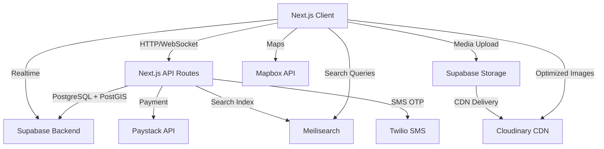
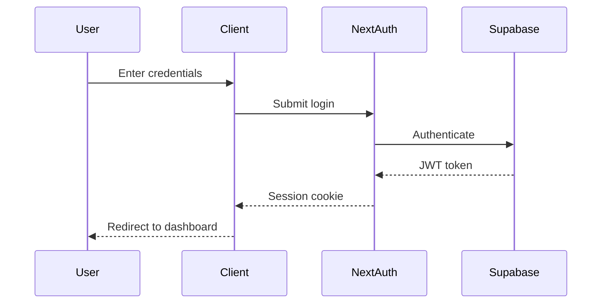

# Design Document: FindAm

## Overview

FindAm is a youth-focused, multipurpose classified marketplace platform for the Nigerian market that combines social media engagement patterns with traditional marketplace functionality. The platform is built using Next.js 16 App Router with TypeScript, leveraging Supabase for backend services (database, authentication, storage, real-time), and featuring a mobile-first design with glassmorphism and neon aesthetics.

### Technology Stack

- **Frontend Framework**: Next.js 15+ (App Router, React 19, TypeScript strict mode)
- **Backend**: Supabase (Auth with email/phone OTP/Google OAuth, Postgres, Storage, Realtime, PostGIS, Edge Functions, RLS)
- **UI/Styling**: shadcn/ui + Tailwind CSS 4 + Tailwind Merge + clsx + cva
- **Animation**: Framer Motion
- **State Management**: Zustand (global state) + TanStack React Query (infinite scroll feeds & caching)
- **Form Handling**: react-hook-form + Zod
- **Notifications**: Sonner (toasts)
- **Date Handling**: date-fns
- **Payment**: Paystack (primary payment for NGN)
- **Icons**: lucide-react
- **Theming**: next-themes (dark/light mode)
- **Maps**: react-leaflet + mapbox + Mapbox GL + react-map-gl
- **Monitoring**: Sentry
- **Email**: Resend + React Email
- **Realtime Chat**: Supabase Realtime + Twilio (SMS OTP)
- **Search**: Meilisearch
- **CDN**: Cloudinary + next-cloudinary
- **Localization**: numeral.js (₦ formatting) + libphonenumber-js (+234 validation) + nigeria-states-lgas
- **Security**: dompurify (XSS prevention)
- **Deployment**: Vercel

### Key Design Principles

1. **Mobile-First**: All interfaces designed for mobile screens first, then enhanced for desktop
2. **Performance**: Aggressive optimization with code splitting, lazy loading, TanStack React Query caching, and Cloudinary CDN
3. **Real-Time**: Leverage Supabase Realtime for messaging, notifications, and live feed updates
4. **Security**: Multi-layer verification system with Trust Scores, RLS policies, dompurify sanitization, and rate limiting
5. **Engagement**: Gamified interactions with Framer Motion animations and visual feedback
6. **Scalability**: Modular architecture supporting future feature additions
7. **Nigerian Localization**: ₦ formatting with numeral.js, +234 phone validation with libphonenumber-js, State/LGA/Ward data from nigeria-states-lgas
8. **Type Safety**: TypeScript strict mode throughout with Zod runtime validation

### Nigerian Localization Implementation

**Currency Formatting**:

```typescript
import numeral from "numeral";

export function formatNGN(amount: number): string {
  return `₦${numeral(amount).format("0,0")}`;
}

// Examples:
// formatNGN(1500000) => "₦1,500,000"
// formatNGN(500) => "₦500"
```

**Phone Number Validation**:

```typescript
import { parsePhoneNumber, isValidPhoneNumber } from "libphonenumber-js";

export function formatNigerianPhone(phone: string): string {
  const parsed = parsePhoneNumber(phone, "NG");
  return parsed.formatInternational(); // +234 XXX XXX XXXX
}

export function validateNigerianPhone(phone: string): boolean {
  return isValidPhoneNumber(phone, "NG");
}
```

**Location Data**:

```typescript
import { states, lgas } from "nigeria-states-lgas";

// All Nigerian states with LGAs and wards
export const NIGERIAN_LOCATIONS = states.map((state) => ({
  state: state.name,
  lgas: state.lgas.map((lga) => ({
    name: lga.name,
    wards: lga.wards,
  })),
}));
```

**Categories with Nigerian Context**:

- Electronics (Phones, Laptops, TVs, Accessories)
- Fashion (Clothing, Shoes, Bags, Jewelry)
- Food (Groceries, Restaurants, Catering)
- Real Estate (Houses, Land, Apartments, Commercial)
- Vehicles (Cars, Motorcycles, Trucks, Parts)
- Services (Plumbing, Electrical, Cleaning, Repairs)
- Jobs (Full-time, Part-time, Freelance, Internships)
- Agriculture (Crops, Livestock, Equipment, Produce)
- Beauty (Salons, Makeup, Skincare, Barbering)
- Education (Tutoring, Courses, Schools, Training)
- Events (Venues, Planning, Catering, Entertainment)
- Home (Furniture, Appliances, Decor, Garden)

## Architecture

### High-Level Architecture



### Application Layers

1. **Presentation Layer** (Client Components)
   - React Server Components for static content
   - Client Components for interactive features
   - Framer Motion for animations
   - Responsive layouts with Tailwind CSS

2. **API Layer** (Next.js API Routes)
   - RESTful endpoints for CRUD operations
   - Server Actions for form submissions
   - Middleware for authentication and rate limiting
   - Webhook handlers for Paystack callbacks

3. **Data Layer** (Supabase)
   - PostgreSQL database with Row Level Security (RLS)
   - Supabase Auth for user management
   - Supabase Storage for media files
   - Supabase Realtime for live updates

4. **External Services**
   - Paystack for payment processing
   - SMS provider for OTP verification
   - Email service for notifications

### Authentication Flow



### Real-Time Architecture

Supabase Realtime is used for:

- **Messaging**: Live chat updates using Postgres LISTEN/NOTIFY
- **Notifications**: Real-time notification delivery
- **Presence**: Online status indicators
- **Feed Updates**: New listing notifications

## Database Schema Design

### PostgreSQL Extensions

```sql
-- Enable PostGIS for location-based queries
CREATE EXTENSION IF NOT EXISTS postgis;

-- Enable pg_trgm for fuzzy text search
CREATE EXTENSION IF NOT EXISTS pg_trgm;

-- Enable uuid generation
CREATE EXTENSION IF NOT EXISTS "uuid-ossp";
```

### Core Tables

#### users

```sql
CREATE TABLE users (
  id UUID PRIMARY KEY DEFAULT uuid_generate_v4(),
  email TEXT UNIQUE NOT NULL,
  username TEXT UNIQUE NOT NULL,
  phone TEXT UNIQUE,
  avatar_url TEXT,
  bio TEXT,
  trust_score INTEGER DEFAULT 0 CHECK (trust_score >= 0 AND trust_score <= 100),
  is_premium BOOLEAN DEFAULT FALSE,
  premium_expires_at TIMESTAMPTZ,
  phone_verified BOOLEAN DEFAULT FALSE,
  nin_verified BOOLEAN DEFAULT FALSE,
  video_verified BOOLEAN DEFAULT FALSE,
  is_suspended BOOLEAN DEFAULT FALSE,
  created_at TIMESTAMPTZ DEFAULT NOW(),
  updated_at TIMESTAMPTZ DEFAULT NOW()
);
```

#### listings

```sql
CREATE TABLE listings (
  id UUID PRIMARY KEY DEFAULT uuid_generate_v4(),
  user_id UUID REFERENCES users(id) ON DELETE CASCADE,
  business_id UUID REFERENCES businesses(id) ON DELETE SET NULL,
  title TEXT NOT NULL,
  description TEXT NOT NULL,
  price DECIMAL(12, 2),
  category_id UUID REFERENCES categories(id),
  subcategory_id UUID REFERENCES subcategories(id),
  condition TEXT CHECK (condition IN ('new', 'used', 'refurbished')),
  state TEXT NOT NULL,
  lga TEXT NOT NULL,
  ward TEXT,
  coordinates GEOGRAPHY(POINT, 4326),
  thumbnail_url TEXT,
  is_boosted BOOLEAN DEFAULT FALSE,
  boost_expires_at TIMESTAMPTZ,
  is_active BOOLEAN DEFAULT TRUE,
  views_count INTEGER DEFAULT 0,
  likes_count INTEGER DEFAULT 0,
  saves_count INTEGER DEFAULT 0,
  created_at TIMESTAMPTZ DEFAULT NOW(),
  updated_at TIMESTAMPTZ DEFAULT NOW()
);

CREATE INDEX idx_listings_user_id ON listings(user_id);
CREATE INDEX idx_listings_business_id ON listings(business_id);
CREATE INDEX idx_listings_category ON listings(category_id);
CREATE INDEX idx_listings_state ON listings(state);
CREATE INDEX idx_listings_lga ON listings(lga);
CREATE INDEX idx_listings_boosted ON listings(is_boosted, boost_expires_at);
CREATE INDEX idx_listings_created ON listings(created_at DESC);
CREATE INDEX idx_listings_price ON listings(price);
CREATE INDEX idx_listings_coords ON listings USING GIST(coordinates);
CREATE INDEX idx_listings_search ON listings USING GIN(to_tsvector('english', title || ' ' || description));
```

#### businesses

```sql
CREATE TABLE businesses (
  id UUID PRIMARY KEY DEFAULT uuid_generate_v4(),
  owner_id UUID REFERENCES users(id) ON DELETE CASCADE,
  name TEXT NOT NULL,
  description TEXT,
  category_id UUID REFERENCES categories(id),
  state TEXT NOT NULL,
  lga TEXT NOT NULL,
  ward TEXT,
  coordinates GEOGRAPHY(POINT, 4326),
  phone TEXT NOT NULL,
  email TEXT,
  website TEXT,
  whatsapp TEXT,
  logo_url TEXT,
  cover_url TEXT,
  is_verified BOOLEAN DEFAULT FALSE,
  verification_documents JSONB,
  created_at TIMESTAMPTZ DEFAULT NOW(),
  updated_at TIMESTAMPTZ DEFAULT NOW()
);

CREATE INDEX idx_businesses_owner ON businesses(owner_id);
CREATE INDEX idx_businesses_category ON businesses(category_id);
CREATE INDEX idx_businesses_state ON businesses(state);
CREATE INDEX idx_businesses_verified ON businesses(is_verified);
CREATE INDEX idx_businesses_coords ON businesses USING GIST(coordinates);
```

#### listing_media

```sql
CREATE TABLE listing_media (
  id UUID PRIMARY KEY DEFAULT uuid_generate_v4(),
  listing_id UUID REFERENCES listings(id) ON DELETE CASCADE,
  media_url TEXT NOT NULL,
  media_type TEXT CHECK (media_type IN ('image', 'video')),
  duration_seconds INTEGER,
  display_order INTEGER DEFAULT 0,
  created_at TIMESTAMPTZ DEFAULT NOW()
);

CREATE INDEX idx_listing_media_listing ON listing_media(listing_id);
```

#### categories

```sql
CREATE TABLE categories (
  id UUID PRIMARY KEY DEFAULT uuid_generate_v4(),
  name TEXT UNIQUE NOT NULL,
  icon TEXT NOT NULL,
  display_order INTEGER DEFAULT 0,
  created_at TIMESTAMPTZ DEFAULT NOW()
);
```

#### subcategories

```sql
CREATE TABLE subcategories (
  id UUID PRIMARY KEY DEFAULT uuid_generate_v4(),
  category_id UUID REFERENCES categories(id) ON DELETE CASCADE,
  name TEXT NOT NULL,
  display_order INTEGER DEFAULT 0,
  created_at TIMESTAMPTZ DEFAULT NOW(),
  UNIQUE(category_id, name)
);

CREATE INDEX idx_subcategories_category ON subcategories(category_id);
```

#### messages

```sql
CREATE TABLE conversations (
  id UUID PRIMARY KEY DEFAULT uuid_generate_v4(),
  listing_id UUID REFERENCES listings(id) ON DELETE SET NULL,
  created_at TIMESTAMPTZ DEFAULT NOW()
);

CREATE TABLE conversation_participants (
  conversation_id UUID REFERENCES conversations(id) ON DELETE CASCADE,
  user_id UUID REFERENCES users(id) ON DELETE CASCADE,
  last_read_at TIMESTAMPTZ DEFAULT NOW(),
  PRIMARY KEY (conversation_id, user_id)
);

CREATE TABLE messages (
  id UUID PRIMARY KEY DEFAULT uuid_generate_v4(),
  conversation_id UUID REFERENCES conversations(id) ON DELETE CASCADE,
  sender_id UUID REFERENCES users(id) ON DELETE CASCADE,
  content TEXT NOT NULL,
  media_url TEXT,
  is_read BOOLEAN DEFAULT FALSE,
  created_at TIMESTAMPTZ DEFAULT NOW()
);

CREATE INDEX idx_messages_conversation ON messages(conversation_id, created_at DESC);
CREATE INDEX idx_messages_sender ON messages(sender_id);
```

#### stories

```sql
CREATE TABLE stories (
  id UUID PRIMARY KEY DEFAULT uuid_generate_v4(),
  user_id UUID REFERENCES users(id) ON DELETE CASCADE,
  video_url TEXT NOT NULL,
  thumbnail_url TEXT,
  views_count INTEGER DEFAULT 0,
  expires_at TIMESTAMPTZ NOT NULL,
  created_at TIMESTAMPTZ DEFAULT NOW()
);

CREATE INDEX idx_stories_user ON stories(user_id);
CREATE INDEX idx_stories_expires ON stories(expires_at);
```

#### reviews

```sql
CREATE TABLE reviews (
  id UUID PRIMARY KEY DEFAULT uuid_generate_v4(),
  reviewer_id UUID REFERENCES users(id) ON DELETE CASCADE,
  reviewed_user_id UUID REFERENCES users(id) ON DELETE CASCADE,
  listing_id UUID REFERENCES listings(id) ON DELETE SET NULL,
  rating INTEGER CHECK (rating >= 1 AND rating <= 5),
  comment TEXT,
  created_at TIMESTAMPTZ DEFAULT NOW(),
  updated_at TIMESTAMPTZ DEFAULT NOW(),
  UNIQUE(reviewer_id, reviewed_user_id, listing_id)
);

CREATE INDEX idx_reviews_reviewed_user ON reviews(reviewed_user_id);
```

#### user_interactions

```sql
CREATE TABLE user_likes (
  user_id UUID REFERENCES users(id) ON DELETE CASCADE,
  listing_id UUID REFERENCES listings(id) ON DELETE CASCADE,
  created_at TIMESTAMPTZ DEFAULT NOW(),
  PRIMARY KEY (user_id, listing_id)
);

CREATE TABLE user_saves (
  user_id UUID REFERENCES users(id) ON DELETE CASCADE,
  listing_id UUID REFERENCES listings(id) ON DELETE CASCADE,
  created_at TIMESTAMPTZ DEFAULT NOW(),
  PRIMARY KEY (user_id, listing_id)
);

CREATE INDEX idx_user_saves_user ON user_saves(user_id, created_at DESC);
```

#### notifications

```sql
CREATE TABLE notifications (
  id UUID PRIMARY KEY DEFAULT uuid_generate_v4(),
  user_id UUID REFERENCES users(id) ON DELETE CASCADE,
  type TEXT NOT NULL,
  title TEXT NOT NULL,
  message TEXT NOT NULL,
  link TEXT,
  is_read BOOLEAN DEFAULT FALSE,
  created_at TIMESTAMPTZ DEFAULT NOW()
);

CREATE INDEX idx_notifications_user ON notifications(user_id, created_at DESC);
CREATE INDEX idx_notifications_unread ON notifications(user_id, is_read);
```

#### payments

```sql
CREATE TABLE payments (
  id UUID PRIMARY KEY DEFAULT uuid_generate_v4(),
  user_id UUID REFERENCES users(id) ON DELETE CASCADE,
  listing_id UUID REFERENCES listings(id) ON DELETE SET NULL,
  amount DECIMAL(12, 2) NOT NULL,
  currency TEXT DEFAULT 'NGN',
  payment_type TEXT CHECK (payment_type IN ('boost', 'premium')),
  paystack_reference TEXT UNIQUE,
  status TEXT CHECK (status IN ('pending', 'success', 'failed')),
  created_at TIMESTAMPTZ DEFAULT NOW()
);

CREATE INDEX idx_payments_user ON payments(user_id);
CREATE INDEX idx_payments_reference ON payments(paystack_reference);
```

#### reports

```sql
CREATE TABLE reports (
  id UUID PRIMARY KEY DEFAULT uuid_generate_v4(),
  reporter_id UUID REFERENCES users(id) ON DELETE CASCADE,
  listing_id UUID REFERENCES listings(id) ON DELETE CASCADE,
  reason TEXT NOT NULL,
  description TEXT,
  status TEXT DEFAULT 'pending' CHECK (status IN ('pending', 'reviewed', 'resolved')),
  admin_notes TEXT,
  created_at TIMESTAMPTZ DEFAULT NOW(),
  resolved_at TIMESTAMPTZ
);

CREATE INDEX idx_reports_status ON reports(status, created_at DESC);
```

#### portfolios

```sql
CREATE TABLE portfolio_items (
  id UUID PRIMARY KEY DEFAULT uuid_generate_v4(),
  user_id UUID REFERENCES users(id) ON DELETE CASCADE,
  title TEXT NOT NULL,
  description TEXT,
  media_url TEXT NOT NULL,
  media_type TEXT CHECK (media_type IN ('image', 'video')),
  display_order INTEGER DEFAULT 0,
  created_at TIMESTAMPTZ DEFAULT NOW()
);

CREATE INDEX idx_portfolio_user ON portfolio_items(user_id, display_order);
```

### Row Level Security (RLS) Policies

Supabase RLS policies ensure data security at the database level:

```sql
-- Users can read all public profiles
CREATE POLICY "Public profiles are viewable by everyone"
  ON users FOR SELECT
  USING (true);

-- Users can update only their own profile
CREATE POLICY "Users can update own profile"
  ON users FOR UPDATE
  USING (auth.uid() = id);

-- Listings are viewable by everyone if active
CREATE POLICY "Active listings are viewable by everyone"
  ON listings FOR SELECT
  USING (is_active = true OR user_id = auth.uid());

-- Users can create their own listings
CREATE POLICY "Users can create own listings"
  ON listings FOR INSERT
  WITH CHECK (auth.uid() = user_id);

-- Users can update their own listings
CREATE POLICY "Users can update own listings"
  ON listings FOR UPDATE
  USING (auth.uid() = user_id);

-- Messages are viewable by conversation participants
CREATE POLICY "Users can view their messages"
  ON messages FOR SELECT
  USING (
    EXISTS (
      SELECT 1 FROM conversation_participants
      WHERE conversation_id = messages.conversation_id
      AND user_id = auth.uid()
    )
  );

-- Businesses are viewable by everyone
CREATE POLICY "Businesses are viewable by everyone"
  ON businesses FOR SELECT
  USING (true);

-- Business owners can update their own businesses
CREATE POLICY "Owners can update own businesses"
  ON businesses FOR UPDATE
  USING (auth.uid() = owner_id);
```

## Meilisearch Integration

### Search Index Configuration

```typescript
// lib/meilisearch/client.ts
import { MeiliSearch } from "meilisearch";

export const searchClient = new MeiliSearch({
  host: process.env.MEILISEARCH_HOST!,
  apiKey: process.env.MEILISEARCH_API_KEY!,
});

export const listingsIndex = searchClient.index("listings");

// Configure searchable attributes
await listingsIndex.updateSettings({
  searchableAttributes: [
    "title",
    "description",
    "category",
    "subcategory",
    "state",
    "lga",
  ],
  filterableAttributes: [
    "category_id",
    "subcategory_id",
    "state",
    "lga",
    "condition",
    "price",
    "is_active",
  ],
  sortableAttributes: ["price", "created_at", "views_count"],
  rankingRules: [
    "words",
    "typo",
    "proximity",
    "attribute",
    "sort",
    "exactness",
  ],
});
```

### Syncing Supabase to Meilisearch

```typescript
// lib/meilisearch/sync.ts
export async function syncListingToMeilisearch(listing: Listing) {
  const searchDocument = {
    id: listing.id,
    title: listing.title,
    description: listing.description,
    price: listing.price,
    category_id: listing.category_id,
    subcategory_id: listing.subcategory_id,
    state: listing.state,
    lga: listing.lga,
    condition: listing.condition,
    is_active: listing.is_active,
    created_at: listing.created_at,
    thumbnail_url: listing.thumbnail_url,
  };

  await listingsIndex.addDocuments([searchDocument]);
}

// Use Supabase Realtime to sync changes
supabase
  .channel("listings-changes")
  .on(
    "postgres_changes",
    { event: "*", schema: "public", table: "listings" },
    async (payload) => {
      if (payload.eventType === "INSERT" || payload.eventType === "UPDATE") {
        await syncListingToMeilisearch(payload.new as Listing);
      } else if (payload.eventType === "DELETE") {
        await listingsIndex.deleteDocument(payload.old.id);
      }
    },
  )
  .subscribe();
```

### Search Queries

```typescript
// lib/meilisearch/queries.ts
export async function searchListings(params: {
  query: string;
  filters?: {
    category?: string;
    state?: string;
    lga?: string;
    minPrice?: number;
    maxPrice?: number;
    condition?: string;
  };
  sort?: string;
  limit?: number;
  offset?: number;
}) {
  const filterArray: string[] = ["is_active = true"];

  if (params.filters?.category) {
    filterArray.push(`category_id = "${params.filters.category}"`);
  }
  if (params.filters?.state) {
    filterArray.push(`state = "${params.filters.state}"`);
  }
  if (params.filters?.lga) {
    filterArray.push(`lga = "${params.filters.lga}"`);
  }
  if (params.filters?.minPrice) {
    filterArray.push(`price >= ${params.filters.minPrice}`);
  }
  if (params.filters?.maxPrice) {
    filterArray.push(`price <= ${params.filters.maxPrice}`);
  }
  if (params.filters?.condition) {
    filterArray.push(`condition = "${params.filters.condition}"`);
  }

  const results = await listingsIndex.search(params.query, {
    filter: filterArray,
    sort: params.sort ? [params.sort] : ["created_at:desc"],
    limit: params.limit || 20,
    offset: params.offset || 0,
  });

  return results;
}
```

## Cloudinary Integration

### Image Upload and Optimization

```typescript
// lib/cloudinary/upload.ts
import { v2 as cloudinary } from "cloudinary";

cloudinary.config({
  cloud_name: process.env.CLOUDINARY_CLOUD_NAME!,
  api_key: process.env.CLOUDINARY_API_KEY!,
  api_secret: process.env.CLOUDINARY_API_SECRET!,
});

export async function uploadToCloudinary(
  file: File,
  folder: string,
): Promise<string> {
  const arrayBuffer = await file.arrayBuffer();
  const buffer = Buffer.from(arrayBuffer);

  return new Promise((resolve, reject) => {
    cloudinary.uploader
      .upload_stream(
        {
          folder: `findam/${folder}`,
          transformation: [
            { width: 1200, height: 1200, crop: "limit" },
            { quality: "auto" },
            { fetch_format: "auto" },
          ],
        },
        (error, result) => {
          if (error) reject(error);
          else resolve(result!.secure_url);
        },
      )
      .end(buffer);
  });
}
```

### Using next-cloudinary

```typescript
// components/listings/ListingCard.tsx
import { CldImage } from 'next-cloudinary';

export function ListingCard({ listing }: { listing: Listing }) {
  return (
    <div className="listing-card">
      <CldImage
        src={listing.thumbnail_url}
        alt={listing.title}
        width={400}
        height={300}
        crop="fill"
        gravity="auto"
        quality="auto"
        format="auto"
        loading="lazy"
      />
      <h3>{listing.title}</h3>
      <p>{formatNGN(listing.price)}</p>
    </div>
  );
}
```

## Component Architecture

### Directory Structure

```
src/
├── app/
│   ├── (auth)/
│   │   ├── login/
│   │   ├── register/
│   │   └── verify/
│   ├── (main)/
│   │   ├── feed/
│   │   ├── search/
│   │   ├── messages/
│   │   ├── profile/[username]/
│   │   ├── listings/[slug]/
│   │   └── businesses/[slug]/
│   ├── (seller)/
│   │   ├── dashboard/
│   │   ├── listings/new/
│   │   └── analytics/
│   ├── (admin)/
│   │   └── dashboard/
│   ├── api/
│   │   ├── listings/
│   │   ├── messages/
│   │   ├── payments/
│   │   ├── search/
│   │   ├── upload/
│   │   └── webhooks/
│   │       └── paystack/
│   └── layout.tsx
├── components/
│   ├── ui/                     # shadcn/ui components
│   ├── listings/               # ListingCard, ListingGrid, ListingForm
│   ├── businesses/             # BusinessCard, BusinessProfile
│   ├── feed/                   # FeedItem, FeedScroll, Stories
│   ├── chat/                   # ChatWindow, MessageBubble, OfferCard
│   ├── maps/                   # MapView, LocationPicker
│   ├── payments/               # PaystackButton, EscrowStatus
│   ├── profile/
│   └── shared/                 # Navbar, Footer, Avatar, Rating
├── lib/
│   ├── supabase/               # client.ts, server.ts, middleware.ts
│   ├── paystack/               # init.ts, webhook.ts, escrow.ts
│   ├── cloudinary/             # upload.ts, transform.ts
│   ├── meilisearch/            # client.ts, sync.ts, queries.ts
│   ├── validations/            # zod schemas for all forms
│   ├── utils/                  # formatNGN, formatPhone, slugify
│   ├── hooks/
│   └── types/
├── hooks/                      # useAuth, useListings, useChat, useSearch
├── stores/                     # Zustand stores: authStore, cartStore
├── types/                      # Global TypeScript interfaces
└── styles/                     # globals.css, fonts
```

### Core Components

#### Key Components (Most Critical)

**ListingCard** (Client Component) - Most-used component

- Displays listing preview with Cloudinary-optimized media
- Implements 3D tilt effect on hover (Framer Motion)
- Auto-plays video when in viewport
- Shows boost indicator for promoted listings
- Handles like, save, and share actions with optimistic UI
- Displays ₦ formatted prices with numeral.js

```typescript
import { CldImage } from 'next-cloudinary';
import { motion } from 'framer-motion';
import { formatNGN } from '@/lib/utils/formatNGN';

export function ListingCard({ listing }: { listing: Listing }) {
  return (
    <motion.div
      whileHover={{ scale: 1.05, rotateY: 5 }}
      transition={{ type: 'spring', stiffness: 300 }}
      className="listing-card"
    >
      <CldImage
        src={listing.thumbnail_url}
        alt={listing.title}
        width={400}
        height={300}
        crop="fill"
        gravity="auto"
        quality="auto"
        format="auto"
      />
      <h3>{listing.title}</h3>
      <p className="font-mono">{formatNGN(listing.price)}</p>
      <ReactionBar listingId={listing.id} />
    </motion.div>
  );
}
```

**ReactionBar** (Client Component) - Optimistic UI

- Like/save/share buttons with TanStack React Query optimistic updates
- Framer Motion animations
- Real-time count updates

```typescript
import { useMutation, useQueryClient } from '@tanstack/react-query';
import { motion } from 'framer-motion';

export function ReactionBar({ listingId }: { listingId: string }) {
  const queryClient = useQueryClient();

  const likeMutation = useMutation({
    mutationFn: (id: string) => likeListing(id),
    onMutate: async (id) => {
      // Optimistic update
      await queryClient.cancelQueries({ queryKey: ['listing', id] });
      const previous = queryClient.getQueryData(['listing', id]);
      queryClient.setQueryData(['listing', id], (old: any) => ({
        ...old,
        likes_count: old.likes_count + 1,
      }));
      return { previous };
    },
  });

  return (
    <div className="reaction-bar">
      <motion.button
        whileTap={{ scale: 0.9 }}
        onClick={() => likeMutation.mutate(listingId)}
      >
        <Heart /> {listing.likes_count}
      </motion.button>
      {/* Save and Share buttons */}
    </div>
  );
}
```

**ChatWindow** (Client Component) - Supabase Realtime

- Real-time message delivery via Supabase Realtime subscriptions
- Typing indicators using Supabase broadcast
- Read receipts
- Image sharing with Cloudinary
- Scam protection warnings

```typescript
import { useEffect, useState } from 'react';
import { supabase } from '@/lib/supabase/client';

export function ChatWindow({ conversationId }: { conversationId: string }) {
  const [messages, setMessages] = useState<Message[]>([]);

  useEffect(() => {
    const channel = supabase
      .channel(`conversation:${conversationId}`)
      .on(
        'postgres_changes',
        {
          event: 'INSERT',
          schema: 'public',
          table: 'messages',
          filter: `conversation_id=eq.${conversationId}`,
        },
        (payload) => {
          setMessages((prev) => [...prev, payload.new as Message]);
        }
      )
      .subscribe();

    return () => {
      supabase.removeChannel(channel);
    };
  }, [conversationId]);

  return (
    <div className="chat-window">
      {messages.map((msg) => (
        <MessageBubble key={msg.id} message={msg} />
      ))}
    </div>
  );
}
```

**PaystackButton** (Client Component) - react-paystack wrapper

- Initializes Paystack payment
- Handles success/failure callbacks
- Displays ₦ formatted amounts

```typescript
import { usePaystackPayment } from 'react-paystack';
import { formatNGN } from '@/lib/utils/formatNGN';

export function PaystackButton({ amount, email, onSuccess }: PaystackButtonProps) {
  const config = {
    reference: new Date().getTime().toString(),
    email,
    amount: amount * 100, // Paystack expects kobo
    publicKey: process.env.NEXT_PUBLIC_PAYSTACK_PUBLIC_KEY!,
    currency: 'NGN',
  };

  const initializePayment = usePaystackPayment(config);

  return (
    <button
      onClick={() => {
        initializePayment(onSuccess);
      }}
    >
      Pay {formatNGN(amount)}
    </button>
  );
}
```

**LocationPicker** (Client Component) - Nigeria states/LGAs/wards with MapBox

- Three-level dropdown: State → LGA → Ward
- Uses nigeria-states-lgas package
- MapBox integration with react-map-gl
- Coordinates stored in PostGIS

```typescript
import { useState } from 'react';
import { states } from 'nigeria-states-lgas';
import Map, { Marker } from 'react-map-gl';

export function LocationPicker({ onChange }: LocationPickerProps) {
  const [selectedState, setSelectedState] = useState('');
  const [selectedLGA, setSelectedLGA] = useState('');
  const [selectedWard, setSelectedWard] = useState('');
  const [coordinates, setCoordinates] = useState<[number, number]>();

  const stateData = states.find((s) => s.name === selectedState);
  const lgaData = stateData?.lgas.find((l) => l.name === selectedLGA);

  return (
    <div className="location-picker">
      <select onChange={(e) => setSelectedState(e.target.value)}>
        <option value="">Select State</option>
        {states.map((state) => (
          <option key={state.name} value={state.name}>
            {state.name}
          </option>
        ))}
      </select>

      {stateData && (
        <select onChange={(e) => setSelectedLGA(e.target.value)}>
          <option value="">Select LGA</option>
          {stateData.lgas.map((lga) => (
            <option key={lga.name} value={lga.name}>
              {lga.name}
            </option>
          ))}
        </select>
      )}

      {lgaData && (
        <select onChange={(e) => setSelectedWard(e.target.value)}>
          <option value="">Select Ward</option>
          {lgaData.wards.map((ward) => (
            <option key={ward} value={ward}>
              {ward}
            </option>
          ))}
        </select>
      )}

      <Map
        mapboxAccessToken={process.env.NEXT_PUBLIC_MAPBOX_TOKEN}
        initialViewState={{
          longitude: 7.4914,
          latitude: 9.0765,
          zoom: 6,
        }}
        style={{ width: '100%', height: 400 }}
        mapStyle="mapbox://styles/mapbox/streets-v12"
        onClick={(e) => {
          setCoordinates([e.lngLat.lng, e.lngLat.lat]);
          onChange({
            state: selectedState,
            lga: selectedLGA,
            ward: selectedWard,
            coordinates: [e.lngLat.lng, e.lngLat.lat],
          });
        }}
      >
        {coordinates && <Marker longitude={coordinates[0]} latitude={coordinates[1]} />}
      </Map>
    </div>
  );
}
```

**VerifiedBadge** (Client Component) - Three variants

- Phone verified (green checkmark)
- NIN verified (blue shield)
- Business verified (gold star)

```typescript
import { CheckCircle, Shield, Star } from 'lucide-react';

export function VerifiedBadge({ type }: { type: 'phone' | 'nin' | 'business' }) {
  const badges = {
    phone: { icon: CheckCircle, color: 'text-green-500', label: 'Phone Verified' },
    nin: { icon: Shield, color: 'text-blue-500', label: '100% Trusted' },
    business: { icon: Star, color: 'text-yellow-500', label: 'Verified Business' },
  };

  const badge = badges[type];
  const Icon = badge.icon;

  return (
    <div className={`verified-badge ${badge.color}`}>
      <Icon size={16} />
      <span>{badge.label}</span>
    </div>
  );
}
```

**FeedScroll** (Client Component) - Infinite scroll with TanStack Query

- Infinite scroll using TanStack React Query
- Virtualization for performance
- Pull-to-refresh
- Skeleton loading states

```typescript
import { useInfiniteQuery } from '@tanstack/react-query';
import { useInView } from 'react-intersection-observer';

export function FeedScroll() {
  const { ref, inView } = useInView();

  const {
    data,
    fetchNextPage,
    hasNextPage,
    isFetchingNextPage,
  } = useInfiniteQuery({
    queryKey: ['feed'],
    queryFn: ({ pageParam = 0 }) => fetchListings(pageParam),
    getNextPageParam: (lastPage, pages) => lastPage.nextCursor,
  });

  useEffect(() => {
    if (inView && hasNextPage) {
      fetchNextPage();
    }
  }, [inView, hasNextPage, fetchNextPage]);

  return (
    <div className="feed-scroll">
      {data?.pages.map((page) =>
        page.listings.map((listing) => (
          <ListingCard key={listing.id} listing={listing} />
        ))
      )}
      <div ref={ref}>{isFetchingNextPage && <Spinner />}</div>
    </div>
  );
}
```

**PriceDisplay** (Client Component) - ₦ formatted with numeral.js

- Uses JetBrains Mono font for prices
- numeral.js formatting
- Responsive sizing

```typescript
import numeral from 'numeral';

export function PriceDisplay({ amount }: { amount: number }) {
  return (
    <span className="font-mono text-2xl font-bold text-naija-green">
      ₦{numeral(amount).format('0,0')}
    </span>
  );
}
```

#### Feed Components

**FeedContainer** (Client Component)

- Manages infinite scroll with virtualization
- Handles video autoplay on viewport intersection
- Implements pull-to-refresh functionality
- Uses Intersection Observer API for performance

**ListingCard** (Client Component)

- Displays listing preview with media
- Implements 3D tilt effect on hover (Framer Motion)
- Auto-plays video when in viewport
- Shows boost indicator for promoted listings
- Handles like, save, and share actions

**TrendingCarousel** (Client Component)

- Horizontal infinite scroll with loop animation
- Displays trending listings
- Uses Framer Motion for smooth transitions

#### Listing Components

**ListingCreationWizard** (Client Component)

- Multi-step form with progress indicator
- Steps: Category → Details → Media → Location → Review
- Form validation with React Hook Form + Zod
- Image/video upload with progress tracking
- Thumbnail generation for videos

**ListingDetailModal** (Client Component)

- Full-screen modal with parallax scrolling
- Image/video gallery with swipe gestures
- Seller information with Trust Score
- Contact actions (message, call, WhatsApp)
- Safety tips and report button

#### Messaging Components

**ConversationList** (Client Component)

- Real-time updates via Supabase Realtime
- Unread badge indicators
- Online status indicators
- Search and filter conversations

**ChatWindow** (Client Component)

- Real-time message delivery
- Typing indicators
- Read receipts
- Image sharing with inline preview
- Scam protection warnings

#### Profile Components

**ProfileHeader** (Server Component)

- User avatar, username, bio
- Trust Score display with verification badges
- Active listings count
- Social links

**ProfileListings** (Server Component with Client pagination)

- Grid layout of user's listings
- Filter by active/sold status
- Infinite scroll pagination

**PortfolioGrid** (Client Component)

- Infinite moving cards animation (Aceternity UI)
- Lightbox modal for full-size view
- Drag-to-reorder for owner

#### Search Components

**SearchBar** (Client Component)

- Autocomplete with debounced API calls
- Recent searches storage (localStorage)
- Category quick filters

**FilterPanel** (Client Component)

- Category/subcategory selection
- Price range slider
- Location multi-select (Nigerian states)
- Condition filters
- Sort options

**SearchResults** (Server Component with Client pagination)

- Grid/list view toggle
- Infinite scroll
- Empty state with suggestions

#### Story Components

**StoryViewer** (Client Component)

- Full-screen vertical video player
- Progress bars for multiple stories
- Tap to advance/go back
- Swipe to next user's stories
- Auto-advance after duration

**StoryCreator** (Client Component)

- Video recording/upload (max 30 seconds)
- Preview before publishing
- Duration validation

#### Admin Components

**AdminDashboard** (Server Component)

- Metrics cards (users, listings, revenue)
- Charts for trends (Recharts)
- Quick actions panel

**ModerationQueue** (Server Component with Client actions)

- Reported listings table
- Filter by status
- Quick approve/remove actions
- Detailed view with report history

## API Design

### RESTful Endpoints

#### Authentication

- `POST /api/auth/register` - Create new user account
- `POST /api/auth/login` - Authenticate user
- `POST /api/auth/logout` - End session
- `POST /api/auth/verify-phone` - Send OTP
- `POST /api/auth/confirm-otp` - Verify OTP

#### Listings

- `GET /api/listings` - Get listings (with filters, pagination)
- `GET /api/listings/:id` - Get single listing
- `POST /api/listings` - Create listing
- `PUT /api/listings/:id` - Update listing
- `DELETE /api/listings/:id` - Delete listing
- `POST /api/listings/:id/boost` - Boost listing
- `POST /api/listings/:id/like` - Like listing
- `POST /api/listings/:id/save` - Save listing

#### Users

- `GET /api/users/:id` - Get user profile
- `PUT /api/users/:id` - Update user profile
- `POST /api/users/:id/verify-nin` - Submit NIN verification
- `GET /api/users/:id/listings` - Get user's listings
- `GET /api/users/:id/reviews` - Get user's reviews

#### Messages

- `GET /api/conversations` - Get user's conversations
- `GET /api/conversations/:id/messages` - Get conversation messages
- `POST /api/conversations` - Create conversation
- `POST /api/messages` - Send message

#### Payments

- `POST /api/payments/initialize` - Initialize Paystack payment
- `POST /api/payments/verify` - Verify payment
- `POST /api/webhooks/paystack` - Paystack webhook handler

#### Stories

- `GET /api/stories` - Get active stories
- `POST /api/stories` - Create story
- `POST /api/stories/:id/view` - Increment view count

#### Admin

- `GET /api/admin/stats` - Get platform statistics
- `GET /api/admin/reports` - Get reported listings
- `PUT /api/admin/reports/:id` - Update report status
- `PUT /api/admin/users/:id/suspend` - Suspend user

### Server Actions

Next.js Server Actions for form submissions:

```typescript
// app/actions/listings.ts
"use server";

export async function createListing(formData: FormData) {
  const session = await getServerSession();
  if (!session) throw new Error("Unauthorized");

  // Validate form data
  const validated = listingSchema.parse({
    title: formData.get("title"),
    description: formData.get("description"),
    // ...
  });

  // Insert into database
  const { data, error } = await supabase
    .from("listings")
    .insert({ ...validated, user_id: session.user.id })
    .select()
    .single();

  if (error) throw error;
  return data;
}
```

## State Management

### Zustand Stores

**Auth Store**

```typescript
interface AuthState {
  user: User | null;
  session: Session | null;
  isLoading: boolean;
  signIn: (email: string, password: string) => Promise<void>;
  signOut: () => Promise<void>;
  updateProfile: (data: Partial<User>) => Promise<void>;
}
```

**Listings Store**

```typescript
interface ListingsState {
  listings: Listing[];
  filters: FilterState;
  isLoading: boolean;
  hasMore: boolean;
  fetchListings: (page: number) => Promise<void>;
  setFilters: (filters: Partial<FilterState>) => void;
  likeListin: (id: string) => Promise<void>;
  saveListing: (id: string) => Promise<void>;
}
```

**Messages Store**

```typescript
interface MessagesState {
  conversations: Conversation[];
  activeConversation: string | null;
  messages: Record<string, Message[]>;
  unreadCount: number;
  subscribeToConversation: (id: string) => void;
  sendMessage: (conversationId: string, content: string) => Promise<void>;
}
```

### React Context

**ThemeContext** - Dark mode toggle (though default is dark)
**NotificationContext** - Real-time notification management

## Data Models

### TypeScript Interfaces

```typescript
interface User {
  id: string;
  email: string;
  username: string;
  phone?: string;
  avatar_url?: string;
  bio?: string;
  trust_score: number;
  is_premium: boolean;
  premium_expires_at?: string;
  phone_verified: boolean;
  nin_verified: boolean;
  video_verified: boolean;
  is_suspended: boolean;
  created_at: string;
  updated_at: string;
}

interface Listing {
  id: string;
  user_id: string;
  title: string;
  description: string;
  price?: number;
  category_id: string;
  subcategory_id: string;
  condition?: "new" | "used" | "refurbished";
  state: string;
  area?: string;
  thumbnail_url?: string;
  is_boosted: boolean;
  boost_expires_at?: string;
  is_active: boolean;
  views_count: number;
  likes_count: number;
  saves_count: number;
  created_at: string;
  updated_at: string;
  media?: ListingMedia[];
  user?: User;
}

interface ListingMedia {
  id: string;
  listing_id: string;
  media_url: string;
  media_type: "image" | "video";
  duration_seconds?: number;
  display_order: number;
  created_at: string;
}

interface Message {
  id: string;
  conversation_id: string;
  sender_id: string;
  content: string;
  media_url?: string;
  is_read: boolean;
  created_at: string;
  sender?: User;
}

interface Review {
  id: string;
  reviewer_id: string;
  reviewed_user_id: string;
  listing_id?: string;
  rating: number;
  comment?: string;
  created_at: string;
  reviewer?: User;
}
```

### Form Validation Schemas

Using Zod for runtime validation:

```typescript
const listingSchema = z.object({
  title: z.string().min(5).max(100),
  description: z.string().min(20).max(2000),
  price: z.number().positive().optional(),
  category_id: z.string().uuid(),
  subcategory_id: z.string().uuid(),
  condition: z.enum(["new", "used", "refurbished"]).optional(),
  state: z.string().min(1),
  area: z.string().optional(),
});

const userProfileSchema = z.object({
  username: z
    .string()
    .min(3)
    .max(30)
    .regex(/^[a-zA-Z0-9_]+$/),
  bio: z.string().max(500).optional(),
  phone: z
    .string()
    .regex(/^\+234[0-9]{10}$/)
    .optional(),
});

const messageSchema = z.object({
  content: z.string().min(1).max(1000),
  media_url: z.string().url().optional(),
});
```

## File Upload Strategy

### Supabase Storage Buckets

1. **avatars** - User profile pictures
   - Max size: 2MB
   - Allowed formats: JPEG, PNG, WebP
   - Public access with RLS

2. **listing-media** - Listing images and videos
   - Max size: 50MB (videos), 5MB (images)
   - Allowed formats: JPEG, PNG, WebP, MP4
   - Public access with RLS

3. **story-videos** - Story content
   - Max size: 20MB
   - Allowed formats: MP4
   - Auto-delete after 24 hours (cron job)

4. **portfolio** - Portfolio items
   - Max size: 10MB
   - Allowed formats: JPEG, PNG, WebP, MP4
   - Public access with RLS

### Upload Flow

```typescript
async function uploadMedia(file: File, bucket: string): Promise<string> {
  // Generate unique filename
  const fileExt = file.name.split(".").pop();
  const fileName = `${uuid()}.${fileExt}`;
  const filePath = `${bucket}/${fileName}`;

  // Upload to Supabase Storage
  const { data, error } = await supabase.storage
    .from(bucket)
    .upload(filePath, file, {
      cacheControl: "3600",
      upsert: false,
    });

  if (error) throw error;

  // Get public URL
  const {
    data: { publicUrl },
  } = supabase.storage.from(bucket).getPublicUrl(filePath);

  return publicUrl;
}
```

### Video Processing

For video uploads:

1. Client-side validation (duration, size)
2. Upload to Supabase Storage
3. Generate thumbnail using canvas API
4. Store thumbnail URL in database

```typescript
async function generateVideoThumbnail(videoFile: File): Promise<Blob> {
  return new Promise((resolve, reject) => {
    const video = document.createElement("video");
    video.src = URL.createObjectURL(videoFile);
    video.currentTime = 1; // Capture at 1 second

    video.onloadeddata = () => {
      const canvas = document.createElement("canvas");
      canvas.width = video.videoWidth;
      canvas.height = video.videoHeight;
      canvas.getContext("2d")?.drawImage(video, 0, 0);

      canvas.toBlob(
        (blob) => {
          if (blob) resolve(blob);
          else reject(new Error("Failed to generate thumbnail"));
        },
        "image/jpeg",
        0.8,
      );
    };
  });
}
```

## Performance Optimization

### Image Optimization

1. **Next.js Image Component**
   - Automatic WebP conversion
   - Responsive image sizes
   - Lazy loading by default
   - Blur placeholder

```typescript
<Image
  src={listing.thumbnail_url}
  alt={listing.title}
  width={400}
  height={300}
  placeholder="blur"
  blurDataURL={listing.blur_data_url}
  sizes="(max-width: 768px) 100vw, (max-width: 1200px) 50vw, 33vw"
/>
```

2. **Image CDN**
   - Supabase Storage serves as CDN
   - Cache-Control headers for browser caching
   - Compression at storage level

### Code Splitting

1. **Route-based splitting** (automatic with App Router)
2. **Component-based splitting** with dynamic imports

```typescript
const ListingDetailModal = dynamic(
  () => import('@/components/listing/ListingDetailModal'),
  { ssr: false, loading: () => <Skeleton /> }
)
```

3. **Library splitting**
   - Framer Motion: Import only needed components
   - Lodash: Use lodash-es for tree-shaking

### Caching Strategy

1. **Server-Side Caching**
   - Next.js ISR for static pages (revalidate: 60)
   - API route caching with Redis (optional)

```typescript
export const revalidate = 60; // Revalidate every 60 seconds

export async function generateStaticParams() {
  const listings = await getPopularListings();
  return listings.map((listing) => ({ id: listing.id }));
}
```

2. **Client-Side Caching**
   - SWR for data fetching with stale-while-revalidate
   - LocalStorage for user preferences
   - IndexedDB for offline PWA data

```typescript
const { data, error } = useSWR(`/api/listings/${id}`, fetcher, {
  revalidateOnFocus: false,
  dedupingInterval: 60000,
});
```

### Database Optimization

1. **Indexes** - Already defined in schema for common queries
2. **Connection Pooling** - Supabase handles automatically
3. **Query Optimization**
   - Select only needed columns
   - Use joins instead of multiple queries
   - Implement pagination with cursor-based approach

```typescript
// Efficient pagination
const { data } = await supabase
  .from("listings")
  .select("id, title, price, thumbnail_url, user:users(username, avatar_url)")
  .eq("is_active", true)
  .order("created_at", { ascending: false })
  .range(page * 20, (page + 1) * 20 - 1);
```

### Infinite Scroll Optimization

Use virtual scrolling for large lists:

```typescript
import { useVirtualizer } from "@tanstack/react-virtual";

const rowVirtualizer = useVirtualizer({
  count: listings.length,
  getScrollElement: () => parentRef.current,
  estimateSize: () => 400,
  overscan: 5,
});
```

## Security Considerations

### Authentication Security

1. **Password Requirements**
   - Minimum 8 characters
   - Supabase Auth handles hashing (bcrypt)
   - Rate limiting on login attempts

2. **Session Management**
   - JWT tokens with short expiration (1 hour)
   - Refresh tokens for extended sessions
   - Secure, httpOnly cookies

3. **OAuth Security**
   - PKCE flow for OAuth providers
   - State parameter validation
   - Redirect URI whitelist

### Data Security

1. **Row Level Security (RLS)**
   - All tables have RLS policies
   - Users can only modify their own data
   - Admin role for moderation

2. **Input Validation**
   - Server-side validation with Zod
   - SQL injection prevention (parameterized queries)
   - XSS prevention (React escapes by default)

3. **File Upload Security**
   - File type validation (MIME type + extension)
   - File size limits enforced
   - Virus scanning (optional, third-party service)
   - Unique filenames to prevent overwrites

### API Security

1. **Rate Limiting**
   - Implement with middleware or Vercel Edge Config
   - Different limits for authenticated vs anonymous
   - Stricter limits on sensitive endpoints (OTP, payments)

```typescript
// middleware.ts
import { Ratelimit } from "@upstash/ratelimit";
import { Redis } from "@upstash/redis";

const ratelimit = new Ratelimit({
  redis: Redis.fromEnv(),
  limiter: Ratelimit.slidingWindow(10, "10 s"),
});

export async function middleware(request: NextRequest) {
  const ip = request.ip ?? "127.0.0.1";
  const { success } = await ratelimit.limit(ip);

  if (!success) {
    return new Response("Too Many Requests", { status: 429 });
  }

  return NextResponse.next();
}
```

2. **CSRF Protection**
   - Next.js Server Actions have built-in CSRF protection
   - Custom tokens for API routes if needed

3. **CORS Configuration**
   - Restrict origins in production
   - Allow credentials for authenticated requests

### Payment Security

1. **Paystack Integration**
   - Never store card details
   - Use Paystack's hosted checkout
   - Verify payments server-side
   - Webhook signature verification

```typescript
import crypto from "crypto";

function verifyPaystackSignature(payload: string, signature: string): boolean {
  const hash = crypto
    .createHmac("sha512", process.env.PAYSTACK_SECRET_KEY!)
    .update(payload)
    .digest("hex");
  return hash === signature;
}
```

### Anti-Fraud Measures

1. **Phone Verification**
   - OTP via SMS
   - Rate limit OTP requests
   - Expire OTPs after 10 minutes

2. **NIN Verification**
   - Integration with Nigerian identity verification service
   - Selfie + video liveness check
   - Manual admin review for edge cases

3. **ScamShield AI**
   - Pattern detection for suspicious listings
   - Price anomaly detection
   - Duplicate image detection (reverse image search)
   - Keyword filtering for scam phrases

```typescript
async function detectScamPatterns(listing: Listing): Promise<boolean> {
  const suspiciousKeywords = [
    "wire transfer",
    "send money first",
    "too good to be true",
  ];
  const hasKeywords = suspiciousKeywords.some((kw) =>
    listing.description.toLowerCase().includes(kw),
  );

  const priceAnomaly = listing.price && listing.price < averagePrice * 0.3;

  return hasKeywords || priceAnomaly;
}
```

## Real-Time Features Implementation

### Supabase Realtime Setup

```typescript
// lib/supabase/realtime.ts
import { createClient } from "@supabase/supabase-js";

const supabase = createClient(
  process.env.NEXT_PUBLIC_SUPABASE_URL!,
  process.env.NEXT_PUBLIC_SUPABASE_ANON_KEY!,
  {
    realtime: {
      params: {
        eventsPerSecond: 10,
      },
    },
  },
);

// Subscribe to messages
export function subscribeToMessages(
  conversationId: string,
  callback: (message: Message) => void,
) {
  return supabase
    .channel(`conversation:${conversationId}`)
    .on(
      "postgres_changes",
      {
        event: "INSERT",
        schema: "public",
        table: "messages",
        filter: `conversation_id=eq.${conversationId}`,
      },
      (payload) => callback(payload.new as Message),
    )
    .subscribe();
}

// Subscribe to notifications
export function subscribeToNotifications(
  userId: string,
  callback: (notification: Notification) => void,
) {
  return supabase
    .channel(`notifications:${userId}`)
    .on(
      "postgres_changes",
      {
        event: "INSERT",
        schema: "public",
        table: "notifications",
        filter: `user_id=eq.${userId}`,
      },
      (payload) => callback(payload.new as Notification),
    )
    .subscribe();
}

// Presence for online status
export function trackPresence(userId: string) {
  const channel = supabase.channel("online-users");

  channel
    .on("presence", { event: "sync" }, () => {
      const state = channel.presenceState();
      // Update UI with online users
    })
    .subscribe(async (status) => {
      if (status === "SUBSCRIBED") {
        await channel.track({
          user_id: userId,
          online_at: new Date().toISOString(),
        });
      }
    });

  return channel;
}
```

### Typing Indicators

```typescript
// components/messaging/ChatWindow.tsx
const [isTyping, setIsTyping] = useState(false);
const typingTimeoutRef = useRef<NodeJS.Timeout>();

const handleTyping = () => {
  if (!isTyping) {
    setIsTyping(true);
    channel.send({
      type: "broadcast",
      event: "typing",
      payload: { user_id: currentUser.id },
    });
  }

  clearTimeout(typingTimeoutRef.current);
  typingTimeoutRef.current = setTimeout(() => {
    setIsTyping(false);
    channel.send({
      type: "broadcast",
      event: "stop_typing",
      payload: { user_id: currentUser.id },
    });
  }, 3000);
};
```

## Design System and Visual Effects

### Color Palette

```typescript
// tailwind.config.ts
export default {
  theme: {
    extend: {
      colors: {
        "naija-green": "#008751",
        "naija-orange": "#FF6B35",
        "neon-cyan": "#00F5FF",
        "neon-pink": "#FF10F0",
        "neon-yellow": "#FFFF00",
        "dark-bg": "#0A0A0F",
        "dark-card": "#1A1A2E",
        "dark-border": "#2A2A3E",
      },
    },
  },
};
```

### Glassmorphism Effect

```css
.glass-card {
  background: rgba(26, 26, 46, 0.7);
  backdrop-filter: blur(10px);
  border: 1px solid rgba(255, 255, 255, 0.1);
  box-shadow: 0 8px 32px 0 rgba(0, 0, 0, 0.37);
}
```

### Framer Motion Animations

**Card Hover Effect**

```typescript
<motion.div
  whileHover={{ scale: 1.05, rotateY: 5 }}
  transition={{ type: 'spring', stiffness: 300 }}
  className="listing-card"
>
  {/* Card content */}
</motion.div>
```

**Page Transitions**

```typescript
const pageVariants = {
  initial: { opacity: 0, y: 20 },
  animate: { opacity: 1, y: 0 },
  exit: { opacity: 0, y: -20 }
}

<motion.div
  variants={pageVariants}
  initial="initial"
  animate="animate"
  exit="exit"
  transition={{ duration: 0.3 }}
>
  {/* Page content */}
</motion.div>
```

**Sparkle Animation**

```typescript
const sparkleVariants = {
  hidden: { scale: 0, opacity: 0 },
  visible: {
    scale: [0, 1, 0],
    opacity: [0, 1, 0],
    transition: { duration: 0.6, times: [0, 0.5, 1] }
  }
}

<motion.div
  variants={sparkleVariants}
  initial="hidden"
  animate="visible"
  className="sparkle"
/>
```

### Aceternity UI Components

1. **Infinite Moving Cards** - For portfolio display
2. **Floating Dock** - For bottom navigation
3. **Shooting Stars** - For hero background
4. **3D Card Effect** - For listing cards
5. **Sparkles** - For success animations

### Magic UI Components

1. **Animated Beam** - For connection indicators
2. **Marquee** - For trending categories
3. **Shimmer Button** - For CTA buttons
4. **Ripple Effect** - For pull-to-refresh

## Mobile-First Design

### Bottom Navigation

```typescript
const navItems = [
  { icon: Home, label: 'Feed', href: '/feed' },
  { icon: Search, label: 'Search', href: '/search' },
  { icon: PlusCircle, label: 'Post', href: '/create' },
  { icon: MessageCircle, label: 'Messages', href: '/messages' },
  { icon: User, label: 'Profile', href: '/profile' }
]

<FloatingDock items={navItems} />
```

### Gesture Handling

```typescript
import { useSwipeable } from 'react-swipeable'

const handlers = useSwipeable({
  onSwipedLeft: () => nextListing(),
  onSwipedRight: () => previousListing(),
  onSwipedUp: () => openDetail(),
  preventDefaultTouchmoveEvent: true,
  trackMouse: true
})

<div {...handlers}>
  {/* Swipeable content */}
</div>
```

### Pull-to-Refresh

```typescript
import { usePullToRefresh } from '@/lib/hooks/usePullToRefresh'

const { pullDistance, isRefreshing } = usePullToRefresh({
  onRefresh: async () => {
    await refetchListings()
  },
  threshold: 80
})

<div style={{ transform: `translateY(${pullDistance}px)` }}>
  {isRefreshing && <Spinner />}
  {/* Content */}
</div>
```

### PWA Configuration

```typescript
// next.config.js
const withPWA = require("next-pwa")({
  dest: "public",
  register: true,
  skipWaiting: true,
  disable: process.env.NODE_ENV === "development",
});

module.exports = withPWA({
  // Next.js config
});
```

```json
// public/manifest.json
{
  "name": "FindAm - Nigerian Marketplace",
  "short_name": "FindAm",
  "description": "Discover and sell items in Nigeria",
  "start_url": "/",
  "display": "standalone",
  "background_color": "#0A0A0F",
  "theme_color": "#008751",
  "icons": [
    {
      "src": "/icon-192.png",
      "sizes": "192x192",
      "type": "image/png"
    },
    {
      "src": "/icon-512.png",
      "sizes": "512x512",
      "type": "image/png"
    }
  ]
}
```

## Error Handling

### Error Boundaries

```typescript
// components/ErrorBoundary.tsx
'use client'

export class ErrorBoundary extends React.Component<
  { children: React.ReactNode },
  { hasError: boolean }
> {
  constructor(props: any) {
    super(props)
    this.state = { hasError: false }
  }

  static getDerivedStateFromError() {
    return { hasError: true }
  }

  componentDidCatch(error: Error, errorInfo: React.ErrorInfo) {
    console.error('Error caught by boundary:', error, errorInfo)
    // Log to error tracking service (Sentry, etc.)
  }

  render() {
    if (this.state.hasError) {
      return (
        <div className="error-container">
          <h2>Something went wrong</h2>
          <button onClick={() => this.setState({ hasError: false })}>
            Try again
          </button>
        </div>
      )
    }

    return this.props.children
  }
}
```

### API Error Handling

```typescript
// lib/api/client.ts
export async function apiRequest<T>(
  url: string,
  options?: RequestInit,
): Promise<T> {
  try {
    const response = await fetch(url, {
      ...options,
      headers: {
        "Content-Type": "application/json",
        ...options?.headers,
      },
    });

    if (!response.ok) {
      const error = await response.json();
      throw new APIError(error.message, response.status);
    }

    return response.json();
  } catch (error) {
    if (error instanceof APIError) throw error;
    throw new APIError("Network error", 500);
  }
}

class APIError extends Error {
  constructor(
    message: string,
    public status: number,
  ) {
    super(message);
    this.name = "APIError";
  }
}
```

### Toast Notifications

```typescript
import { toast } from "sonner";

// Success
toast.success("Listing created successfully!");

// Error
toast.error("Failed to create listing. Please try again.");

// Loading
const toastId = toast.loading("Creating listing...");
// Later: toast.success('Done!', { id: toastId })
```

## Correctness Properties

A property is a characteristic or behavior that should hold true across all valid executions of a system—essentially, a formal statement about what the system should do. Properties serve as the bridge between human-readable specifications and machine-verifiable correctness guarantees.

### Property Reflection

After analyzing all acceptance criteria, I identified the following redundancies and consolidations:

- Requirements 3.4 and 7.1 both test phone verification requirements → Combined into Property 8
- Requirements 2.7 and 8.6 both test premium badge display → Combined into Property 5
- Requirements 5.3 and 14.3 both test category filtering → Combined into Property 15
- Requirements 5.5 and 18.3 both test location filtering → Combined into Property 17
- Requirements 13.6 and 20.4 both test offline functionality → Combined into Property 52
- Video duration validation (3.3, 9.1) → Handled as edge cases in generators
- Trust score edge cases (2.5, 7.2) → Handled as edge cases in generators

### Authentication and User Management Properties

Property 1: User Registration Round Trip
_For any_ valid registration data (email, password, username, phone), creating a user account should result in a retrievable user record with matching credentials.
**Validates: Requirements 1.1**

Property 2: Duplicate Registration Rejection
_For any_ existing user, attempting to register with the same email or username should be rejected with an appropriate error.
**Validates: Requirements 1.2**

Property 3: Authentication Session Establishment
_For any_ valid user credentials, successful authentication should establish a session that can be used for subsequent authenticated requests.
**Validates: Requirements 1.3**

Property 4: Password Validation
_For any_ password string with fewer than 8 characters, registration should be rejected with a validation error.
**Validates: Requirements 1.5**

Property 5: Session Termination
_For any_ authenticated session, logging out should invalidate the session such that subsequent requests with that session fail authentication.
**Validates: Requirements 1.7**

### Profile Management Properties

Property 6: Profile Rendering Completeness
_For any_ user profile, the rendered profile page should contain all required fields: username, avatar, bio, contact information, social links, active listings count, reviews, and Trust_Score.
**Validates: Requirements 2.1**

Property 7: Avatar Upload Round Trip
_For any_ valid image file, uploading it as a profile avatar should result in the avatar URL being stored and retrievable from the user's profile.
**Validates: Requirements 2.2**

Property 8: Profile Update Persistence
_For any_ valid profile update (bio, contact, social links), the changes should persist such that retrieving the profile returns the updated values.
**Validates: Requirements 2.3**

Property 9: Trust Score Increase on Verification
_For any_ user who completes phone verification, their Trust_Score should increase and a verification badge should be displayed.
**Validates: Requirements 2.4**

Property 10: Profile Visibility
_For any_ user, viewing another user's profile should return their public information, active listings, and review history.
**Validates: Requirements 2.6**

Property 11: Premium Badge Display
_For any_ user with an active premium subscription, their profile should display a premium badge, and non-premium users should not have the badge.
**Validates: Requirements 2.7, 8.6**

### Listing Management Properties

Property 12: Listing Media Association
_For any_ listing with uploaded media, the media files should be stored and associated with the listing such that retrieving the listing returns the media URLs.
**Validates: Requirements 3.2**

Property 13: Unverified User Publication Prevention
_For any_ user without phone verification, attempting to publish a listing should be rejected.
**Validates: Requirements 3.4, 7.1**

Property 14: Free Tier Listing Limit
_For any_ free-tier user with 3 active listings, attempting to create a fourth listing should be rejected.
**Validates: Requirements 3.5**

Property 15: Listing Publication Visibility
_For any_ published listing, it should appear in search results and feed queries.
**Validates: Requirements 3.6**

Property 16: Listing Edit Timestamp Preservation
_For any_ listing edit, the updated listing should reflect the changes while preserving the original created_at timestamp.
**Validates: Requirements 3.7**

Property 17: Listing Deletion Visibility
_For any_ deleted listing, it should not appear in public search results or feeds.
**Validates: Requirements 3.8**

Property 18: Video Thumbnail Generation
_For any_ listing with video media, a thumbnail URL should be generated and stored.
**Validates: Requirements 3.9**

### Feed and Display Properties

Property 19: Boosted Listing Indicator
_For any_ boosted listing, the rendered listing card should display a "Boosted" indicator.
**Validates: Requirements 4.6**

### Search and Filtering Properties

Property 20: Search Autocomplete Relevance
_For any_ search query string, the autocomplete suggestions should contain listings or categories that match the query text.
**Validates: Requirements 5.1**

Property 21: Search Results Relevance
_For any_ search query, all returned listings should contain the query text in their title, description, or category.
**Validates: Requirements 5.2**

Property 22: Category Filter Correctness
_For any_ selected category filter, all returned listings should belong to that category.
**Validates: Requirements 5.3, 14.3**

Property 23: Price Range Filter Correctness
_For any_ price range filter (min, max), all returned listings should have prices within the specified bounds.
**Validates: Requirements 5.4**

Property 24: Location Filter Correctness
_For any_ selected location filter, all returned listings should be from the specified Nigerian states.
**Validates: Requirements 5.5, 18.3**

Property 25: Condition Filter Correctness
_For any_ condition filter (new/used/refurbished), all returned listings should match the specified condition.
**Validates: Requirements 5.6**

Property 26: Sort Order Correctness
_For any_ sort option (price, date, relevance), the returned listings should be ordered according to the selected criterion.
**Validates: Requirements 5.7**

Property 27: Search History Storage
_For any_ search query performed by a user, the query should be stored in their recent searches.
**Validates: Requirements 5.8**

### Messaging Properties

Property 28: Conversation Creation
_For any_ user initiating a conversation, a conversation record should be created and retrievable.
**Validates: Requirements 6.1**

Property 29: Message Delivery
_For any_ sent message, the message should be stored and retrievable by both sender and recipient.
**Validates: Requirements 6.2**

Property 30: Unread Message Status
_For any_ newly received message, it should be marked as unread until the recipient views it.
**Validates: Requirements 6.4**

Property 31: Read Receipt Update
_For any_ message viewed by the recipient, the message status should be updated to read.
**Validates: Requirements 6.5**

Property 32: Image Sharing Round Trip
_For any_ image shared in a chat, the image should be uploaded and the URL should be stored in the message record.
**Validates: Requirements 6.6**

Property 33: Conversation List Completeness
_For any_ user, viewing their message list should return all conversations they are a participant in.
**Validates: Requirements 6.7**

Property 34: Scam Detection Warnings
_For any_ conversation containing suspicious keywords or patterns, a scam protection warning should be displayed.
**Validates: Requirements 6.8**

### Safety and Security Properties

Property 35: Phone Number Masking
_For any_ listing with a phone number, the rendered listing should not display the phone number directly (it should be masked or hidden).
**Validates: Requirements 7.3**

Property 36: Phone Reveal Rate Limiting
_For any_ user, attempting to reveal more phone numbers than the allowed limit should be rejected.
**Validates: Requirements 7.4**

Property 37: Reported Listing Visibility
_For any_ reported listing, it should be immediately hidden from public search results and feeds.
**Validates: Requirements 7.6**

Property 38: Scam Pattern Detection
_For any_ listing containing suspicious patterns (unrealistic prices, suspicious keywords), the listing should be flagged for review.
**Validates: Requirements 7.7**

### Payment and Monetization Properties

Property 39: Boost Payment Processing
_For any_ successful boost payment, the listing should be marked as boosted with an expiration timestamp.
**Validates: Requirements 8.2**

Property 40: Premium Subscription Activation
_For any_ successful premium payment, the user account should be marked as premium with an expiration timestamp.
**Validates: Requirements 8.3**

Property 41: Premium Listing Limit
_For any_ premium user, they should be able to create up to 30 active listings.
**Validates: Requirements 8.4**

Property 42: Premium Analytics Access
_For any_ premium user, analytics data should be available for their listings.
**Validates: Requirements 8.5**

Property 43: Subscription Expiration Downgrade
_For any_ premium subscription that has expired, the user account should be downgraded to free tier.
**Validates: Requirements 8.8**

### Story Properties

Property 44: Story Visibility Duration
_For any_ published story, it should be visible to all users immediately after publication.
**Validates: Requirements 9.2**

Property 45: Premium Story Priority
_For any_ premium user's story, it should have priority placement over non-premium stories.
**Validates: Requirements 9.6**

### Admin and Moderation Properties

Property 46: Admin Dashboard Metrics Completeness
_For any_ admin dashboard view, it should display user growth metrics, active listings count, and engagement statistics.
**Validates: Requirements 10.1**

Property 47: Reported Listings Display
_For any_ admin viewing reported listings, all flagged content with report reasons should be displayed.
**Validates: Requirements 10.2**

Property 48: Listing Approval Restoration
_For any_ reported listing that is approved by an admin, the listing should be restored to public visibility.
**Validates: Requirements 10.3**

Property 49: Admin Listing Removal
_For any_ listing removed by an admin, the listing should be permanently deleted from the database.
**Validates: Requirements 10.4**

Property 50: User Management Display
_For any_ admin viewing user management, all users should be displayed with filtering and search capabilities.
**Validates: Requirements 10.5**

Property 51: User Suspension Effect
_For any_ suspended user, login attempts should be rejected and all their listings should be hidden.
**Validates: Requirements 10.6**

Property 52: Admin Analytics Display
_For any_ admin viewing analytics, popular categories, conversion rates, and engagement trends should be displayed.
**Validates: Requirements 10.7**

### Notification Properties

Property 53: Interest-Based Notification Creation
_For any_ new listing matching a user's interests, a notification should be created for that user.
**Validates: Requirements 11.1**

Property 54: Message Notification Creation
_For any_ new message received by a user, a notification should be created with a message preview.
**Validates: Requirements 11.2**

Property 55: Interaction Notification Creation
_For any_ like or save action on a user's listing, a notification should be created for the listing owner.
**Validates: Requirements 11.3**

Property 56: Notification Preferences Respect
_For any_ user with disabled notification preferences for a specific type, notifications of that type should not be sent to them.
**Validates: Requirements 11.6**

### Offline and PWA Properties

Property 57: Offline Content Access
_For any_ cached content, it should be accessible when the user is offline.
**Validates: Requirements 13.6, 20.4**

### Category System Properties

Property 58: Category Hierarchy Integrity
_For any_ subcategory, it should reference a valid parent category.
**Validates: Requirements 14.5**

Property 59: Listing Category Requirement
_For any_ listing creation attempt without both main category and subcategory, the creation should be rejected.
**Validates: Requirements 14.4**

Property 60: Subcategory Display Correctness
_For any_ selected main category, all displayed subcategories should belong to that parent category.
**Validates: Requirements 14.2**

### User Interaction Properties

Property 61: Like Action Storage
_For any_ like action on a listing, the like should be stored and the listing's like count should be incremented.
**Validates: Requirements 15.1**

Property 62: Save Action Storage
_For any_ save action on a listing, the listing should be added to the user's saved items collection.
**Validates: Requirements 15.2**

Property 63: Share Link Generation
_For any_ listing share action, a shareable link with Open Graph metadata should be generated.
**Validates: Requirements 15.3**

Property 64: Saved Listings Retrieval
_For any_ user viewing their saved listings, all items they have saved should be returned.
**Validates: Requirements 15.4**

Property 65: Unlike/Unsave Action Removal
_For any_ unlike or unsave action, the action should be removed from storage and the listing's count should be decremented.
**Validates: Requirements 15.5**

### Review System Properties

Property 66: Review Storage
_For any_ submitted review with rating and text, the review should be stored and associated with the reviewed user.
**Validates: Requirements 16.1**

Property 67: Review Display and Average Calculation
_For any_ user profile view, all reviews should be displayed and the average rating should be correctly calculated.
**Validates: Requirements 16.2**

Property 68: Review Authorization
_For any_ user attempting to review without completing a transaction, the review submission should be rejected.
**Validates: Requirements 16.3**

Property 69: Trust Score Update on Review
_For any_ submitted review, the reviewed user's Trust_Score should be recalculated to reflect the new review.
**Validates: Requirements 16.4**

Property 70: Review Edit Persistence
_For any_ review edit, the updated content should persist and the average rating should be recalculated.
**Validates: Requirements 16.5**

### Location Properties

Property 71: Listing Location Requirement
_For any_ listing creation attempt without a Nigerian state selection, the creation should be rejected.
**Validates: Requirements 18.1**

### Portfolio Properties

Property 72: Service Provider Portfolio Display
_For any_ user marked as a service provider, their profile should display a portfolio grid.
**Validates: Requirements 19.1**

Property 73: Portfolio Upload Round Trip
_For any_ portfolio item uploaded by a service provider, the item should be stored and retrievable from their profile.
**Validates: Requirements 19.2**

Property 74: Job Seeker CV Upload
_For any_ user marked as a job seeker, they should be able to upload a CV and list skills.
**Validates: Requirements 19.3**

### Data Persistence Properties

Property 75: Session State Restoration
_For any_ user logging in, their saved listings, preferences, and session state should be restored.
**Validates: Requirements 20.1**

Property 76: Immediate Data Persistence
_For any_ data modification, the changes should be immediately retrievable from the database.
**Validates: Requirements 20.3**

Property 77: Offline Action Sync
_For any_ action queued while offline, the action should be executed when network connectivity is restored.
**Validates: Requirements 20.5**

## Testing Strategy

### Dual Testing Approach

The FindAm platform will employ both unit testing and property-based testing to ensure comprehensive coverage:

**Unit Tests** focus on:

- Specific examples demonstrating correct behavior
- Edge cases (video duration limits, empty inputs, boundary conditions)
- Error conditions (invalid inputs, unauthorized access)
- Integration points between components
- UI component rendering with specific props

**Property-Based Tests** focus on:

- Universal properties that hold for all inputs
- Comprehensive input coverage through randomization
- Data integrity across operations
- Round-trip properties (serialization, database operations)
- Invariants that must be maintained

Both approaches are complementary and necessary. Unit tests catch concrete bugs with specific inputs, while property tests verify general correctness across a wide range of inputs.

### Property-Based Testing Configuration

**Library Selection**: We will use **fast-check** for TypeScript/JavaScript property-based testing.

**Test Configuration**:

- Minimum 100 iterations per property test (due to randomization)
- Each property test must reference its design document property
- Tag format: `// Feature: findam, Property {number}: {property_text}`

**Example Property Test**:

```typescript
import fc from "fast-check";
import { describe, it, expect } from "vitest";

describe("User Registration", () => {
  it("Property 1: User Registration Round Trip", () => {
    // Feature: findam, Property 1: User Registration Round Trip
    fc.assert(
      fc.asyncProperty(
        fc.record({
          email: fc.emailAddress(),
          password: fc.string({ minLength: 8, maxLength: 50 }),
          username: fc.string({ minLength: 3, maxLength: 30 }),
          phone: fc.string({ minLength: 10, maxLength: 15 }),
        }),
        async (userData) => {
          // Create user
          const user = await createUser(userData);

          // Retrieve user
          const retrieved = await getUserById(user.id);

          // Verify round trip
          expect(retrieved.email).toBe(userData.email);
          expect(retrieved.username).toBe(userData.username);
          expect(retrieved.phone).toBe(userData.phone);
        },
      ),
      { numRuns: 100 },
    );
  });
});
```

### Test Organization

```
tests/
├── unit/
│   ├── auth/
│   ├── listings/
│   ├── messaging/
│   └── payments/
├── property/
│   ├── auth.property.test.ts
│   ├── listings.property.test.ts
│   ├── messaging.property.test.ts
│   └── payments.property.test.ts
├── integration/
│   ├── feed-flow.test.ts
│   └── checkout-flow.test.ts
└── e2e/
    └── critical-paths.spec.ts
```

### Testing Tools

- **Unit Testing**: Vitest
- **Property Testing**: fast-check
- **E2E Testing**: Playwright
- **Component Testing**: React Testing Library
- **API Testing**: Supertest
- **Mocking**: MSW (Mock Service Worker)

### Coverage Goals

- Unit test coverage: 80% minimum
- Property tests: All 77 correctness properties implemented
- E2E tests: All critical user flows
- Integration tests: All API endpoints

### Continuous Integration

All tests run on:

- Pull request creation
- Merge to main branch
- Nightly builds for extended property test runs (1000+ iterations)
