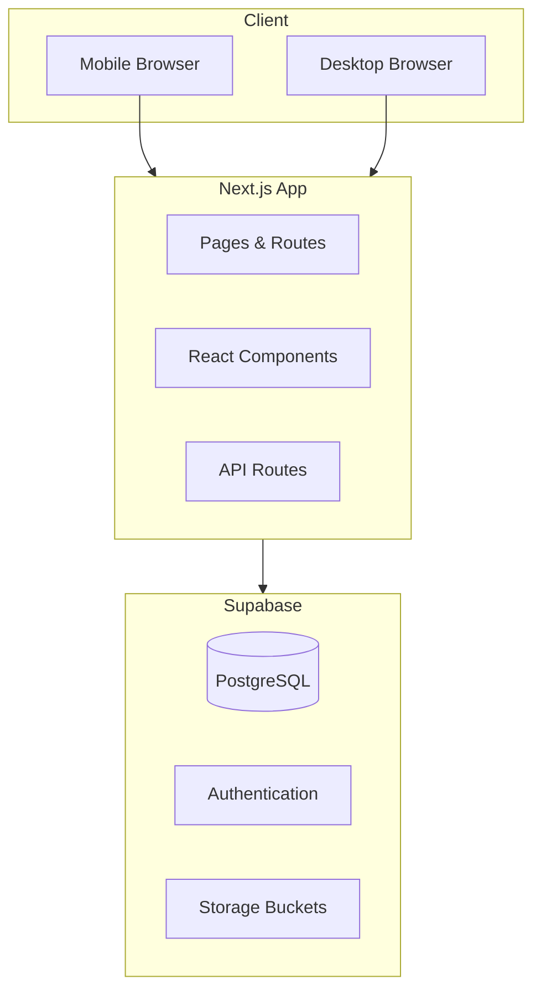
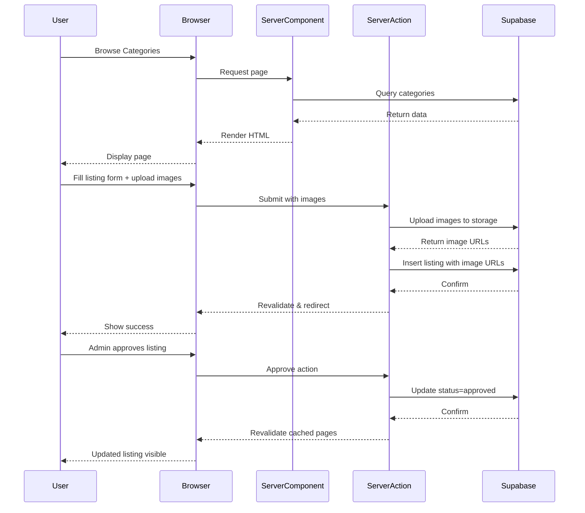
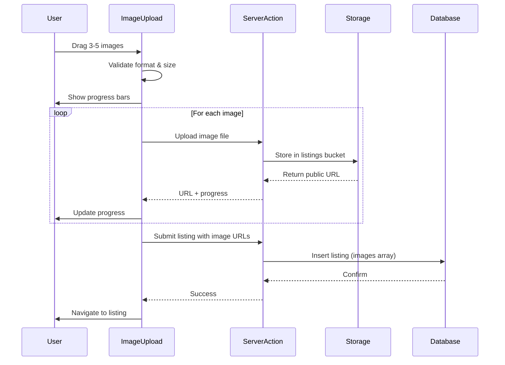

# Technical Design Document: FindAm Curated Directory

## Overview

FindAm is a youth-centric curated directory platform connecting young Nigerians with services, opportunities, and businesses. The platform emphasizes simplicity, manual quality control, and mobile accessibility to deliver a trustworthy directory experience.

### Core Characteristics

- **Curated Directory**: Manual approval process ensures quality listings
- **Youth-Centric**: Vibrant design appealing to young users
- **Mobile-First**: Responsive from 320px to 2560px with mobile priority
- **Simple Architecture**: Next.js + Supabase only, no external services
- **Fast Launch Focused**: Essential features to get platform live quickly

### Design Principles

1. **Simplicity**: Clean, maintainable code without over-engineering
2. **Manual Curation**: Admin-controlled approval for listings and vendors
3. **Mobile Accessibility**: Touch-friendly, responsive design
4. **Type Safety**: TypeScript for reliability and developer experience
5. **Youth Appeal**: Vibrant colors, modern typography, engaging visuals
6. **Practical Implementation**: Focus on what works, avoid premature optimization

### Technology Stack

- **Framework**: Next.js 16.2.6 (App Router, Server Components, Server Actions)
- **Language**: TypeScript (strict mode)
- **Backend**: Supabase (database, auth, storage via @supabase/ssr)
- **UI**: React 19, Tailwind CSS, Radix UI components
- **Image Optimization**: Next.js 16 Image component with automatic optimization
- **Validation**: Zod schemas
- **Testing**: Vitest (unit), Playwright (E2E for critical flows), fast-check (property-based)

## Architecture

### System Overview



### Application Structure

```
app/
├── (auth)/                   # Route group for authentication
│   ├── login/
│   │   └── page.tsx         # Server Component with login form
│   ├── register/
│   │   └── page.tsx         # Server Component with registration form
│   └── reset-password/
│       └── page.tsx         # Server Component with password reset
├── (public)/                # Route group for public pages
│   ├── page.tsx             # Homepage Server Component
│   ├── browse/
│   │   └── page.tsx         # Browse with filters (Server Component)
│   ├── categories/[slug]/
│   │   └── page.tsx         # Dynamic category page (Server Component)
│   ├── listings/[id]/
│   │   └── page.tsx         # Listing detail with image gallery
│   ├── about/
│   │   └── page.tsx         # About page
│   ├── contact/
│   │   └── page.tsx         # Contact page
│   └── how-it-works/
│       └── page.tsx         # How it works page
├── (authenticated)/         # Route group requiring auth
│   ├── listings/
│   │   ├── create/
│   │   │   └── page.tsx     # Create listing with multi-image upload
│   │   └── my-listings/
│   │       └── page.tsx     # User's listings management
│   ├── profile/
│   │   └── page.tsx         # User profile with avatar upload
│   └── vendor/
│       └── apply/
│           └── page.tsx     # Vendor application form
└── (admin)/                 # Route group for admin only
    └── admin/
        ├── layout.tsx       # Admin layout wrapper
        ├── page.tsx         # Admin dashboard
        ├── listings/
        │   └── page.tsx     # Pending listings approval
        └── vendors/
            └── page.tsx     # Pending vendor approvals

components/
├── layout/
│   ├── navigation-bar.tsx          # Client Component (interactive)
│   ├── mobile-menu.tsx             # Client Component (hamburger menu)
│   ├── footer.tsx                  # Server Component
│   └── user-menu.tsx               # Client Component (dropdown)
├── features/
│   ├── hero-section.tsx            # Server Component with search
│   ├── hero-search.tsx             # Client Component (search input)
│   ├── category-grid.tsx           # Server Component
│   ├── category-card.tsx           # Server Component (no interactions)
│   ├── featured-listings.tsx       # Server Component
│   ├── listing-card.tsx            # Server Component
│   ├── browse-filters.tsx          # Client Component (form)
│   ├── image-gallery.tsx           # Client Component (interactive viewer)
│   ├── image-upload.tsx            # Client Component (drag-drop)
│   └── listing-form.tsx            # Client Component (form)
├── admin/
│   ├── listing-approval-card.tsx   # Client Component (approve/reject)
│   └── vendor-approval-card.tsx    # Client Component (approve/reject)
└── shared/
    ├── button.tsx                   # Client Component
    ├── card.tsx                     # Server Component
    ├── input.tsx                    # Client Component
    ├── image-uploader.tsx           # Client Component (multi-upload)
    └── optimized-image.tsx          # Server Component wrapper

lib/
├── actions/                 # Server Actions (Next.js 16)
│   ├── auth-actions.ts      # Login, register, logout
│   ├── listing-actions.ts   # Create, update listings
│   ├── admin-actions.ts     # Approve/reject actions
│   └── image-actions.ts     # Upload, delete images
├── services/
│   ├── supabase/
│   │   ├── server.ts        # Server-side Supabase client
│   │   ├── client.ts        # Client-side Supabase client
│   │   └── middleware.ts    # Middleware Supabase client
│   ├── auth.ts              # Auth utilities
│   ├── database.ts          # Database queries
│   └── storage.ts           # Storage operations (multi-image)
├── types/
│   ├── database.ts          # Supabase generated types
│   └── core.ts              # Application types
├── validation/
│   └── schemas.ts           # Zod schemas
└── utils/
    ├── image.ts             # Image processing utilities
    └── error.ts             # Error handling utilities
```

### Next.js 16.2.6 Architecture Decisions

**Server Components by Default**
- All pages and layout components are Server Components unless interactivity is required
- Fetching data directly in Server Components (no separate API routes for internal data)
- Reduced client-side JavaScript bundle size

**Client Components for Interactivity**
- Forms, search inputs, image uploaders, galleries, navigation menus
- Marked with `'use client'` directive
- Keep client components small and focused

**Server Actions for Mutations**
- Form submissions use Server Actions (login, registration, listing creation)
- Image uploads handled via Server Actions
- Admin approval/rejection actions
- Automatic revalidation of cached data

**Image Optimization**
- Next.js 16 Image component for all images
- Automatic format optimization (WebP/AVIF)
- Responsive image sizes based on viewport
- Lazy loading for off-screen images
- Blur placeholder for better UX

### Data Flow



### Multi-Image Upload Flow



## Components and Interfaces

### Core Types

```typescript
// lib/types/core.ts

export interface User {
  id: string;
  email: string;
  phone: string | null;
  full_name: string;
  avatar_url: string | null;
  role: 'user' | 'admin';
  created_at: string;
  updated_at: string;
}

export interface Category {
  id: string;
  name: string;
  slug: string;
  parent_id: string | null;
  description: string | null;
  image_url: string | null;
  display_order: number;
  listing_count: number;
}

export interface Listing {
  id: string;
  title: string;
  description: string;
  price: number | null;
  category_id: string;
  user_id: string;
  location_state: string;
  location_city: string;
  images: string[];              // Array of image URLs (3-5 images)
  primary_image_index: number;   // Index of primary image (default: 0)
  is_featured: boolean;
  status: 'pending' | 'approved' | 'rejected';
  rejection_reason: string | null;
  created_at: string;
  updated_at: string;
  
  // Relations (when joined)
  category?: Category;
  user?: User;
  vendor?: ApprovedVendor | null;
}

export interface VendorApplication {
  id: string;
  user_id: string;
  business_name: string;
  business_description: string;
  contact_email: string;
  contact_phone: string;
  status: 'pending' | 'approved' | 'rejected';
  rejection_reason: string | null;
  created_at: string;
  
  // Relations (when joined)
  user?: User;
}

export interface ApprovedVendor {
  user_id: string;
  business_name: string;
  approved_at: string;
  approved_badge_enabled: boolean;
}

export interface ImageUploadResult {
  url: string;
  path: string;
  size: number;
}

export interface ImageGalleryImage {
  url: string;
  alt: string;
  width?: number;
  height?: number;
}
```

### Server Action Interfaces

```typescript
// lib/actions/auth-actions.ts

'use server'

export async function registerAction(formData: FormData): Promise<{
  success: boolean;
  error?: string;
  user?: User;
}> {
  // Implementation
}

export async function loginAction(formData: FormData): Promise<{
  success: boolean;
  error?: string;
}> {
  // Implementation
}

export async function logoutAction(): Promise<void> {
  // Implementation
}

// lib/actions/listing-actions.ts

'use server'

export async function createListingAction(formData: FormData): Promise<{
  success: boolean;
  error?: string;
  listingId?: string;
}> {
  // Handles form data including image URLs
  // Images uploaded separately via image-actions
}

export async function updateListingImagesAction(
  listingId: string,
  imageUrls: string[],
  primaryIndex: number
): Promise<{
  success: boolean;
  error?: string;
}> {
  // Implementation
}

// lib/actions/image-actions.ts

'use server'

export async function uploadImageAction(
  formData: FormData,
  bucket: 'avatars' | 'listings'
): Promise<{
  success: boolean;
  error?: string;
  result?: ImageUploadResult;
}> {
  // Single image upload
  // Returns URL for client to collect
}

export async function deleteImageAction(
  imagePath: string,
  bucket: 'avatars' | 'listings'
): Promise<{
  success: boolean;
  error?: string;
}> {
  // Delete image from storage
}

// lib/actions/admin-actions.ts

'use server'

export async function approveListingAction(listingId: string): Promise<{
  success: boolean;
  error?: string;
}> {
  // Implementation with revalidation
}

export async function rejectListingAction(
  listingId: string,
  reason: string
): Promise<{
  success: boolean;
  error?: string;
}> {
  // Implementation with revalidation
}

export async function approveVendorAction(applicationId: string): Promise<{
  success: boolean;
  error?: string;
}> {
  // Implementation
}

export async function rejectVendorAction(
  applicationId: string,
  reason: string
): Promise<{
  success: boolean;
  error?: string;
}> {
  // Implementation
}
```

### Service Interfaces

```typescript
// lib/services/database.ts

export interface DatabaseService {
  // Categories
  getCategories(): Promise<Category[]>;
  getCategoryBySlug(slug: string): Promise<Category | null>;
  
  // Listings
  getListings(filters: BrowseFilters): Promise<Listing[]>;
  getListingById(id: string): Promise<Listing | null>;
  getFeaturedListings(limit: number): Promise<Listing[]>;
  getUserListings(userId: string): Promise<Listing[]>;
  
  // Vendors
  getVendorStatus(userId: string): Promise<ApprovedVendor | null>;
  
  // Admin
  getPendingListings(): Promise<Listing[]>;
  getPendingVendorApplications(): Promise<VendorApplication[]>;
}

export interface BrowseFilters {
  category_id?: string;
  location_city?: string;
  search_query?: string;
  sort_by?: 'newest' | 'featured';
  limit?: number;
  offset?: number;
}

// lib/services/storage.ts

export interface StorageService {
  uploadImage(
    file: File,
    bucket: 'avatars' | 'listings',
    userId: string
  ): Promise<ImageUploadResult>;
  
  deleteImage(
    imagePath: string,
    bucket: 'avatars' | 'listings'
  ): Promise<void>;
  
  getPublicUrl(
    imagePath: string,
    bucket: 'avatars' | 'listings'
  ): string;
  
  validateImage(
    file: File,
    bucket: 'avatars' | 'listings'
  ): { valid: boolean; error?: string };
}
```

### Component Props Interfaces

```typescript
// components/features/image-upload.tsx

'use client'

export interface ImageUploadProps {
  onImagesUploaded: (urls: string[]) => void;
  maxImages?: number;        // Default: 5
  maxSizeMB?: number;        // Default: 5
  existingImages?: string[]; // For edit mode
  bucket: 'avatars' | 'listings';
}

// components/features/image-gallery.tsx

'use client'

export interface ImageGalleryProps {
  images: ImageGalleryImage[];
  primaryIndex?: number;
  alt: string;
  className?: string;
}

// components/features/listing-card.tsx

export interface ListingCardProps {
  listing: Listing;
  showStatus?: boolean;  // For admin/user views
  priority?: boolean;    // For Next.js Image priority
}

// components/features/browse-filters.tsx

'use client'

export interface BrowseFiltersProps {
  categories: Category[];
  cities: string[];
  initialFilters?: BrowseFilters;
  onFilterChange: (filters: BrowseFilters) => void;
}
```

## Data Models

### Database Schema

```sql
-- Users table
CREATE TABLE users (
  id UUID PRIMARY KEY DEFAULT uuid_generate_v4(),
  email TEXT UNIQUE NOT NULL,
  phone TEXT,
  full_name TEXT NOT NULL,
  avatar_url TEXT,
  role TEXT NOT NULL DEFAULT 'user' CHECK (role IN ('user', 'admin')),
  created_at TIMESTAMPTZ DEFAULT NOW(),
  updated_at TIMESTAMPTZ DEFAULT NOW()
);

-- Categories table
CREATE TABLE categories (
  id UUID PRIMARY KEY DEFAULT uuid_generate_v4(),
  name TEXT NOT NULL,
  slug TEXT UNIQUE NOT NULL,
  parent_id UUID REFERENCES categories(id),
  description TEXT,
  image_url TEXT,
  display_order INTEGER DEFAULT 0,
  listing_count INTEGER DEFAULT 0,
  created_at TIMESTAMPTZ DEFAULT NOW(),
  updated_at TIMESTAMPTZ DEFAULT NOW()
);

-- Listings table with multi-image support
CREATE TABLE listings (
  id UUID PRIMARY KEY DEFAULT uuid_generate_v4(),
  title TEXT NOT NULL,
  description TEXT NOT NULL,
  price DECIMAL(10, 2),
  category_id UUID NOT NULL REFERENCES categories(id),
  user_id UUID NOT NULL REFERENCES users(id) ON DELETE CASCADE,
  location_state TEXT NOT NULL,
  location_city TEXT NOT NULL,
  images TEXT[] DEFAULT '{}',           -- Array of image URLs (3-5 images)
  primary_image_index INTEGER DEFAULT 0, -- Index of primary image
  is_featured BOOLEAN DEFAULT FALSE,
  status TEXT NOT NULL DEFAULT 'pending' CHECK (status IN ('pending', 'approved', 'rejected')),
  rejection_reason TEXT,
  created_at TIMESTAMPTZ DEFAULT NOW(),
  updated_at TIMESTAMPTZ DEFAULT NOW(),
  
  -- Constraints
  CONSTRAINT valid_primary_image CHECK (primary_image_index >= 0),
  CONSTRAINT valid_images_count CHECK (array_length(images, 1) BETWEEN 1 AND 5),
  CONSTRAINT primary_within_bounds CHECK (
    primary_image_index < array_length(images, 1) OR array_length(images, 1) IS NULL
  )
);

-- Vendor applications table
CREATE TABLE vendor_applications (
  id UUID PRIMARY KEY DEFAULT uuid_generate_v4(),
  user_id UUID NOT NULL REFERENCES users(id) ON DELETE CASCADE,
  business_name TEXT NOT NULL,
  business_description TEXT NOT NULL,
  contact_email TEXT NOT NULL,
  contact_phone TEXT NOT NULL,
  status TEXT NOT NULL DEFAULT 'pending' CHECK (status IN ('pending', 'approved', 'rejected')),
  rejection_reason TEXT,
  reviewed_at TIMESTAMPTZ,
  reviewed_by UUID REFERENCES users(id),
  created_at TIMESTAMPTZ DEFAULT NOW(),
  updated_at TIMESTAMPTZ DEFAULT NOW()
);

-- Approved vendors table
CREATE TABLE approved_vendors (
  user_id UUID PRIMARY KEY REFERENCES users(id) ON DELETE CASCADE,
  business_name TEXT NOT NULL,
  approved_at TIMESTAMPTZ DEFAULT NOW(),
  approved_badge_enabled BOOLEAN DEFAULT TRUE
);

-- Indexes for performance
CREATE INDEX idx_listings_category ON listings(category_id);
CREATE INDEX idx_listings_status ON listings(status);
CREATE INDEX idx_listings_user ON listings(user_id);
CREATE INDEX idx_listings_featured ON listings(is_featured, created_at DESC) 
  WHERE status = 'approved';
CREATE INDEX idx_listings_city ON listings(location_city);
CREATE INDEX idx_listings_created ON listings(created_at DESC) 
  WHERE status = 'approved';
CREATE INDEX idx_vendor_applications_status ON vendor_applications(status);
CREATE INDEX idx_vendor_applications_user ON vendor_applications(user_id);

-- Function to update listing count on categories
CREATE OR REPLACE FUNCTION update_category_listing_count()
RETURNS TRIGGER AS $$
BEGIN
  IF TG_OP = 'INSERT' AND NEW.status = 'approved' THEN
    UPDATE categories 
    SET listing_count = listing_count + 1 
    WHERE id = NEW.category_id;
  ELSIF TG_OP = 'UPDATE' THEN
    IF OLD.status != 'approved' AND NEW.status = 'approved' THEN
      UPDATE categories 
      SET listing_count = listing_count + 1 
      WHERE id = NEW.category_id;
    ELSIF OLD.status = 'approved' AND NEW.status != 'approved' THEN
      UPDATE categories 
      SET listing_count = listing_count - 1 
      WHERE id = NEW.category_id;
    END IF;
  ELSIF TG_OP = 'DELETE' AND OLD.status = 'approved' THEN
    UPDATE categories 
    SET listing_count = listing_count - 1 
    WHERE id = OLD.category_id;
  END IF;
  RETURN COALESCE(NEW, OLD);
END;
$$ LANGUAGE plpgsql;

CREATE TRIGGER trigger_update_category_listing_count
  AFTER INSERT OR UPDATE OR DELETE ON listings
  FOR EACH ROW
  EXECUTE FUNCTION update_category_listing_count();
```

### Row Level Security (RLS) Policies

```sql
-- Enable RLS
ALTER TABLE users ENABLE ROW LEVEL SECURITY;
ALTER TABLE categories ENABLE ROW LEVEL SECURITY;
ALTER TABLE listings ENABLE ROW LEVEL SECURITY;
ALTER TABLE vendor_applications ENABLE ROW LEVEL SECURITY;
ALTER TABLE approved_vendors ENABLE ROW LEVEL SECURITY;

-- Users: public read, users update own
CREATE POLICY "users_select" ON users FOR SELECT USING (true);
CREATE POLICY "users_update" ON users FOR UPDATE 
  USING (auth.uid() = id);

-- Categories: public read
CREATE POLICY "categories_select" ON categories FOR SELECT USING (true);

-- Listings: public see approved, users see own, admins see all
CREATE POLICY "listings_select" ON listings FOR SELECT 
  USING (
    status = 'approved' 
    OR auth.uid() = user_id 
    OR EXISTS (SELECT 1 FROM users WHERE id = auth.uid() AND role = 'admin')
  );

CREATE POLICY "listings_insert" ON listings FOR INSERT 
  WITH CHECK (auth.uid() = user_id);

CREATE POLICY "listings_update" ON listings FOR UPDATE 
  USING (
    auth.uid() = user_id 
    OR EXISTS (SELECT 1 FROM users WHERE id = auth.uid() AND role = 'admin')
  );

CREATE POLICY "listings_delete" ON listings FOR DELETE 
  USING (auth.uid() = user_id);

-- Vendor applications: users see own, admins see all
CREATE POLICY "vendor_applications_select" ON vendor_applications FOR SELECT 
  USING (
    auth.uid() = user_id 
    OR EXISTS (SELECT 1 FROM users WHERE id = auth.uid() AND role = 'admin')
  );

CREATE POLICY "vendor_applications_insert" ON vendor_applications FOR INSERT 
  WITH CHECK (auth.uid() = user_id);

CREATE POLICY "vendor_applications_update" ON vendor_applications FOR UPDATE 
  USING (EXISTS (SELECT 1 FROM users WHERE id = auth.uid() AND role = 'admin'));

-- Approved vendors: public read
CREATE POLICY "approved_vendors_select" ON approved_vendors FOR SELECT USING (true);
```

### Storage Buckets Configuration

**Bucket Structure:**

```typescript
// Supabase Storage Configuration

const STORAGE_BUCKETS = {
  avatars: {
    name: 'avatars',
    public: true,
    fileSizeLimit: 2 * 1024 * 1024,      // 2MB
    allowedMimeTypes: ['image/jpeg', 'image/png', 'image/webp'],
  },
  listings: {
    name: 'listings',
    public: true,
    fileSizeLimit: 5 * 1024 * 1024,      // 5MB per image
    allowedMimeTypes: ['image/jpeg', 'image/png', 'image/webp'],
  },
} as const;
```

**File Path Structure:**

```
listings/
  {user_id}/
    {listing_id}/
      image-1-{timestamp}.webp
      image-2-{timestamp}.webp
      image-3-{timestamp}.webp
      image-4-{timestamp}.webp
      image-5-{timestamp}.webp

avatars/
  {user_id}/
    avatar-{timestamp}.webp
```

**Storage RLS Policies:**

```sql
-- Listings bucket: anyone can read, users can upload to their own folder
CREATE POLICY "listings_select"
  ON storage.objects FOR SELECT
  USING (bucket_id = 'listings');

CREATE POLICY "listings_insert"
  ON storage.objects FOR INSERT
  WITH CHECK (
    bucket_id = 'listings' 
    AND (storage.foldername(name))[1] = auth.uid()::text
  );

CREATE POLICY "listings_delete"
  ON storage.objects FOR DELETE
  USING (
    bucket_id = 'listings' 
    AND (storage.foldername(name))[1] = auth.uid()::text
  );

-- Avatars bucket: anyone can read, users can manage their own
CREATE POLICY "avatars_select"
  ON storage.objects FOR SELECT
  USING (bucket_id = 'avatars');

CREATE POLICY "avatars_insert"
  ON storage.objects FOR INSERT
  WITH CHECK (
    bucket_id = 'avatars' 
    AND (storage.foldername(name))[1] = auth.uid()::text
  );

CREATE POLICY "avatars_update"
  ON storage.objects FOR UPDATE
  USING (
    bucket_id = 'avatars' 
    AND (storage.foldername(name))[1] = auth.uid()::text
  );

CREATE POLICY "avatars_delete"
  ON storage.objects FOR DELETE
  USING (
    bucket_id = 'avatars' 
    AND (storage.foldername(name))[1] = auth.uid()::text
  );
```

## Validation

### Zod Schemas

```typescript
// lib/validation/schemas.ts

import { z } from 'zod';

// Authentication
export const registerSchema = z.object({
  email: z.string().email('Invalid email format'),
  password: z
    .string()
    .min(8, 'Password must be at least 8 characters')
    .regex(/[A-Z]/, 'Must contain uppercase letter')
    .regex(/[a-z]/, 'Must contain lowercase letter')
    .regex(/[0-9]/, 'Must contain number'),
  full_name: z.string().min(2, 'Name must be at least 2 characters'),
});

export const loginSchema = z.object({
  email: z.string().email('Invalid email format'),
  password: z.string().min(1, 'Password required'),
});

// Listings with multi-image support
export const createListingSchema = z.object({
  title: z.string().min(5).max(100),
  description: z.string().min(20).max(2000),
  price: z.number().positive().nullable(),
  category_id: z.string().uuid(),
  location_state: z.string().min(2),
  location_city: z.string().min(2),
  images: z.array(z.string().url()).min(1).max(5, 'Maximum 5 images allowed'),
  primary_image_index: z.number().int().min(0).max(4).default(0),
});

export const updateListingImagesSchema = z.object({
  images: z.array(z.string().url()).min(1).max(5, 'Maximum 5 images allowed'),
  primary_image_index: z.number().int().min(0).max(4),
}).refine(
  (data) => data.primary_image_index < data.images.length,
  { message: 'Primary image index must be within images array bounds' }
);

// Image upload validation
export const imageUploadSchema = z.object({
  file: z.instanceof(File),
  bucket: z.enum(['avatars', 'listings']),
}).refine(
  (data) => {
    const validTypes = ['image/jpeg', 'image/png', 'image/webp'];
    return validTypes.includes(data.file.type);
  },
  { message: 'Invalid file type. Only JPEG, PNG, and WebP allowed' }
).refine(
  (data) => {
    const maxSize = data.bucket === 'avatars' ? 2 * 1024 * 1024 : 5 * 1024 * 1024;
    return data.file.size <= maxSize;
  },
  (data) => ({
    message: `File too large. Maximum ${data.bucket === 'avatars' ? '2' : '5'}MB allowed`
  })
);

// Vendor applications
export const vendorApplicationSchema = z.object({
  business_name: z.string().min(2).max(100),
  business_description: z.string().min(20).max(500),
  contact_email: z.string().email(),
  contact_phone: z.string().regex(/^(\+?234|0)[789]\d{9}$/, 'Invalid Nigerian phone'),
});

// Browse filters
export const browseFiltersSchema = z.object({
  category_id: z.string().uuid().optional(),
  location_city: z.string().optional(),
  search_query: z.string().max(100).optional(),
  sort_by: z.enum(['newest', 'featured']).default('newest'),
  limit: z.number().int().positive().max(50).default(20),
  offset: z.number().int().min(0).default(0),
});

// Admin actions
export const rejectReasonSchema = z.object({
  reason: z.string().min(10, 'Rejection reason must be at least 10 characters').max(500),
});
```

## Multi-Image Upload Implementation

### Image Upload Component Architecture

```typescript
// components/shared/image-uploader.tsx
'use client'

import { useState } from 'react';
import { uploadImageAction, deleteImageAction } from '@/lib/actions/image-actions';

interface ImageUploadState {
  file: File;
  preview: string;
  uploading: boolean;
  progress: number;
  url?: string;
  error?: string;
}

export function ImageUploader({
  onImagesUploaded,
  maxImages = 5,
  maxSizeMB = 5,
  existingImages = [],
  bucket = 'listings',
}: ImageUploadProps) {
  const [images, setImages] = useState<ImageUploadState[]>([]);
  const [uploadedUrls, setUploadedUrls] = useState<string[]>(existingImages);
  const [primaryIndex, setPrimaryIndex] = useState(0);

  // Drag and drop handlers
  const handleDrop = async (e: React.DragEvent) => {
    e.preventDefault();
    const files = Array.from(e.dataTransfer.files);
    await handleFiles(files);
  };

  // File selection handler
  const handleFiles = async (files: File[]) => {
    const remaining = maxImages - uploadedUrls.length;
    const filesToUpload = files.slice(0, remaining);
    
    // Validate files
    const validFiles = filesToUpload.filter(file => {
      const isValidType = ['image/jpeg', 'image/png', 'image/webp'].includes(file.type);
      const isValidSize = file.size <= maxSizeMB * 1024 * 1024;
      return isValidType && isValidSize;
    });

    // Create preview states
    const newImages: ImageUploadState[] = validFiles.map(file => ({
      file,
      preview: URL.createObjectURL(file),
      uploading: false,
      progress: 0,
    }));

    setImages(prev => [...prev, ...newImages]);

    // Upload sequentially with progress
    for (let i = 0; i < newImages.length; i++) {
      await uploadSingleImage(images.length + i, newImages[i].file);
    }
  };

  const uploadSingleImage = async (index: number, file: File) => {
    // Update state to uploading
    setImages(prev => {
      const updated = [...prev];
      updated[index] = { ...updated[index], uploading: true, progress: 0 };
      return updated;
    });

    // Create FormData
    const formData = new FormData();
    formData.append('file', file);
    formData.append('bucket', bucket);

    // Upload via Server Action
    const result = await uploadImageAction(formData, bucket);

    if (result.success && result.result) {
      // Update with URL
      setImages(prev => {
        const updated = [...prev];
        updated[index] = {
          ...updated[index],
          uploading: false,
          progress: 100,
          url: result.result!.url,
        };
        return updated;
      });

      // Add to uploaded URLs
      const newUrls = [...uploadedUrls, result.result.url];
      setUploadedUrls(newUrls);
      onImagesUploaded(newUrls);
    } else {
      // Handle error
      setImages(prev => {
        const updated = [...prev];
        updated[index] = {
          ...updated[index],
          uploading: false,
          error: result.error || 'Upload failed',
        };
        return updated;
      });
    }
  };

  const handleRemove = async (index: number) => {
    const url = uploadedUrls[index];
    
    // Extract path from URL for deletion
    const path = url.split('/').slice(-3).join('/'); // user_id/listing_id/filename
    
    // Delete from storage
    await deleteImageAction(path, bucket);
    
    // Update state
    const newUrls = uploadedUrls.filter((_, i) => i !== index);
    setUploadedUrls(newUrls);
    onImagesUploaded(newUrls);
    
    // Adjust primary index if needed
    if (primaryIndex >= newUrls.length) {
      setPrimaryIndex(Math.max(0, newUrls.length - 1));
    }
  };

  const handleReorder = (fromIndex: number, toIndex: number) => {
    const newUrls = [...uploadedUrls];
    const [moved] = newUrls.splice(fromIndex, 1);
    newUrls.splice(toIndex, 0, moved);
    setUploadedUrls(newUrls);
    onImagesUploaded(newUrls);
  };

  // Render drag-and-drop zone, preview grid, progress bars, etc.
  // Implementation details omitted for brevity
}
```

### Image Gallery Component

```typescript
// components/features/image-gallery.tsx
'use client'

import { useState } from 'react';
import Image from 'next/image';

export function ImageGallery({
  images,
  primaryIndex = 0,
  alt,
  className,
}: ImageGalleryProps) {
  const [selectedIndex, setSelectedIndex] = useState(primaryIndex);
  const [isFullscreen, setIsFullscreen] = useState(false);

  const handlePrevious = () => {
    setSelectedIndex((prev) => (prev === 0 ? images.length - 1 : prev - 1));
  };

  const handleNext = () => {
    setSelectedIndex((prev) => (prev === images.length - 1 ? 0 : prev + 1));
  };

  const handleKeyboard = (e: React.KeyboardEvent) => {
    if (e.key === 'ArrowLeft') handlePrevious();
    if (e.key === 'ArrowRight') handleNext();
    if (e.key === 'Escape') setIsFullscreen(false);
  };

  return (
    <div className={className} onKeyDown={handleKeyboard} tabIndex={0}>
      {/* Main image */}
      <div className="relative aspect-[4/3] w-full overflow-hidden rounded-lg">
        <Image
          src={images[selectedIndex].url}
          alt={`${alt} - Image ${selectedIndex + 1}`}
          fill
          className="object-cover cursor-pointer"
          onClick={() => setIsFullscreen(true)}
          sizes="(max-width: 768px) 100vw, (max-width: 1200px) 50vw, 33vw"
          priority={selectedIndex === primaryIndex}
        />
      </div>

      {/* Thumbnail strip */}
      <div className="mt-4 grid grid-cols-5 gap-2">
        {images.map((image, index) => (
          <button
            key={index}
            onClick={() => setSelectedIndex(index)}
            className={`relative aspect-square overflow-hidden rounded ${
              index === selectedIndex ? 'ring-2 ring-blue-500' : ''
            }`}
          >
            <Image
              src={image.url}
              alt={`Thumbnail ${index + 1}`}
              fill
              className="object-cover"
              sizes="(max-width: 768px) 20vw, 10vw"
            />
            {index === primaryIndex && (
              <span className="absolute top-1 right-1 bg-blue-500 text-white text-xs px-1 rounded">
                Primary
              </span>
            )}
          </button>
        ))}
      </div>

      {/* Fullscreen modal */}
      {isFullscreen && (
        <div
          className="fixed inset-0 z-50 bg-black flex items-center justify-center"
          onClick={() => setIsFullscreen(false)}
        >
          <Image
            src={images[selectedIndex].url}
            alt={`${alt} - Fullscreen`}
            fill
            className="object-contain p-4"
            sizes="100vw"
          />
          {/* Navigation arrows */}
          <button
            onClick={(e) => { e.stopPropagation(); handlePrevious(); }}
            className="absolute left-4 top-1/2 -translate-y-1/2 bg-white/20 hover:bg-white/40 rounded-full p-2"
          >
            ←
          </button>
          <button
            onClick={(e) => { e.stopPropagation(); handleNext(); }}
            className="absolute right-4 top-1/2 -translate-y-1/2 bg-white/20 hover:bg-white/40 rounded-full p-2"
          >
            →
          </button>
        </div>
      )}
    </div>
  );
}
```

### Next.js 16 Image Optimization Strategy

```typescript
// lib/utils/image.ts

export const IMAGE_SIZES = {
  thumbnail: 200,
  card: 400,
  detail: 800,
  fullscreen: 1920,
} as const;

export const IMAGE_QUALITY = {
  thumbnail: 75,
  card: 80,
  detail: 85,
  fullscreen: 90,
} as const;

// Generate responsive srcset for image
export function getImageSizes(context: 'card' | 'detail' | 'thumbnail'): string {
  switch (context) {
    case 'thumbnail':
      return '(max-width: 768px) 100px, 200px';
    case 'card':
      return '(max-width: 768px) 100vw, (max-width: 1200px) 50vw, 33vw';
    case 'detail':
      return '(max-width: 768px) 100vw, (max-width: 1200px) 60vw, 800px';
    default:
      return '100vw';
  }
}

// Validate image file client-side
export function validateImageFile(
  file: File,
  bucket: 'avatars' | 'listings'
): { valid: boolean; error?: string } {
  const validTypes = ['image/jpeg', 'image/png', 'image/webp'];
  const maxSize = bucket === 'avatars' ? 2 * 1024 * 1024 : 5 * 1024 * 1024;

  if (!validTypes.includes(file.type)) {
    return {
      valid: false,
      error: 'Invalid file type. Only JPEG, PNG, and WebP allowed',
    };
  }

  if (file.size > maxSize) {
    return {
      valid: false,
      error: `File too large. Maximum ${bucket === 'avatars' ? '2' : '5'}MB allowed`,
    };
  }

  return { valid: true };
}

// Generate unique filename
export function generateImageFilename(userId: string, prefix: string): string {
  const timestamp = Date.now();
  const random = Math.random().toString(36).substring(7);
  return `${userId}/${prefix}-${timestamp}-${random}.webp`;
}
```

## Complete Feature Implementations

### Authentication Flow

**Registration (Complete Implementation)**
1. User fills registration form (`app/(auth)/register/page.tsx`)
2. Client-side validation with real-time feedback
3. Form submits via Server Action (`registerAction`)
4. Server validates with Zod schema
5. Creates user in Supabase Auth
6. Creates user record in `users` table
7. Automatically logs user in (creates session)
8. Redirects to homepage
9. Displays success toast notification

**Login (Complete Implementation)**
1. User fills login form (`app/(auth)/login/page.tsx`)
2. Client-side validation
3. Form submits via Server Action (`loginAction`)
4. Server validates credentials with Supabase Auth
5. Creates session cookie (HTTP-only, secure)
6. Redirects to intended page or homepage
7. Navigation bar updates to show user menu

**Password Reset (Complete Implementation)**
1. User requests reset on `/reset-password` page
2. Server Action sends reset email via Supabase
3. User clicks link in email
4. Redirects to reset form with token
5. User sets new password
6. Server validates and updates password
7. Auto-login and redirect to homepage

### Listing Creation Flow (Multi-Image)

**Complete Implementation Steps:**

1. **Page Load** (`app/(authenticated)/listings/create/page.tsx`)
   - Server Component fetches categories from database
   - Renders listing form with ImageUploader component
   - Displays Nigerian states and cities in dropdowns

2. **Image Upload** (Client Component)
   - User drags/selects 3-5 images
   - Client validates each image (format, size)
   - Shows preview grid with progress bars
   - Uploads images sequentially via Server Action
   - Each upload returns public URL
   - User can reorder images (first = primary)
   - User can remove images before submission

3. **Form Submission** (Server Action)
   - User fills all required fields
   - Client validates form with Zod schema
   - Shows validation errors inline
   - Submits form with array of image URLs
   - Server Action creates listing with status='pending'
   - Returns listing ID

4. **Post-Submission**
   - Shows success message
   - Redirects to "My Listings" page
   - Displays pending status badge

### Browse and Filter Flow

**Complete Implementation:**

1. **Initial Load** (`app/(public)/browse/page.tsx`)
   - Server Component fetches all approved listings
   - Fetches categories and cities for filters
   - Renders listings grid with filters sidebar

2. **Filter Application** (Client Component)
   - User selects category, city, or search term
   - User chooses sort order (newest/featured)
   - Client Component updates URL params
   - Server Component re-renders with filtered results
   - Smooth transition with loading state

3. **Search** (Combined Client + Server)
   - User types in search bar
   - Debounced input (300ms)
   - Updates URL param on Enter or blur
   - Server performs text search on title + description
   - Results update automatically

4. **Infinite Scroll/Pagination**
   - Initial load shows 20 listings
   - "Load More" button at bottom
   - Client Component fetches next page
   - Appends results to grid
   - Disables button when no more results

### Admin Approval Workflows

**Listing Approval (Complete Implementation):**

1. **Admin Dashboard** (`app/(admin)/admin/listings/page.tsx`)
   - Server Component fetches pending listings with joins
   - Displays listing cards with full details
   - Shows preview of primary image
   - Shows user information

2. **Approval Action** (Client Component + Server Action)
   - Admin clicks "Approve" button
   - Confirmation dialog appears
   - Server Action updates status to 'approved'
   - Revalidates browse pages and category pages
   - Listing immediately visible to public
   - Sends email notification to creator

3. **Rejection Action**
   - Admin clicks "Reject" button
   - Modal appears requesting reason (min 10 chars)
   - Server Action updates status with reason
   - Sends email with rejection reason
   - Listing hidden from public view
   - User can view rejection reason in "My Listings"

**Vendor Approval (Complete Implementation):**

1. **Application Submission** (`app/(authenticated)/vendor/apply/page.tsx`)
   - User fills vendor application form
   - Validates Nigerian phone number format
   - Submits via Server Action
   - Creates record in `vendor_applications`
   - Shows confirmation message

2. **Admin Review** (`app/(admin)/admin/vendors/page.tsx`)
   - Server Component fetches pending applications
   - Shows full application details
   - Displays user information

3. **Approval** (Server Action)
   - Admin approves application
   - Creates record in `approved_vendors` table
   - Updates application status
   - Revalidates user profile pages
   - Sends approval email
   - Badge immediately visible on user's listings

### Complete Navigation Implementation

**Navigation Bar (Client Component with Server Data):**

```typescript
// components/layout/navigation-bar.tsx
'use client'

export function NavigationBar({ user }: { user: User | null }) {
  const [mobileMenuOpen, setMobileMenuOpen] = useState(false);
  const [searchQuery, setSearchQuery] = useState('');

  const handleSearch = (e: React.FormEvent) => {
    e.preventDefault();
    if (searchQuery.trim()) {
      router.push(`/browse?search_query=${encodeURIComponent(searchQuery)}`);
    }
  };

  return (
    <nav className="sticky top-0 z-40 bg-white border-b">
      <div className="container mx-auto px-4">
        <div className="flex items-center justify-between h-16">
          {/* Logo */}
          <Link href="/" className="font-bold text-xl">
            FindAm
          </Link>

          {/* Search bar (desktop) */}
          <form onSubmit={handleSearch} className="hidden md:block flex-1 max-w-lg mx-8">
            <input
              type="search"
              placeholder="Search services..."
              value={searchQuery}
              onChange={(e) => setSearchQuery(e.target.value)}
              className="w-full px-4 py-2 rounded-full border focus:outline-none focus:ring-2"
            />
          </form>

          {/* Desktop menu */}
          <div className="hidden md:flex items-center gap-4">
            <Link href="/browse">Browse</Link>
            {user ? (
              <>
                <Link href="/listings/create">Create Listing</Link>
                <UserMenu user={user} />
              </>
            ) : (
              <>
                <Link href="/login">Login</Link>
                <Link href="/register">
                  <Button>Sign Up</Button>
                </Link>
              </>
            )}
          </div>

          {/* Mobile menu button */}
          <button
            onClick={() => setMobileMenuOpen(!mobileMenuOpen)}
            className="md:hidden"
          >
            {mobileMenuOpen ? <X /> : <Menu />}
          </button>
        </div>

        {/* Mobile search */}
        <form onSubmit={handleSearch} className="md:hidden pb-4">
          <input
            type="search"
            placeholder="Search..."
            value={searchQuery}
            onChange={(e) => setSearchQuery(e.target.value)}
            className="w-full px-4 py-2 rounded-full border"
          />
        </form>
      </div>

      {/* Mobile menu */}
      {mobileMenuOpen && (
        <MobileMenu user={user} onClose={() => setMobileMenuOpen(false)} />
      )}
    </nav>
  );
}
```

**Footer (Server Component):**

```typescript
// components/layout/footer.tsx

export function Footer() {
  return (
    <footer className="bg-gray-900 text-white mt-16">
      <div className="container mx-auto px-4 py-12">
        <div className="grid grid-cols-1 md:grid-cols-4 gap-8">
          {/* Column 1: About */}
          <div>
            <h3 className="font-bold mb-4">About FindAm</h3>
            <ul className="space-y-2">
              <li><Link href="/about">About Us</Link></li>
              <li><Link href="/how-it-works">How It Works</Link></li>
              <li><Link href="/contact">Contact</Link></li>
            </ul>
          </div>

          {/* Column 2: Categories */}
          <div>
            <h3 className="font-bold mb-4">Categories</h3>
            <ul className="space-y-2">
              <li><Link href="/categories/services">Services</Link></li>
              <li><Link href="/categories/products">Products</Link></li>
              <li><Link href="/categories/opportunities">Opportunities</Link></li>
            </ul>
          </div>

          {/* Column 3: For Vendors */}
          <div>
            <h3 className="font-bold mb-4">For Vendors</h3>
            <ul className="space-y-2">
              <li><Link href="/vendor/apply">Become a Vendor</Link></li>
              <li><Link href="/listings/create">Create Listing</Link></li>
            </ul>
          </div>

          {/* Column 4: Legal */}
          <div>
            <h3 className="font-bold mb-4">Legal</h3>
            <ul className="space-y-2">
              <li><Link href="/privacy">Privacy Policy</Link></li>
              <li><Link href="/terms">Terms of Service</Link></li>
            </ul>
          </div>
        </div>

        {/* Bottom bar */}
        <div className="border-t border-gray-800 mt-8 pt-8 flex flex-col md:flex-row justify-between items-center">
          <p>© 2024 FindAm. All rights reserved.</p>
          <div className="flex gap-4 mt-4 md:mt-0">
            <a href="https://twitter.com/findam" target="_blank" rel="noopener">
              Twitter
            </a>
            <a href="https://instagram.com/findam" target="_blank" rel="noopener">
              Instagram
            </a>
          </div>
        </div>
      </div>
    </footer>
  );
}
```

## Error Handling

### Error Response Format

```typescript
// lib/types/core.ts

export type ActionResult<T = void> = 
  | { success: true; data: T }
  | { success: false; error: string; code?: ErrorCode };

export type ErrorCode =
  | 'VALIDATION_ERROR'
  | 'UNAUTHORIZED'
  | 'FORBIDDEN'
  | 'NOT_FOUND'
  | 'SERVER_ERROR'
  | 'STORAGE_ERROR'
  | 'DATABASE_ERROR';
```

### Error Handling Patterns

**Server Action Error Handling:**

```typescript
// lib/actions/listing-actions.ts
'use server'

export async function createListingAction(formData: FormData): Promise<ActionResult<string>> {
  try {
    // 1. Authentication check
    const user = await getCurrentUser();
    if (!user) {
      return { success: false, error: 'Please log in to create a listing', code: 'UNAUTHORIZED' };
    }

    // 2. Validation
    const data = {
      title: formData.get('title'),
      description: formData.get('description'),
      // ... other fields
    };

    const validation = createListingSchema.safeParse(data);
    if (!validation.success) {
      return {
        success: false,
        error: validation.error.errors[0].message,
        code: 'VALIDATION_ERROR',
      };
    }

    // 3. Database operation
    const { data: listing, error } = await supabase
      .from('listings')
      .insert(validation.data)
      .select('id')
      .single();

    if (error) {
      console.error('Database error:', error);
      return {
        success: false,
        error: 'Failed to create listing. Please try again.',
        code: 'DATABASE_ERROR',
      };
    }

    // 4. Success
    revalidatePath('/browse');
    revalidatePath('/listings/my-listings');
    
    return { success: true, data: listing.id };

  } catch (error) {
    console.error('Unexpected error:', error);
    return {
      success: false,
      error: 'An unexpected error occurred. Please try again.',
      code: 'SERVER_ERROR',
    };
  }
}
```

**Client-Side Error Display:**

```typescript
// components/features/listing-form.tsx
'use client'

export function ListingForm({ categories }: { categories: Category[] }) {
  const [error, setError] = useState<string | null>(null);
  const [isSubmitting, setIsSubmitting] = useState(false);

  const handleSubmit = async (e: React.FormEvent<HTMLFormElement>) => {
    e.preventDefault();
    setError(null);
    setIsSubmitting(true);

    try {
      const formData = new FormData(e.currentTarget);
      const result = await createListingAction(formData);

      if (!result.success) {
        setError(result.error);
        setIsSubmitting(false);
        return;
      }

      // Success
      toast.success('Listing created successfully!');
      router.push('/listings/my-listings');

    } catch (error) {
      setError('An unexpected error occurred. Please try again.');
      setIsSubmitting(false);
    }
  };

  return (
    <form onSubmit={handleSubmit}>
      {error && (
        <div className="bg-red-50 border border-red-200 text-red-800 px-4 py-3 rounded mb-4">
          {error}
        </div>
      )}
      {/* Form fields */}
    </form>
  );
}
```

### Common Error Scenarios

**Image Upload Errors:**
- File too large: "Image exceeds 5MB limit. Please compress or choose a smaller image."
- Invalid format: "Invalid file type. Only JPEG, PNG, and WebP are supported."
- Upload failed: "Failed to upload image. Please check your connection and try again."
- Storage full: "Storage limit reached. Please delete some images and try again."

**Authentication Errors:**
- Invalid credentials: "Invalid email or password. Please try again."
- Email in use: "This email is already registered. Please log in instead."
- Weak password: "Password must be at least 8 characters with uppercase, lowercase, and number."
- Session expired: "Your session has expired. Please log in again."

**Listing Creation Errors:**
- Missing required fields: Specific field-level validation messages
- Database error: "Failed to save listing. Please try again."
- Permission denied: "You don't have permission to perform this action."

**Network Errors:**
- Connection failed: "Unable to connect. Please check your internet connection."
- Timeout: "Request timed out. Please try again."
- Server unavailable: "Service temporarily unavailable. Please try again later."

## Testing Strategy

### Testing Approach

FindAm uses a balanced testing strategy prioritizing critical user flows:

**1. Unit Tests (Vitest)**
- Validation schemas (Zod)
- Utility functions (image validation, URL generation)
- Type safety verification
- Data transformation logic

**2. Integration Tests (Vitest)**
- Server Actions with mocked Supabase
- Database query logic
- Image upload flow with mocked storage

**3. E2E Tests (Playwright)**
- Critical user flows only (2-3 flows)
- Authentication (register, login, logout)
- Listing creation with image upload
- Browse and filter functionality

**4. Property-Based Tests (fast-check)**
- Validation schema properties
- Image URL array properties
- Filter combination properties

### Property-Based Testing Assessment

**PBT IS NOT APPROPRIATE for FindAm's primary features** because:

1. **UI-Centric Features**: Most requirements involve UI rendering, navigation, and layout
   - Hero section, navigation bar, footer, category grids
   - Solution: Snapshot tests and E2E tests

2. **External Service Integration**: Core functionality depends on Supabase services
   - Database operations, authentication, storage
   - Solution: Integration tests with mocked Supabase

3. **Manual Approval Workflows**: Admin workflows are stateful UI interactions
   - Approval/rejection actions, form submissions
   - Solution: E2E tests for critical paths

4. **Simple CRUD Operations**: Most database operations are straightforward inserts/updates
   - Solution: Integration tests with example data

**PBT IS APPROPRIATE for specific validation logic:**

- Input validation schemas (email, password, phone, image constraints)
- Filter combination logic (category + city + search)
- Image array manipulation (reordering, primary index bounds)

Since PBT applies only to a limited subset of the system, we will:
- Use property-based tests for validation schemas
- Use example-based unit tests and E2E tests for all other features
- **Skip the Correctness Properties section** in this design document

### Unit Tests Examples

```typescript
// lib/validation/schemas.test.ts

import { describe, it, expect } from 'vitest';
import fc from 'fast-check';
import {
  registerSchema,
  createListingSchema,
  imageUploadSchema,
  browseFiltersSchema,
} from './schemas';

describe('Registration Schema', () => {
  it('validates correct registration data', () => {
    const valid = {
      email: 'user@example.com',
      password: 'Password123',
      full_name: 'John Doe',
    };
    expect(() => registerSchema.parse(valid)).not.toThrow();
  });
  
  it('rejects weak password', () => {
    const invalid = {
      email: 'user@example.com',
      password: 'weak',
      full_name: 'John Doe',
    };
    expect(() => registerSchema.parse(invalid)).toThrow();
  });

  // Property test: any valid email should pass
  it('accepts any valid email format', () => {
    fc.assert(
      fc.property(
        fc.emailAddress(),
        fc.string({ minLength: 8 }).filter(s => 
          /[A-Z]/.test(s) && /[a-z]/.test(s) && /[0-9]/.test(s)
        ),
        fc.string({ minLength: 2 }),
        (email, password, name) => {
          const result = registerSchema.safeParse({
            email,
            password,
            full_name: name,
          });
          return result.success;
        }
      ),
      { numRuns: 100 }
    );
  });
});

describe('Listing Schema with Multi-Image', () => {
  it('validates correct listing data with 3-5 images', () => {
    const valid = {
      title: 'Test Listing',
      description: 'This is a detailed description of the listing',
      price: 5000,
      category_id: '123e4567-e89b-12d3-a456-426614174000',
      location_state: 'Lagos',
      location_city: 'Ikeja',
      images: [
        'https://example.com/image1.jpg',
        'https://example.com/image2.jpg',
        'https://example.com/image3.jpg',
      ],
      primary_image_index: 0,
    };
    expect(() => createListingSchema.parse(valid)).not.toThrow();
  });
  
  it('rejects listing with more than 5 images', () => {
    const invalid = {
      title: 'Test Listing',
      description: 'Detailed description',
      price: 5000,
      category_id: '123e4567-e89b-12d3-a456-426614174000',
      location_state: 'Lagos',
      location_city: 'Ikeja',
      images: Array(6).fill('https://example.com/image.jpg'),
      primary_image_index: 0,
    };
    expect(() => createListingSchema.parse(invalid)).toThrow();
  });

  it('rejects listing without images', () => {
    const invalid = {
      title: 'Test Listing',
      description: 'Detailed description',
      price: 5000,
      category_id: '123e4567-e89b-12d3-a456-426614174000',
      location_state: 'Lagos',
      location_city: 'Ikeja',
      images: [],
      primary_image_index: 0,
    };
    expect(() => createListingSchema.parse(invalid)).toThrow();
  });

  // Property test: primary index must be within bounds
  it('primary index must be within image array bounds', () => {
    fc.assert(
      fc.property(
        fc.array(fc.webUrl(), { minLength: 1, maxLength: 5 }),
        fc.nat(),
        (images, index) => {
          const data = {
            title: 'Test Listing',
            description: 'This is a detailed description',
            price: 5000,
            category_id: '123e4567-e89b-12d3-a456-426614174000',
            location_state: 'Lagos',
            location_city: 'Ikeja',
            images,
            primary_image_index: index,
          };
          
          const result = createListingSchema.safeParse(data);
          
          // Should succeed only if index is within bounds
          if (index < images.length) {
            return result.success;
          } else {
            return !result.success;
          }
        }
      ),
      { numRuns: 100 }
    );
  });
});

describe('Image Upload Validation', () => {
  it('validates correct image file', () => {
    const file = new File(['image content'], 'test.jpg', { type: 'image/jpeg' });
    const result = validateImageFile(file, 'listings');
    expect(result.valid).toBe(true);
  });

  it('rejects oversized image', () => {
    const largeContent = new Uint8Array(6 * 1024 * 1024); // 6MB
    const file = new File([largeContent], 'test.jpg', { type: 'image/jpeg' });
    const result = validateImageFile(file, 'listings');
    expect(result.valid).toBe(false);
    expect(result.error).toContain('Maximum 5MB');
  });

  it('rejects invalid file type', () => {
    const file = new File(['content'], 'test.pdf', { type: 'application/pdf' });
    const result = validateImageFile(file, 'listings');
    expect(result.valid).toBe(false);
    expect(result.error).toContain('Invalid file type');
  });
});

describe('Browse Filters', () => {
  // Property test: combining multiple filters should always return valid schema
  it('any combination of valid filters produces valid result', () => {
    fc.assert(
      fc.property(
        fc.option(fc.uuid(), { nil: undefined }),
        fc.option(fc.string({ minLength: 2 }), { nil: undefined }),
        fc.option(fc.string({ maxLength: 100 }), { nil: undefined }),
        fc.constantFrom('newest', 'featured'),
        (category_id, location_city, search_query, sort_by) => {
          const filters = {
            category_id,
            location_city,
            search_query,
            sort_by,
          };
          
          const result = browseFiltersSchema.safeParse(filters);
          return result.success;
        }
      ),
      { numRuns: 100 }
    );
  });
});
```

### Integration Tests

```typescript
// lib/actions/listing-actions.test.ts

import { describe, it, expect, beforeEach, vi } from 'vitest';
import { createListingAction } from './listing-actions';

// Mock Supabase
vi.mock('@/lib/services/supabase/server', () => ({
  createClient: () => ({
    from: vi.fn(() => ({
      insert: vi.fn(() => ({
        select: vi.fn(() => ({
          single: vi.fn(() => ({ data: { id: 'test-id' }, error: null })),
        })),
      })),
    })),
    auth: {
      getUser: vi.fn(() => ({ data: { user: { id: 'user-id' } }, error: null })),
    },
  }),
}));

describe('Create Listing Action', () => {
  beforeEach(() => {
    vi.clearAllMocks();
  });

  it('creates listing with valid data', async () => {
    const formData = new FormData();
    formData.append('title', 'Test Listing');
    formData.append('description', 'This is a detailed description');
    formData.append('price', '5000');
    formData.append('category_id', '123e4567-e89b-12d3-a456-426614174000');
    formData.append('location_state', 'Lagos');
    formData.append('location_city', 'Ikeja');
    formData.append('images', JSON.stringify([
      'https://example.com/image1.jpg',
      'https://example.com/image2.jpg',
      'https://example.com/image3.jpg',
    ]));

    const result = await createListingAction(formData);

    expect(result.success).toBe(true);
    expect(result.data).toBe('test-id');
  });

  it('rejects listing with invalid data', async () => {
    const formData = new FormData();
    formData.append('title', 'Test');
    formData.append('description', 'Too short');

    const result = await createListingAction(formData);

    expect(result.success).toBe(false);
    expect(result.code).toBe('VALIDATION_ERROR');
  });
});
```

### E2E Tests (Critical Flows)

```typescript
// tests/e2e/critical-flows.spec.ts

import { test, expect } from '@playwright/test';

test.describe('Authentication Flow', () => {
  test('user can register, login, and logout', async ({ page }) => {
    // Register
    await page.goto('/register');
    await page.fill('input[name="email"]', 'test@example.com');
    await page.fill('input[name="password"]', 'Password123');
    await page.fill('input[name="full_name"]', 'Test User');
    await page.click('button[type="submit"]');
    
    await expect(page).toHaveURL('/');
    await expect(page.locator('text=Test User')).toBeVisible();

    // Logout
    await page.click('[data-testid="user-menu"]');
    await page.click('text=Logout');
    await expect(page.locator('text=Login')).toBeVisible();

    // Login
    await page.goto('/login');
    await page.fill('input[name="email"]', 'test@example.com');
    await page.fill('input[name="password"]', 'Password123');
    await page.click('button[type="submit"]');
    await expect(page).toHaveURL('/');
  });
});

test.describe('Listing Creation with Multi-Image', () => {
  test.beforeEach(async ({ page }) => {
    // Login first
    await page.goto('/login');
    await page.fill('input[name="email"]', 'test@example.com');
    await page.fill('input[name="password"]', 'Password123');
    await page.click('button[type="submit"]');
  });

  test('user can create listing with 3 images', async ({ page }) => {
    await page.goto('/listings/create');

    // Fill form
    await page.fill('input[name="title"]', 'Test Product');
    await page.fill('textarea[name="description"]', 'Detailed description of the product');
    await page.fill('input[name="price"]', '5000');
    await page.selectOption('select[name="category_id"]', { index: 1 });
    await page.selectOption('select[name="location_state"]', 'Lagos');
    await page.fill('input[name="location_city"]', 'Ikeja');

    // Upload images
    const fileInput = page.locator('input[type="file"]');
    await fileInput.setInputFiles([
      'tests/fixtures/image1.jpg',
      'tests/fixtures/image2.jpg',
      'tests/fixtures/image3.jpg',
    ]);

    // Wait for uploads to complete
    await expect(page.locator('[data-testid="upload-progress"]')).toHaveCount(0);
    await expect(page.locator('[data-testid="image-preview"]')).toHaveCount(3);

    // Submit
    await page.click('button[type="submit"]');
    
    await expect(page.locator('text=submitted for approval')).toBeVisible();
    await expect(page).toHaveURL('/listings/my-listings');
  });
});

test.describe('Browse and Filter', () => {
  test('user can browse and filter listings', async ({ page }) => {
    await page.goto('/browse');
    
    // Initial listings visible
    await expect(page.locator('[data-testid="listing-card"]')).toHaveCount(20);

    // Apply category filter
    await page.selectOption('select[name="category_id"]', { index: 1 });
    await page.click('button:has-text("Apply Filters")');
    await page.waitForURL(/category_id=/);
    
    // Verify filtered results
    await expect(page.locator('[data-testid="listing-card"]')).toHaveCount.toBeGreaterThan(0);

    // Apply city filter
    await page.fill('input[name="location_city"]', 'Lagos');
    await page.click('button:has-text("Apply Filters")');
    await page.waitForURL(/location_city=Lagos/);
    
    // Verify all results show Lagos
    const cityTags = page.locator('[data-testid="listing-city"]');
    await expect(cityTags.first()).toContainText('Lagos');

    // Search
    await page.fill('input[name="search_query"]', 'test');
    await page.press('input[name="search_query"]', 'Enter');
    await page.waitForURL(/search_query=test/);
    
    // Verify search results
    await expect(page.locator('[data-testid="listing-card"]')).toHaveCount.toBeGreaterThan(0);
  });
});

test.describe('Image Gallery', () => {
  test('user can view listing with image gallery', async ({ page }) => {
    await page.goto('/listings/test-listing-id');

    // Main image visible
    await expect(page.locator('[data-testid="main-image"]')).toBeVisible();

    // Thumbnails visible
    await expect(page.locator('[data-testid="thumbnail"]')).toHaveCount(3);

    // Click thumbnail changes main image
    await page.click('[data-testid="thumbnail"]:nth-child(2)');
    await expect(page.locator('[data-testid="main-image"]')).toHaveAttribute('src', /image2/);

    // Fullscreen viewer
    await page.click('[data-testid="main-image"]');
    await expect(page.locator('[data-testid="fullscreen-viewer"]')).toBeVisible();

    // Navigate with arrows
    await page.click('[data-testid="next-arrow"]');
    await expect(page.locator('[data-testid="fullscreen-image"]')).toHaveAttribute('src', /image3/);

    // Close fullscreen
    await page.press('body', 'Escape');
    await expect(page.locator('[data-testid="fullscreen-viewer"]')).not.toBeVisible();
  });
});
```

### Mobile Testing

```typescript
// tests/e2e/mobile.spec.ts

import { test, expect, devices } from '@playwright/test';

test.use(devices['iPhone 12']);

test('mobile navigation works', async ({ page }) => {
  await page.goto('/');

  // Hamburger menu
  await page.click('[data-testid="mobile-menu-button"]');
  await expect(page.locator('[data-testid="mobile-menu"]')).toBeVisible();

  // Navigate
  await page.click('text=Browse');
  await expect(page).toHaveURL('/browse');

  // Mobile search
  await expect(page.locator('input[type="search"]')).toBeVisible();
  await page.fill('input[type="search"]', 'test');
  await page.press('input[type="search"]', 'Enter');
  await expect(page).toHaveURL(/search_query=test/);
});

test('mobile image upload works', async ({ page }) => {
  // Login first
  await page.goto('/login');
  await page.fill('input[name="email"]', 'test@example.com');
  await page.fill('input[name="password"]', 'Password123');
  await page.click('button[type="submit"]');

  // Navigate to create listing
  await page.goto('/listings/create');

  // Touch-friendly file input
  const fileInput = page.locator('input[type="file"]');
  await expect(fileInput).toBeVisible();

  // Upload image
  await fileInput.setInputFiles('tests/fixtures/image1.jpg');
  
  // Verify preview on mobile
  await expect(page.locator('[data-testid="image-preview"]')).toBeVisible();
});
```

## Youth-Centric Design

### Visual Design Guidelines

1. **Color Palette**
   - Primary: Vibrant blue/purple
   - Accent: Warm orange/yellow
   - Neutral: Clean grays
   - Ensure WCAG AA contrast (4.5:1 for text)

2. **Typography**
   - Font: Inter or DM Sans
   - Body: 16px minimum
   - Clear heading hierarchy (h1→h2→h3)

3. **Layout**
   - Card-based design
   - Generous whitespace
   - Clear call-to-action buttons

4. **Imagery**
   - High-quality photos
   - Placeholder images for loading states
   - Category icons

### Accessibility Requirements

1. **Keyboard Navigation**: Tab through all interactive elements
2. **Touch Targets**: Minimum 44x44px on mobile
3. **Focus States**: Clear visual indicators
4. **Semantic HTML**: Proper heading hierarchy and ARIA labels

### Mobile-First Breakpoints

- **Mobile**: 320px - 767px
- **Tablet**: 768px - 1023px
- **Desktop**: 1024px+

## Implementation Roadmap

### Phase 1: Foundation (Weeks 1-2)

**Next.js 16 Project Setup**
- Initialize Next.js 16.2.6 with TypeScript (strict mode)
- Configure Tailwind CSS with youth-centric design tokens
- Set up ESLint and Prettier
- Configure Radix UI components

**Supabase Configuration**
- Create Supabase project
- Set up database schema (users, categories, listings, vendors)
- Configure authentication
- Create storage buckets (avatars, listings)
- Set up Row Level Security policies
- Configure environment variables

**Authentication System**
- Server-side Supabase client (`lib/services/supabase/server.ts`)
- Client-side Supabase client (`lib/services/supabase/client.ts`)
- Middleware for auth state (`middleware.ts`)
- Registration Server Action with validation
- Login Server Action with session management
- Logout Server Action
- Password reset flow (email + reset page)
- Auth pages (register, login, reset-password)

### Phase 2: Core Layout & Navigation (Weeks 3-4)

**Layout Components**
- Root layout with Supabase context
- Navigation bar (Server Component with client interactivity)
  - Logo and branding
  - Search bar (client component)
  - User menu with avatar
  - Mobile hamburger menu
  - Responsive breakpoints (768px, 1024px)
- Footer (Server Component)
  - Link sections (About, Categories, Vendors, Legal)
  - Social media links
  - Copyright and policies

**Homepage**
- Hero section (Server Component)
  - Engaging headline and subheadline
  - CTA buttons (Sign Up, Browse)
  - Search bar with category filter
  - Background imagery
- Category grid (Server Component)
  - Fetch categories from Supabase
  - Display category cards with images
  - Click navigation to category pages
- Featured listings (Server Component)
  - Fetch featured listings with images
  - Display listing cards
  - Link to listing detail pages

**Static Pages**
- About page
- How It Works page
- Contact page
- Privacy Policy page
- Terms of Service page

### Phase 3: Multi-Image Upload System (Weeks 5-6)

**Image Storage Setup**
- Configure Supabase storage buckets with RLS
- Implement storage service (`lib/services/storage.ts`)
  - Upload single image
  - Delete image
  - Get public URL
  - Validate file type and size

**Image Upload Component**
- Drag-and-drop zone (client component)
- File selection input
- Client-side validation (format, size)
- Upload progress tracking
- Preview grid with thumbnails
- Reorder images functionality
- Remove image functionality
- Primary image designation

**Image Actions**
- Upload image Server Action
- Delete image Server Action
- Generate unique filenames with user ID
- Handle upload errors

**Image Gallery Component**
- Display multiple images (3-5)
- Main image viewer
- Thumbnail strip
- Fullscreen modal viewer
- Keyboard navigation (arrow keys, Escape)
- Touch gestures for mobile
- Primary image indicator

**Next.js 16 Image Optimization**
- Configure Next.js Image component
- Responsive sizes for different contexts
- Blur placeholders
- Lazy loading
- Automatic format optimization (WebP/AVIF)

### Phase 4: Listings (Weeks 6-7)

**Listing Creation**
- Create listing page (authenticated route)
- Listing form (client component)
  - Title, description, price inputs
  - Category dropdown (fetch from server)
  - State and city dropdowns
  - Multi-image uploader integration
  - Real-time validation
  - Submit via Server Action
- Create listing Server Action
  - Validate data with Zod
  - Insert into database with status=pending
  - Revalidate relevant pages
  - Return success/error

**Listing Detail Page**
- Dynamic route (`app/(public)/listings/[id]/page.tsx`)
- Fetch listing with category and vendor data
- Display image gallery component
- Show all listing details
- Display vendor badge if approved
- Contact buttons (call, message)
- SEO metadata (Open Graph tags)
- Responsive layout

**My Listings Page**
- Fetch user's own listings
- Display with status indicators
- Edit and delete options
- View rejection reasons
- Pagination

**Browse Page**
- Server Component for initial data
- Fetch approved listings with filters
- Display filters (client component)
  - Category dropdown
  - City input
  - Search input
  - Sort options (newest, featured)
- Display listings grid
- Load more pagination
- Empty state handling
- URL params for sharing

### Phase 5: Vendor System (Weeks 8-9)

**Vendor Application**
- Application form page (authenticated)
- Form validation (business name, description, contact)
- Nigerian phone number validation
- Submit via Server Action
- Confirmation message

**Vendor Status**
- Check vendor status in user menu
- Display badge on approved listings
- Show application status (pending, approved, rejected)

### Phase 6: Admin Dashboard (Weeks 9-10)

**Admin Layout**
- Admin-only route group
- Admin dashboard page
- Navigation sidebar
- Pending counts badges

**Listing Approval**
- Fetch pending listings with user data
- Display listing cards with preview
- Approve button with Server Action
- Reject button with reason modal
- Email notifications
- Revalidate public pages

**Vendor Approval**
- Fetch pending vendor applications
- Display application details
- Approve button with Server Action
- Reject button with reason modal
- Email notifications
- Update approved_vendors table

### Phase 7: Polish and Testing (Weeks 10-11)

**Responsive Design Refinement**
- Test all pages on mobile (320px-768px)
- Test tablet layouts (768px-1024px)
- Test desktop layouts (1024px+)
- Verify touch targets (44x44px minimum)
- Test on iOS Safari and Chrome Android

**Accessibility**
- Semantic HTML verification
- Heading hierarchy check
- ARIA labels for interactive elements
- Keyboard navigation testing
- Focus state indicators
- WCAG AA contrast ratios
- Screen reader testing

**Testing**
- Write unit tests for validation schemas
- Write unit tests for utility functions
- Write property tests for validation logic
- Write integration tests for Server Actions
- Write E2E tests for critical flows
  - Authentication (register, login, logout)
  - Listing creation with images
  - Browse and filter
  - Image gallery interaction
- Write mobile E2E tests

**Performance Optimization**
- Optimize image loading
- Enable Next.js caching
- Database query optimization
- Bundle size analysis
- Lighthouse audits (mobile and desktop)

**Seed Data Generation**
- Create seed script
- Generate 20 users
- Generate 10 approved vendors
- Generate 50 listings across categories
- Generate realistic Nigerian data
- Upload sample images to storage

### Phase 8: Deployment (Week 12)

**Production Setup**
- Vercel deployment configuration
- Environment variables setup
- Supabase production project
- Database migration
- Storage bucket creation
- Custom domain configuration

**Final Checks**
- Production environment testing
- SSL certificate verification
- Error monitoring setup (Sentry)
- Analytics setup (Vercel Analytics)
- Performance monitoring
- Backup strategy

**Launch**
- Seed production database
- Create admin account
- Upload category images
- Soft launch testing
- Public launch
- Monitor errors and performance

## Future Enhancements

Out of scope for MVP, but potential future additions:

1. **Payment Integration**
   - Paystack integration for premium listings
   - Subscription plans for vendors
   - Featured listing purchases

2. **Real-Time Features**
   - Direct messaging between users and vendors
   - Real-time notifications
   - Chat system with Supabase Realtime

3. **Advanced Search**
   - Typesense or Algolia integration
   - Faceted search
   - Search suggestions and autocomplete
   - Geolocation-based search

4. **Enhanced Media**
   - Video uploads for listings
   - 360-degree product views
   - Image galleries with zoom

5. **Social Features**
   - Reviews and ratings system
   - User testimonials
   - Share listings on social media
   - Favorite/saved listings
   - Follow vendors

6. **Analytics and Insights**
   - Vendor dashboard with analytics
   - Listing view counts
   - Performance metrics
   - User behavior tracking

7. **Progressive Web App**
   - Offline functionality
   - Push notifications
   - Install prompts
   - Background sync

8. **Internationalization**
   - Multi-language support
   - Currency conversion
   - Regional content

9. **Marketing Tools**
   - Email marketing integration
   - Newsletter system
   - Promotional campaigns
   - Referral program

10. **Advanced Admin**
    - Bulk operations
    - Content moderation tools
    - User management
    - System analytics dashboard
    - Automated fraud detection

## Technical Debt Prevention

### Code Quality

**TypeScript Strict Mode**
- Enable all strict compiler options
- No implicit any
- Strict null checks
- Strict function types

**Code Organization**
- Follow Next.js 16 conventions
- Separate Server and Client Components clearly
- Use Server Actions for mutations
- Keep components focused and single-purpose
- Avoid prop drilling (use composition)

**Performance**
- Use Next.js Image component everywhere
- Implement proper caching strategies
- Optimize database queries (indexes, joins)
- Monitor bundle size
- Lazy load non-critical components

### Monitoring and Observability

**Error Tracking**
- Integrate Sentry for error monitoring
- Track Server Action errors
- Monitor Supabase connection issues
- Log image upload failures

**Performance Monitoring**
- Vercel Analytics for Core Web Vitals
- Database query performance tracking
- API response time monitoring
- Storage operation latency

**User Analytics**
- Track key user flows
- Monitor conversion rates
- Identify drop-off points
- A/B test critical features

### Security

**Authentication**
- Use HTTP-only cookies for sessions
- Implement CSRF protection
- Secure password requirements
- Rate limiting on auth endpoints

**Data Protection**
- Row Level Security on all tables
- Storage bucket policies
- Input sanitization
- XSS prevention

**API Security**
- Rate limiting on Server Actions
- Input validation with Zod
- SQL injection prevention (Supabase parameterized queries)
- File upload restrictions

### Maintenance

**Documentation**
- Component documentation
- Server Action documentation
- Database schema documentation
- Deployment runbook

**Testing Strategy**
- Maintain test coverage above 70%
- Regular E2E test runs
- Mobile testing on real devices
- Accessibility audits

**Dependency Management**
- Regular dependency updates
- Security vulnerability scanning
- Breaking change review process
- Next.js version upgrades
