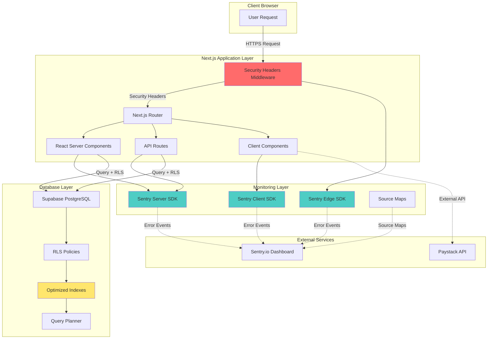
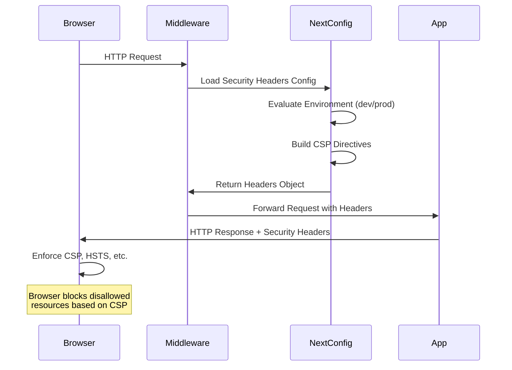
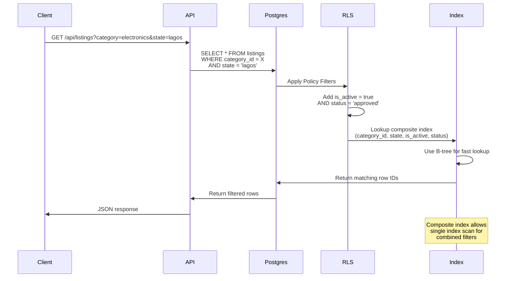
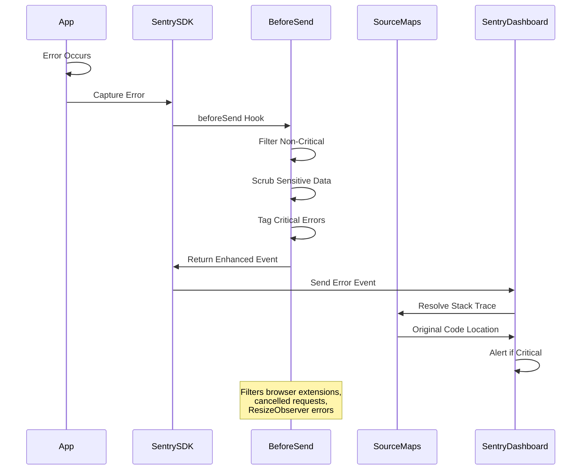

# Design Document

## Overview

This design document outlines the technical implementation for production security hardening of the Findam marketplace application. The system encompasses three critical security domains:

1. **Security Headers System**: HTTP security headers configured through Next.js to protect against common web vulnerabilities (XSS, clickjacking, MIME-type confusion)
2. **Database Performance Optimization**: Strategic indexing for Row Level Security (RLS) policies and search operations to ensure efficient query execution
3. **Error Monitoring Infrastructure**: Comprehensive Sentry integration for tracking, debugging, and alerting on production errors

The application is built with Next.js 14 App Router and uses Supabase PostgreSQL with RLS enabled on all tables. Sentry is partially configured across client, server, and edge runtime, requiring validation and enhancement to meet production standards.

**Key Design Principles:**
- Defense-in-depth security through multiple layers (headers, RLS, monitoring)
- Performance optimization through strategic indexing aligned with RLS policy filters
- Comprehensive error visibility without exposing sensitive data
- Environment-aware configuration (development vs. production)
- Zero-downtime deployment of database indexes using `CONCURRENTLY`

## Architecture

### High-Level System Architecture



### Security Headers Flow



### Database Query with RLS and Indexes



### Sentry Error Flow



## Components and Interfaces

### Component 1: Security Headers Configuration

**Location:** `next.config.ts`

**Responsibility:** Configure and inject HTTP security headers for all responses

**Interface:**

```typescript
interface SecurityHeadersConfig {
  // Content Security Policy directives
  csp: {
    defaultSrc: string[];
    scriptSrc: string[];
    styleSrc: string[];
    imgSrc: string[];
    connectSrc: string[];
    fontSrc: string[];
    objectSrc: string[];
    mediaSrc: string[];
    frameSrc: string[];
    frameAncestors: string[];
    formAction: string[];
    baseUri: string[];
    upgradeInsecureRequests: boolean;
  };
  
  // Other security headers
  hsts: {
    maxAge: number;
    includeSubDomains: boolean;
    preload: boolean;
  };
  
  xFrameOptions: 'DENY' | 'SAMEORIGIN';
  xContentTypeOptions: 'nosniff';
  referrerPolicy: string;
  permissionsPolicy: Record<string, string[]>;
}
```

**Implementation Details:**

The security headers are configured in the `headers()` function within `next.config.ts`. The configuration is environment-aware:

- **Development Mode:**
  - Includes `unsafe-eval` for script-src (Next.js Fast Refresh requirement)
  - Allows localhost WebSocket connections in connect-src
  - Enables debug logging

- **Production Mode:**
  - Strict CSP without `unsafe-eval`
  - HSTS with max-age of 2 years (63072000 seconds)
  - Removes development-specific directives

**CSP Directive Breakdown:**

| Directive | Value | Rationale |
|-----------|-------|-----------|
| `default-src` | `'self'` | Only load resources from same origin by default |
| `script-src` | `'self' 'unsafe-inline' https://js.paystack.co` | Allow inline scripts for Next.js hydration + Paystack payment gateway |
| `style-src` | `'self' 'unsafe-inline'` | Allow inline styles for styled-components and CSS-in-JS |
| `img-src` | `'self' data: blob: https: *.supabase.co` | Allow images from Supabase storage, Cloudinary, data URIs |
| `connect-src` | `'self' *.supabase.co https://api.paystack.co` | Allow API calls to Supabase and Paystack |
| `font-src` | `'self' data:` | Allow fonts from same origin and data URIs |
| `object-src` | `'none'` | Block plugins (Flash, Java applets) |
| `frame-src` | `'self' https://js.paystack.co` | Allow iframes for Paystack payment widget |
| `frame-ancestors` | `'none'` | Prevent clickjacking by disallowing embedding |
| `form-action` | `'self'` | Only allow form submissions to same origin |
| `base-uri` | `'self'` | Restrict base tag to same origin |
| `upgrade-insecure-requests` | - | Automatically upgrade HTTP to HTTPS |

**Header Application Strategy:**

```typescript
// Applied to all routes
{
  source: '/:path*',
  headers: [
    { key: 'Strict-Transport-Security', value: '...' },
    { key: 'X-Frame-Options', value: 'SAMEORIGIN' },
    { key: 'X-Content-Type-Options', value: 'nosniff' },
    { key: 'Referrer-Policy', value: 'origin-when-cross-origin' },
    { key: 'Permissions-Policy', value: '...' },
    { key: 'Content-Security-Policy', value: '...' }
  ]
}

// CORS headers for API routes
{
  source: '/api/:path*',
  headers: [
    { key: 'Access-Control-Allow-Origin', value: '...' },
    { key: 'Access-Control-Allow-Methods', value: '...' },
    // ... other CORS headers
  ]
}
```

### Component 2: Database Index Optimizer

**Location:** `supabase/migrations/058_security_hardening_indexes.sql`

**Responsibility:** Create optimized indexes for RLS policy columns and frequently filtered columns

**Index Strategy:**

The index design follows these principles based on [Supabase RLS performance guidance](https://supabase.com/docs/guides/database/postgres/row-level-security-performance):

1. **Index RLS policy columns first** - Columns used in WHERE clauses of RLS policies must be indexed
2. **Composite indexes for combined filters** - When multiple columns are frequently filtered together, create composite indexes
3. **Use CONCURRENTLY for zero-downtime** - All index creation uses `CREATE INDEX CONCURRENTLY` to avoid table locks
4. **Index selectivity** - Choose columns with high selectivity (many distinct values) first in composite indexes

**RLS Policy Column Indexes:**

From the RLS policies in `057_rls_policies_listings.sql`, these columns are filtered in policies:

```sql
-- Listings table RLS policies filter on:
-- 1. status = 'approved' AND is_active = true (public read)
-- 2. user_id = auth.uid() (owner read/write)

-- Product/Service listings RLS policies filter on:
-- 1. is_active = true (public read)
-- 2. business_profile_id (owner check via subquery)
```

**Index Definitions:**

```sql
-- Single-column indexes for RLS policy filters
CREATE INDEX CONCURRENTLY idx_listings_user_id ON listings(user_id);
CREATE INDEX CONCURRENTLY idx_listings_status ON listings(status);
CREATE INDEX CONCURRENTLY idx_listings_is_active ON listings(is_active);

-- Composite index for public listing queries (RLS policy: status='approved' AND is_active=true)
CREATE INDEX CONCURRENTLY idx_listings_status_active 
  ON listings(status, is_active) 
  WHERE status = 'approved' AND is_active = true;

-- Composite indexes for category browsing with RLS filters
CREATE INDEX CONCURRENTLY idx_listings_category_browse 
  ON listings(category_id, state, is_active, status)
  WHERE is_active = true AND status = 'approved';

-- Composite indexes for location browsing with RLS filters
CREATE INDEX CONCURRENTLY idx_listings_location_browse 
  ON listings(state, lga, is_active, status)
  WHERE is_active = true AND status = 'approved';

-- Product listings indexes
CREATE INDEX CONCURRENTLY idx_product_listings_active 
  ON product_listings(is_active);
CREATE INDEX CONCURRENTLY idx_product_listings_business 
  ON product_listings(business_profile_id);

-- Service listings indexes
CREATE INDEX CONCURRENTLY idx_service_listings_active 
  ON service_listings(is_active);
CREATE INDEX CONCURRENTLY idx_service_listings_business 
  ON service_listings(business_profile_id);
```

**Index Selection Logic:**

The query planner will choose these indexes based on the query pattern:

| Query Pattern | Index Used | Reason |
|---------------|-----------|--------|
| `WHERE user_id = X` | `idx_listings_user_id` | Single column lookup (owner queries) |
| `WHERE status = 'approved' AND is_active = true` | `idx_listings_status_active` | Partial index optimized for public queries |
| `WHERE category_id = X AND state = Y AND is_active = true AND status = 'approved'` | `idx_listings_category_browse` | Composite index covers all filters |
| `WHERE state = X AND lga = Y AND is_active = true AND status = 'approved'` | `idx_listings_location_browse` | Composite index covers location filters |

**Partial Indexes:**

The `idx_listings_status_active`, `idx_listings_category_browse`, and `idx_listings_location_browse` indexes use `WHERE` clauses to create partial indexes. These are smaller and faster than full indexes because they only index rows that match the public listing criteria (`is_active = true AND status = 'approved'`).

**Benefits:**
- Smaller index size (reduced storage)
- Faster index scans (fewer entries to scan)
- Better cache efficiency (index fits in memory)

### Component 3: Sentry Client Configuration

**Location:** `sentry.client.config.ts`

**Responsibility:** Capture and report client-side errors, session replays, and performance metrics

**Configuration:**

```typescript
interface SentryClientConfig {
  dsn: string;
  environment: string;
  tracesSampleRate: number;
  replaysSessionSampleRate: number;
  replaysOnErrorSampleRate: number;
  profilesSampleRate: number;
  
  integrations: [
    ReplayIntegration,
    BrowserTracingIntegration,
    BrowserProfilingIntegration
  ];
  
  beforeSend: (event: ErrorEvent, hint: EventHint) => ErrorEvent | null;
  ignoreErrors: string[];
  denyUrls: RegExp[];
}
```

**Error Filtering Strategy:**

The `beforeSend` hook implements sophisticated filtering:

1. **Filter by error level:**
   - Ignore `warning` level in production
   - Capture all errors in development for debugging

2. **Filter non-critical patterns:**
   - Network errors (failed to fetch, load failed)
   - Cancelled requests (AbortError)
   - Browser extension errors
   - ResizeObserver loop exceeded
   - Chunk load errors (code splitting race conditions)

3. **Tag critical patterns:**
   - Payment failures → `level: fatal`, `critical: true`
   - Authentication failures → `level: fatal`, `critical: true`
   - Security breaches → `level: fatal`, `critical: true`

**Session Replay Configuration:**

```typescript
Sentry.replayIntegration({
  maskAllText: true,              // Mask all text content for privacy
  blockAllMedia: true,             // Block images/videos from replay
  networkDetailAllowUrls: [        // Capture network requests to these origins
    window.location.origin,
    process.env.NEXT_PUBLIC_SUPABASE_URL
  ]
})
```

- **10% of normal sessions** are recorded
- **100% of error sessions** are recorded
- Privacy-first approach: mask text and block media by default

**Performance Monitoring:**

The `browserTracingIntegration` captures:
- Page load performance
- Navigation timing
- Core Web Vitals (LCP, FID, CLS)
- Long tasks (> 50ms)

### Component 4: Sentry Server Configuration

**Location:** `sentry.server.config.ts`

**Responsibility:** Capture and report server-side errors from React Server Components and API routes

**Configuration:**

```typescript
interface SentryServerConfig {
  dsn: string;
  environment: string;
  tracesSampleRate: number;
  profilesSampleRate: number;
  
  beforeSend: (event: ErrorEvent, hint: EventHint) => ErrorEvent | null;
  ignoreErrors: string[];
  ignoreTransactions: string[];
}
```

**Server-Specific Error Handling:**

The server configuration differs from client in these ways:

1. **No session replay** - Not applicable for server-side
2. **Enhanced request context:**
   - Node.js version, platform, architecture
   - Request URL, method, headers
   - Request body for API routes (scrubbed of sensitive data)

3. **Different non-critical patterns:**
   - Connection errors (ECONNREFUSED, ENOTFOUND, ETIMEDOUT)
   - Socket hang ups
   - Network errors (common in development with hot reload)

**Critical Error Tagging:**

Same critical patterns as client, with additions:
- Database connection failures
- Data corruption errors
- Unauthorized access attempts

**Transaction Filtering:**

```typescript
ignoreTransactions: ['/api/health', '/api/ping']
```

Health check and ping endpoints are excluded from transaction sampling to avoid inflating quota usage.

### Component 5: Sentry Edge Configuration

**Location:** `sentry.edge.config.ts`

**Responsibility:** Capture errors from Next.js middleware (Edge runtime)

**Configuration:**

Edge runtime has limitations compared to Node.js:
- No file system access
- No Node.js APIs
- Limited `beforeSend` capabilities

The configuration is minimal:

```typescript
Sentry.init({
  dsn: process.env.NEXT_PUBLIC_SENTRY_DSN,
  tracesSampleRate: process.env.NODE_ENV === "production" ? 0.1 : 1.0,
  environment: process.env.NODE_ENV || "development",
});
```

### Component 6: Source Map Upload

**Location:** `next.config.ts` + Sentry Webpack Plugin

**Responsibility:** Upload source maps to Sentry during build for readable stack traces in production

**Configuration:**

Source maps are configured via the `@sentry/nextjs` Webpack plugin (auto-configured when Sentry is installed):

```typescript
// Automatically configured by @sentry/nextjs
{
  productionBrowserSourceMaps: false,  // Don't expose source maps publicly
  
  // Sentry plugin configuration (in sentry.properties or environment variables)
  SENTRY_AUTH_TOKEN: process.env.SENTRY_AUTH_TOKEN,
  SENTRY_ORG: process.env.SENTRY_ORG,
  SENTRY_PROJECT: process.env.SENTRY_PROJECT,
}
```

**Source Map Upload Strategy:**

1. **Build time:** During `npm run build`, Next.js generates source maps
2. **Upload:** Sentry Webpack plugin uploads source maps to Sentry
3. **Release tagging:** Each upload is tagged with git commit SHA + release version
4. **Cleanup:** Source maps are deleted from public build artifacts
5. **Association:** Sentry associates uploaded source maps with error events based on release version

**Environment Variables Required:**

```bash
SENTRY_AUTH_TOKEN=sntrys_xxxxx                    # Sentry API token
SENTRY_ORG=your-org                               # Sentry organization slug
SENTRY_PROJECT=your-project                       # Sentry project slug
NEXT_PUBLIC_SENTRY_DSN=https://xxx@sentry.io/xxx # Public DSN for error reporting
```

### Component 7: Error Boundary Components

**Location:** `app/error.tsx`, `app/(main)/error.tsx`, `app/(admin)/admin/error.tsx`

**Responsibility:** Catch React errors and report to Sentry while showing user-friendly error UI

**Implementation:**

Next.js 14 uses file-based error boundaries. Each route group can have an `error.tsx` file:

```typescript
'use client';

import { useEffect } from 'react';
import * as Sentry from '@sentry/nextjs';

export default function Error({
  error,
  reset,
}: {
  error: Error & { digest?: string };
  reset: () => void;
}) {
  useEffect(() => {
    // Log error to Sentry
    Sentry.captureException(error);
  }, [error]);

  return (
    <div className="error-boundary">
      <h2>Something went wrong!</h2>
      <button onClick={reset}>Try again</button>
    </div>
  );
}
```

**Error Boundary Hierarchy:**

```
app/
  error.tsx                    # Root error boundary (catches all unhandled errors)
  (main)/
    error.tsx                 # Main layout errors
    (listings)/
      error.tsx               # Listing-specific errors
  (admin)/
    admin/
      error.tsx               # Admin panel errors
```

Errors bubble up to the nearest error boundary in the hierarchy.

### Component 8: Security Headers Validation Script

**Location:** `scripts/validate-security-headers.ts`

**Responsibility:** Validate that security headers are correctly configured in all environments

**Interface:**

```typescript
interface SecurityHeaderValidation {
  // Check if header exists
  hasHeader(name: string): boolean;
  
  // Check header value
  validateValue(name: string, expectedValue: string): boolean;
  
  // Check CSP directives
  validateCSP(directives: Record<string, string[]>): ValidationResult;
  
  // Check HSTS configuration
  validateHSTS(minMaxAge: number): ValidationResult;
  
  // Generate validation report
  generateReport(): SecurityHeaderReport;
}

interface ValidationResult {
  valid: boolean;
  errors: string[];
  warnings: string[];
}

interface SecurityHeaderReport {
  endpoint: string;
  timestamp: string;
  headers: Record<string, string>;
  validation: {
    csp: ValidationResult;
    hsts: ValidationResult;
    xFrameOptions: ValidationResult;
    xContentTypeOptions: ValidationResult;
    referrerPolicy: ValidationResult;
    permissionsPolicy: ValidationResult;
  };
  summary: {
    passed: number;
    failed: number;
    warnings: number;
  };
}
```

**Validation Logic:**

```typescript
// 1. Fetch headers from test endpoint
const response = await fetch('https://app.com/api/test');
const headers = Object.fromEntries(response.headers);

// 2. Validate required headers exist
const requiredHeaders = [
  'content-security-policy',
  'strict-transport-security',
  'x-frame-options',
  'x-content-type-options',
  'referrer-policy',
  'permissions-policy'
];

for (const header of requiredHeaders) {
  if (!headers[header]) {
    errors.push(`Missing required header: ${header}`);
  }
}

// 3. Validate CSP directives
const csp = parseCSP(headers['content-security-policy']);
if (!csp['default-src'].includes("'self'")) {
  errors.push("CSP default-src must include 'self'");
}
if (!csp['frame-ancestors'].includes("'none'")) {
  errors.push("CSP frame-ancestors should be 'none' to prevent clickjacking");
}

// 4. Validate HSTS max-age
const hsts = parseHSTS(headers['strict-transport-security']);
if (hsts.maxAge < 31536000) {
  warnings.push("HSTS max-age should be at least 31536000 (1 year)");
}

// 5. Generate report
return generateReport(headers, errors, warnings);
```

### Component 9: Database Index Verification Script

**Location:** `scripts/verify-database-indexes.ts`

**Responsibility:** Query database to verify all required indexes exist

**Interface:**

```typescript
interface DatabaseIndexVerification {
  // List all indexes on a table
  listIndexes(tableName: string): Promise<IndexInfo[]>;
  
  // Check if specific index exists
  hasIndex(tableName: string, indexName: string): Promise<boolean>;
  
  // Verify all required indexes
  verifyRequiredIndexes(): Promise<VerificationResult>;
  
  // Generate verification report
  generateReport(): Promise<IndexVerificationReport>;
}

interface IndexInfo {
  schemaName: string;
  tableName: string;
  indexName: string;
  indexDef: string;
  columns: string[];
  isUnique: boolean;
  isPartial: boolean;
}

interface VerificationResult {
  valid: boolean;
  missingIndexes: string[];
  extraIndexes: string[];
}

interface IndexVerificationReport {
  timestamp: string;
  tables: {
    tableName: string;
    requiredIndexes: string[];
    existingIndexes: IndexInfo[];
    missing: string[];
  }[];
  summary: {
    totalRequired: number;
    totalExisting: number;
    totalMissing: number;
  };
}
```

**Verification Queries:**

```sql
-- List all indexes on listings table
SELECT
  schemaname,
  tablename,
  indexname,
  indexdef
FROM pg_indexes
WHERE tablename = 'listings'
  AND schemaname = 'public'
ORDER BY indexname;

-- Check index columns
SELECT
  i.relname AS index_name,
  a.attname AS column_name,
  a.attnum AS column_position
FROM pg_index idx
JOIN pg_class i ON i.oid = idx.indexrelid
JOIN pg_class t ON t.oid = idx.indrelid
JOIN pg_attribute a ON a.attrelid = t.oid AND a.attnum = ANY(idx.indkey)
WHERE t.relname = 'listings'
  AND i.relname = 'idx_listings_category_browse'
ORDER BY a.attnum;
```

**Verification Logic:**

```typescript
const requiredIndexes = {
  listings: [
    'idx_listings_user_id',
    'idx_listings_status',
    'idx_listings_is_active',
    'idx_listings_status_active',
    'idx_listings_category_browse',
    'idx_listings_location_browse',
  ],
  product_listings: [
    'idx_product_listings_active',
    'idx_product_listings_business',
  ],
  service_listings: [
    'idx_service_listings_active',
    'idx_service_listings_business',
  ],
};

for (const [table, indexes] of Object.entries(requiredIndexes)) {
  const existingIndexes = await listIndexes(table);
  const existingNames = existingIndexes.map(i => i.indexName);
  
  for (const requiredIndex of indexes) {
    if (!existingNames.includes(requiredIndex)) {
      missingIndexes.push(`${table}.${requiredIndex}`);
    }
  }
}
```

## Data Models

### Index Definitions

**Listings Table Indexes:**

```sql
-- Primary Key (auto-created)
PRIMARY KEY (id)

-- Foreign Keys (auto-indexed)
FOREIGN KEY (user_id) REFERENCES auth.users(id)
FOREIGN KEY (category_id) REFERENCES categories(id)
FOREIGN KEY (subcategory_id) REFERENCES subcategories(id)

-- RLS Policy Indexes
idx_listings_user_id: B-tree (user_id)
  - Used by: "Users can view own listings" policy
  - Selectivity: High (many users)
  - Size estimate: ~10-20 MB per 1M rows

idx_listings_status: B-tree (status)
  - Used by: "Public can view approved listings" policy
  - Selectivity: Low (few status values: draft, pending, approved, rejected)
  - Size estimate: ~5 MB per 1M rows

idx_listings_is_active: B-tree (is_active)
  - Used by: "Public can view approved listings" policy
  - Selectivity: Very low (boolean: true/false)
  - Size estimate: ~3 MB per 1M rows

-- Composite Partial Index for Public Queries
idx_listings_status_active: B-tree (status, is_active)
  WHERE status = 'approved' AND is_active = true
  - Used by: Public listing queries with RLS
  - Selectivity: High (only approved active listings)
  - Size estimate: ~5-8 MB per 1M rows (much smaller due to WHERE clause)
  - Performance: Eliminates "Rows Removed by Filter" in EXPLAIN output

-- Composite Indexes for Search/Browse
idx_listings_category_browse: B-tree (category_id, state, is_active, status)
  WHERE is_active = true AND status = 'approved'
  - Used by: Category browse pages with location filter
  - Selectivity: High (category × state combinations)
  - Size estimate: ~10-15 MB per 1M rows
  - Query pattern: "Show me approved active listings in Electronics category in Lagos"

idx_listings_location_browse: B-tree (state, lga, is_active, status)
  WHERE is_active = true AND status = 'approved'
  - Used by: Location browse pages
  - Selectivity: Very high (state × LGA combinations)
  - Size estimate: ~10-15 MB per 1M rows
  - Query pattern: "Show me all approved active listings in Lagos, Ikeja LGA"

-- Search Indexes
idx_listings_category: B-tree (category_id)
  - Used by: Simple category filter queries
  - Selectivity: Medium (dozens of categories)
  - Size estimate: ~5 MB per 1M rows

idx_listings_subcategory: B-tree (subcategory_id)
  - Used by: Subcategory filter queries
  - Selectivity: High (hundreds of subcategories)
  - Size estimate: ~5-8 MB per 1M rows

idx_listings_state: B-tree (state)
  - Used by: State filter queries
  - Selectivity: Low (36 Nigerian states)
  - Size estimate: ~5 MB per 1M rows

idx_listings_lga: B-tree (lga)
  - Used by: LGA filter queries
  - Selectivity: High (774 LGAs in Nigeria)
  - Size estimate: ~5-8 MB per 1M rows

-- Full-Text Search Index
idx_listings_search: GIN (search_vector)
  - Used by: Full-text search queries
  - Type: GIN (Generalized Inverted Index)
  - Size estimate: ~20-40 MB per 1M rows (larger due to GIN structure)
  - Query pattern: "Search for 'samsung galaxy' in title and description"
```

**Product Listings Table Indexes:**

```sql
-- Primary Key (auto-created)
PRIMARY KEY (id)

-- Foreign Key (auto-indexed)
FOREIGN KEY (business_profile_id) REFERENCES business_profiles(id)

-- RLS Policy Indexes
idx_product_listings_active: B-tree (is_active)
  - Used by: "Public can view active products" policy
  - Selectivity: Very low (boolean)
  - Size estimate: ~2 MB per 100K rows

idx_product_listings_business: B-tree (business_profile_id)
  - Used by: "Business owners can manage products" policy
  - Selectivity: High (many businesses)
  - Size estimate: ~3-5 MB per 100K rows
```

**Service Listings Table Indexes:**

```sql
-- Primary Key (auto-created)
PRIMARY KEY (id)

-- Foreign Key (auto-indexed)
FOREIGN KEY (business_profile_id) REFERENCES business_profiles(id)

-- RLS Policy Indexes
idx_service_listings_active: B-tree (is_active)
  - Used by: "Public can view active services" policy
  - Selectivity: Very low (boolean)
  - Size estimate: ~2 MB per 100K rows

idx_service_listings_business: B-tree (business_profile_id)
  - Used by: "Business owners can manage services" policy
  - Selectivity: High (many businesses)
  - Size estimate: ~3-5 MB per 100K rows
```

### Index Size Estimates

| Index Name | Table | Estimated Size (1M rows) | Selectivity | Priority |
|------------|-------|------------------------|-------------|----------|
| `idx_listings_user_id` | listings | 15 MB | High | Critical |
| `idx_listings_status_active` | listings | 6 MB | High | Critical |
| `idx_listings_category_browse` | listings | 12 MB | High | High |
| `idx_listings_location_browse` | listings | 12 MB | Very High | High |
| `idx_listings_search` | listings | 30 MB | N/A | Medium |
| `idx_listings_category` | listings | 5 MB | Medium | Medium |
| `idx_listings_subcategory` | listings | 6 MB | High | Medium |
| `idx_listings_state` | listings | 5 MB | Low | Low |
| `idx_listings_lga` | listings | 6 MB | High | Low |

**Total Estimated Index Size:** ~97 MB per 1M listings

### Sentry Event Data Model

**Error Event Structure:**

```typescript
interface SentryErrorEvent {
  // Event identification
  event_id: string;
  timestamp: number;
  platform: 'javascript' | 'node';
  
  // Error details
  exception: {
    values: [{
      type: string;           // Error type (e.g., "TypeError")
      value: string;          // Error message
      stacktrace: {
        frames: StackFrame[];
      };
    }];
  };
  
  // Context
  contexts: {
    browser?: {
      name: string;
      version: string;
      viewport: {
        width: number;
        height: number;
      };
    };
    device?: {
      online: boolean;
      memory: number;
    };
    server?: {
      node_version: string;
      platform: string;
      arch: string;
    };
  };
  
  // Request context
  request?: {
    url: string;
    method: string;
    headers: Record<string, string>;
    data: any;  // Scrubbed of sensitive data
  };
  
  // User context (PII removed)
  user?: {
    id: string;
    // email and name removed by beforeSend
  };
  
  // Tags for filtering/alerting
  tags: {
    environment: 'development' | 'staging' | 'production';
    critical?: 'true';
    alert?: 'immediate';
    [key: string]: string;
  };
  
  // Release tracking
  release: string;  // Git commit SHA
  
  // Transaction sampling
  transaction: string;  // Route name
  
  // Breadcrumbs (user actions leading to error)
  breadcrumbs: Breadcrumb[];
}

interface StackFrame {
  filename: string;
  function: string;
  lineno: number;
  colno: number;
  in_app: boolean;  // true for app code, false for vendor code
  
  // Source map resolved (if available)
  abs_path?: string;
  pre_context?: string[];
  context_line?: string;
  post_context?: string[];
}

interface Breadcrumb {
  timestamp: number;
  category: string;  // 'navigation', 'xhr', 'console', 'ui.click'
  message: string;
  level: 'info' | 'warning' | 'error';
  data?: Record<string, any>;
}
```

**Transaction Event Structure:**

```typescript
interface SentryTransactionEvent {
  // Event identification
  event_id: string;
  timestamp: number;
  type: 'transaction';
  
  // Transaction details
  transaction: string;  // Route name (e.g., "/listings/[id]")
  transaction_info: {
    source: 'route' | 'url' | 'custom';
  };
  
  // Performance metrics
  start_timestamp: number;
  timestamp: number;
  
  // Spans (sub-operations)
  spans: Span[];
  
  // Measurements (Core Web Vitals)
  measurements: {
    lcp?: { value: number, unit: 'millisecond' };
    fid?: { value: number, unit: 'millisecond' };
    cls?: { value: number, unit: '' };
    fcp?: { value: number, unit: 'millisecond' };
    ttfb?: { value: number, unit: 'millisecond' };
  };
  
  // Context
  contexts: {
    browser?: BrowserContext;
    device?: DeviceContext;
  };
  
  // Tags
  tags: {
    environment: string;
    [key: string]: string;
  };
  
  // Release tracking
  release: string;
}

interface Span {
  span_id: string;
  parent_span_id?: string;
  trace_id: string;
  op: string;  // 'http.client', 'db.query', 'render'
  description: string;
  start_timestamp: number;
  timestamp: number;
  status: 'ok' | 'cancelled' | 'internal_error';
  tags?: Record<string, string>;
}
```

**Session Replay Data Model:**

```typescript
interface SentryReplay {
  // Replay identification
  replay_id: string;
  timestamp: number;
  
  // Replay type
  replay_type: 'session' | 'error';
  
  // Recording data
  events: ReplayEvent[];  // DOM mutations, mouse movements, clicks
  
  // Associated errors
  error_ids: string[];
  
  // Session metadata
  session: {
    started: number;
    duration: number;
    url: string;
    user_agent: string;
  };
  
  // Privacy settings applied
  privacy: {
    mask_all_text: boolean;
    block_all_media: boolean;
  };
}
```

## Error Handling

### Client-Side Error Handling

**1. React Error Boundaries:**

Error boundaries catch errors during render, in lifecycle methods, and in constructors:

```typescript
// app/error.tsx
'use client';

export default function Error({ error, reset }: ErrorProps) {
  useEffect(() => {
    Sentry.captureException(error);
  }, [error]);
  
  return (
    <div>
      <h2>Something went wrong</h2>
      <button onClick={reset}>Try again</button>
    </div>
  );
}
```

**2. Async Error Handling:**

Errors in async functions (API calls, data fetching) are caught with try-catch:

```typescript
async function fetchListings() {
  try {
    const response = await fetch('/api/listings');
    const data = await response.json();
    return data;
  } catch (error) {
    // Sentry automatically captures unhandled promise rejections
    // Manual capture for additional context:
    Sentry.captureException(error, {
      tags: { component: 'listings-fetch' },
      extra: { endpoint: '/api/listings' }
    });
    throw error;
  }
}
```

**3. Event Handler Errors:**

Errors in event handlers are captured automatically by Sentry's global error handler:

```typescript
function handleSubmit(event: FormEvent) {
  event.preventDefault();
  // Any errors thrown here are captured by Sentry
  processFormData(formData);
}
```

### Server-Side Error Handling

**1. API Route Errors:**

API routes use try-catch with Sentry capture:

```typescript
// app/api/listings/route.ts
export async function GET(request: Request) {
  try {
    const listings = await fetchListings();
    return Response.json(listings);
  } catch (error) {
    Sentry.captureException(error, {
      tags: { route: '/api/listings' },
      extra: { 
        method: request.method,
        url: request.url 
      }
    });
    
    return Response.json(
      { error: 'Failed to fetch listings' },
      { status: 500 }
    );
  }
}
```

**2. Server Component Errors:**

Server components throw errors that are caught by the nearest error boundary:

```typescript
// app/(main)/listings/page.tsx
export default async function ListingsPage() {
  // Errors here are caught by app/(main)/error.tsx
  const listings = await fetchListings();
  
  return <ListingGrid listings={listings} />;
}
```

**3. Middleware Errors:**

Middleware errors are captured by Sentry Edge SDK:

```typescript
// middleware.ts
import * as Sentry from '@sentry/nextjs';

export async function middleware(request: NextRequest) {
  try {
    // Security checks
    validateHeaders(request);
    
    return NextResponse.next();
  } catch (error) {
    Sentry.captureException(error);
    return new NextResponse('Forbidden', { status: 403 });
  }
}
```

### Database Error Handling

**1. RLS Policy Violations:**

RLS policy violations throw PostgreSQL errors that are captured:

```typescript
try {
  await supabase
    .from('listings')
    .update({ status: 'approved' })
    .eq('id', listingId);
} catch (error) {
  // Error: new row violates row-level security policy
  if (error.code === '42501') {  // insufficient_privilege
    Sentry.captureException(error, {
      tags: { error_type: 'rls_violation' },
      extra: { listing_id: listingId }
    });
  }
}
```

**2. Index Missing Warnings:**

Slow queries due to missing indexes are detected via query performance monitoring:

```typescript
// Log slow queries (development)
if (queryTime > 1000) {
  console.warn(`Slow query detected: ${queryTime}ms`);
  Sentry.captureMessage('Slow query', {
    level: 'warning',
    tags: { query_type: 'listings_fetch' },
    extra: { 
      query_time: queryTime,
      table: 'listings',
      filters: { category, state }
    }
  });
}
```

### CSP Violation Reporting

**CSP Report Endpoint:**

CSP violations are reported to a dedicated endpoint:

```typescript
// app/api/csp-report/route.ts
export async function POST(request: Request) {
  const report = await request.json();
  
  // Log CSP violation to Sentry
  Sentry.captureMessage('CSP Violation', {
    level: 'warning',
    tags: { 
      violation_type: 'csp',
      blocked_uri: report['csp-report']['blocked-uri'],
      violated_directive: report['csp-report']['violated-directive']
    },
    extra: report
  });
  
  return new Response(null, { status: 204 });
}
```

**CSP Header Configuration:**

```typescript
const cspDirectives = [
  // ... other directives
  "report-uri /api/csp-report",
  "report-to csp-endpoint"
].join('; ');
```

## Testing Strategy

### Unit Tests

**1. Security Headers Validation:**

```typescript
// __tests__/security-headers.test.ts
describe('Security Headers', () => {
  it('should return CSP header for all routes', async () => {
    const response = await fetch('http://localhost:3000/');
    const csp = response.headers.get('content-security-policy');
    
    expect(csp).toBeTruthy();
    expect(csp).toContain("default-src 'self'");
    expect(csp).toContain("frame-ancestors 'none'");
  });
  
  it('should return HSTS header with correct max-age', async () => {
    const response = await fetch('https://app.com/');
    const hsts = response.headers.get('strict-transport-security');
    
    expect(hsts).toBeTruthy();
    expect(hsts).toContain('max-age=63072000');
    expect(hsts).toContain('includeSubDomains');
  });
  
  it('should remove X-Powered-By header', async () => {
    const response = await fetch('http://localhost:3000/');
    const poweredBy = response.headers.get('x-powered-by');
    
    expect(poweredBy).toBeNull();
  });
});
```

**2. Sentry Error Filtering:**

```typescript
// __tests__/sentry-filtering.test.ts
import { beforeSend } from '@/sentry.client.config';

describe('Sentry Error Filtering', () => {
  it('should filter browser extension errors', () => {
    const event = {
      message: 'chrome-extension://xyz failed to load',
      level: 'error'
    };
    
    const result = beforeSend(event, {});
    expect(result).toBeNull();
  });
  
  it('should tag critical payment errors', () => {
    const event = {
      message: 'Payment failed: card declined',
      level: 'error'
    };
    
    const result = beforeSend(event, {});
    expect(result.level).toBe('fatal');
    expect(result.tags.critical).toBe('true');
  });
  
  it('should scrub PII from user context', () => {
    const event = {
      user: {
        id: '123',
        email: 'user@example.com',
        name: 'John Doe'
      }
    };
    
    const result = beforeSend(event, {});
    expect(result.user.id).toBe('123');
    expect(result.user.email).toBeUndefined();
    expect(result.user.name).toBeUndefined();
  });
});
```

**3. Database Index Verification:**

```typescript
// __tests__/database-indexes.test.ts
describe('Database Indexes', () => {
  it('should have index on listings.user_id', async () => {
    const { data } = await supabase.rpc('get_indexes', { 
      table_name: 'listings' 
    });
    
    const userIdIndex = data.find(idx => 
      idx.index_name === 'idx_listings_user_id'
    );
    
    expect(userIdIndex).toBeTruthy();
    expect(userIdIndex.columns).toContain('user_id');
  });
  
  it('should have composite index for category browsing', async () => {
    const { data } = await supabase.rpc('get_indexes', { 
      table_name: 'listings' 
    });
    
    const categoryIndex = data.find(idx => 
      idx.index_name === 'idx_listings_category_browse'
    );
    
    expect(categoryIndex).toBeTruthy();
    expect(categoryIndex.columns).toEqual([
      'category_id', 'state', 'is_active', 'status'
    ]);
  });
});
```

### Integration Tests

**1. End-to-End Header Validation:**

```typescript
// e2e/security-headers.spec.ts
import { test, expect } from '@playwright/test';

test('should enforce security headers on production', async ({ page }) => {
  const response = await page.goto('https://app.com/');
  
  const headers = response.headers();
  
  expect(headers['content-security-policy']).toBeTruthy();
  expect(headers['strict-transport-security']).toBeTruthy();
  expect(headers['x-frame-options']).toBe('SAMEORIGIN');
  expect(headers['x-content-type-options']).toBe('nosniff');
});
```

**2. RLS + Index Performance Test:**

```typescript
// e2e/database-performance.spec.ts
test('should efficiently query listings with RLS', async ({ page }) => {
  // Login as regular user
  await page.goto('/login');
  await login(page, 'user@example.com', 'password');
  
  // Measure query time for public listings
  const startTime = Date.now();
  await page.goto('/listings?category=electronics&state=lagos');
  const endTime = Date.now();
  
  const queryTime = endTime - startTime;
  
  // Query should complete in < 1 second with indexes
  expect(queryTime).toBeLessThan(1000);
});
```

**3. Sentry Error Capture Test:**

```typescript
// e2e/error-monitoring.spec.ts
test('should capture and report errors to Sentry', async ({ page }) => {
  // Trigger an error
  await page.goto('/listings/invalid-id');
  
  // Wait for error to be sent to Sentry
  await page.waitForTimeout(2000);
  
  // Verify error appears in Sentry (requires Sentry API access)
  const sentryEvents = await fetchSentryEvents();
  const errorEvent = sentryEvents.find(e => 
    e.transaction === '/listings/[id]'
  );
  
  expect(errorEvent).toBeTruthy();
  expect(errorEvent.level).toBe('error');
});
```

### Manual Testing

**1. CSP Violation Testing:**

- Open browser DevTools Console
- Try to load a script from an unauthorized domain:
  ```javascript
  const script = document.createElement('script');
  script.src = 'https://evil.com/malicious.js';
  document.body.appendChild(script);
  ```
- Verify CSP blocks the script and logs violation to console
- Check that violation is reported to `/api/csp-report`

**2. HSTS Testing:**

- Access site over HTTP: `http://app.com`
- Verify browser automatically upgrades to HTTPS
- Check HSTS header in DevTools Network tab
- Verify `Strict-Transport-Security` header includes `max-age` and `includeSubDomains`

**3. Index Performance Testing:**

Run EXPLAIN ANALYZE queries to verify indexes are used:

```sql
-- Test 1: Public listing query uses idx_listings_status_active
EXPLAIN ANALYZE
SELECT * FROM listings
WHERE status = 'approved' AND is_active = true
LIMIT 20;

-- Expected: Index Scan using idx_listings_status_active
-- Rows Removed by Filter: 0

-- Test 2: Category browse uses idx_listings_category_browse
EXPLAIN ANALYZE
SELECT * FROM listings
WHERE category_id = 5
  AND state = 'Lagos'
  AND is_active = true
  AND status = 'approved'
LIMIT 20;

-- Expected: Index Scan using idx_listings_category_browse
-- Rows Removed by Filter: 0

-- Test 3: Owner query uses idx_listings_user_id
EXPLAIN ANALYZE
SELECT * FROM listings
WHERE user_id = 'user-uuid-here';

-- Expected: Index Scan using idx_listings_user_id
```

**4. Sentry Session Replay Testing:**

- Perform actions that trigger errors (e.g., submit invalid form)
- Navigate to Sentry dashboard
- Find the error event
- Click "Replay" to watch session recording
- Verify text is masked and media is blocked
- Verify breadcrumbs show user actions leading to error

## Deployment Strategy

### Database Migration Deployment

**Zero-Downtime Index Creation:**

All indexes use `CREATE INDEX CONCURRENTLY` to avoid table locks:

```sql
-- Migration 058: Security Hardening Indexes
BEGIN;

-- Create indexes concurrently (can't be in transaction block)
COMMIT;

-- Indexes must be created outside transaction
CREATE INDEX CONCURRENTLY IF NOT EXISTS idx_listings_user_id 
  ON listings(user_id);

CREATE INDEX CONCURRENTLY IF NOT EXISTS idx_listings_status_active 
  ON listings(status, is_active) 
  WHERE status = 'approved' AND is_active = true;

-- ... other indexes

-- Verify indexes were created
SELECT schemaname, tablename, indexname, indexdef
FROM pg_indexes
WHERE tablename IN ('listings', 'product_listings', 'service_listings')
  AND schemaname = 'public'
ORDER BY tablename, indexname;
```

**Deployment Steps:**

1. **Pre-deployment verification:**
   ```bash
   # Check current index count
   npm run db:verify:indexes
   
   # Check current query performance
   npm run db:analyze:queries
   ```

2. **Apply migration:**
   ```bash
   # Apply to staging first
   supabase db push --db-url $STAGING_DATABASE_URL
   
   # Verify indexes created
   npm run db:verify:indexes
   
   # Run performance tests
   npm run perf:check
   ```

3. **Monitor performance:**
   - Watch query execution times in logs
   - Check for "Rows Removed by Filter" in slow query logs
   - Monitor index usage with `pg_stat_user_indexes`

4. **Apply to production:**
   ```bash
   supabase db push --db-url $PRODUCTION_DATABASE_URL
   ```

**Rollback Plan:**

If indexes cause performance issues:

```sql
-- Drop problematic index
DROP INDEX CONCURRENTLY idx_listings_category_browse;

-- Recreate with different column order
CREATE INDEX CONCURRENTLY idx_listings_category_browse_v2
  ON listings(state, category_id, is_active, status)
  WHERE is_active = true AND status = 'approved';
```

### Next.js Configuration Deployment

**Security Headers Update:**

1. **Update `next.config.ts`:**
   - Add/modify CSP directives
   - Update HSTS max-age
   - Add Permissions-Policy restrictions

2. **Build and test locally:**
   ```bash
   npm run build
   npm run start
   
   # Verify headers
   curl -I http://localhost:3000/
   ```

3. **Deploy to staging:**
   ```bash
   vercel deploy --env staging
   
   # Verify headers
   npm run validate:headers -- --env staging
   ```

4. **Deploy to production:**
   ```bash
   vercel deploy --prod
   
   # Verify headers
   npm run validate:headers -- --env production
   ```

**CSP Gradual Rollout:**

Use CSP Report-Only mode first:

```typescript
// next.config.ts - Phase 1: Report-Only
{
  key: 'Content-Security-Policy-Report-Only',
  value: cspDirectives
}

// Phase 2: After 1 week of monitoring, switch to enforcement
{
  key: 'Content-Security-Policy',
  value: cspDirectives
}
```

### Sentry Deployment

**1. Environment Variables:**

Set environment variables in Vercel dashboard:

```bash
NEXT_PUBLIC_SENTRY_DSN=https://xxx@sentry.io/xxx
SENTRY_AUTH_TOKEN=sntrys_xxxxx
SENTRY_ORG=your-org
SENTRY_PROJECT=your-project
NODE_ENV=production
```

**2. Source Map Upload:**

Source maps are uploaded automatically during build:

```bash
# Build triggers source map upload
npm run build

# Verify upload succeeded
npx sentry-cli releases list
```

**3. Sentry Configuration Validation:**

```bash
# Test error capture in staging
npm run test:sentry -- --env staging

# Check Sentry dashboard for test events
```

**4. Alert Configuration:**

Set up alerts in Sentry dashboard:
- Critical errors → Slack notification
- Payment failures → Email + Slack
- Error rate spike (>100/hour) → Email

### Monitoring Post-Deployment

**1. Security Headers:**

```bash
# Run header validation script
npm run validate:headers -- --env production

# Check for CSP violations
# Visit Sentry dashboard → Issues → Filter by "CSP Violation"
```

**2. Database Performance:**

```sql
-- Check index usage
SELECT
  schemaname,
  tablename,
  indexname,
  idx_scan as index_scans,
  idx_tup_read as rows_read,
  idx_tup_fetch as rows_fetched
FROM pg_stat_user_indexes
WHERE schemaname = 'public'
  AND tablename IN ('listings', 'product_listings', 'service_listings')
ORDER BY idx_scan DESC;

-- Check for sequential scans (should be low after indexes)
SELECT
  schemaname,
  tablename,
  seq_scan as sequential_scans,
  seq_tup_read as rows_read,
  idx_scan as index_scans,
  CASE 
    WHEN seq_scan > 0 
    THEN ROUND(100.0 * idx_scan / (seq_scan + idx_scan), 2)
    ELSE 100
  END as index_usage_pct
FROM pg_stat_user_tables
WHERE schemaname = 'public'
  AND tablename IN ('listings', 'product_listings', 'service_listings')
ORDER BY seq_scan DESC;
```

**3. Sentry Error Rate:**

- Monitor Sentry dashboard for spike in error rate
- Check for new error types introduced by changes
- Verify critical errors are being tagged correctly
- Confirm session replays are recording error sessions

**Success Metrics:**

- All required security headers present (100%)
- CSP violations < 10 per day
- Database query time < 500ms for 95th percentile
- Index usage > 95% for filtered queries
- Sentry error capture rate > 99%
- Session replay capture: 10% normal, 100% error sessions

## Performance Considerations

### Database Index Performance

**Index Overhead:**

Indexes improve read performance but add overhead to writes:

| Operation | Impact | Mitigation |
|-----------|--------|------------|
| INSERT | ~5-10% slower | Acceptable for marketplace (reads >> writes) |
| UPDATE | ~5-15% slower | Only indexes on updated columns are affected |
| DELETE | ~5-10% slower | Minimal impact (soft deletes used) |
| SELECT | 10-1000x faster | Dramatic improvement for filtered queries |

**Index Selectivity:**

Index effectiveness depends on selectivity (ratio of distinct values to total rows):

- **High selectivity** (user_id, category_id, subcategory_id, lga): Very effective
  - user_id: 1 user per listing → High selectivity
  - category_id: ~50 categories → Medium selectivity
  - subcategory_id: ~500 subcategories → High selectivity

- **Low selectivity** (status, is_active): Less effective alone
  - status: ~4 values (draft, pending, approved, rejected) → Low selectivity
  - is_active: 2 values (true/false) → Very low selectivity
  - **Solution:** Use composite indexes or partial indexes

**Composite Index Order:**

Column order in composite indexes matters:

```sql
-- Good: High selectivity first
CREATE INDEX idx_listings_category_browse 
  ON listings(category_id, state, is_active, status);

-- Queries that benefit:
-- WHERE category_id = X
-- WHERE category_id = X AND state = Y
-- WHERE category_id = X AND state = Y AND is_active = true
-- WHERE category_id = X AND state = Y AND is_active = true AND status = 'approved'

-- Bad: Low selectivity first
CREATE INDEX idx_listings_bad 
  ON listings(is_active, status, category_id, state);

-- First columns are not selective enough
-- Index is larger and less efficient
```

**Partial Index Benefits:**

Partial indexes with WHERE clauses are smaller and faster:

```sql
-- Without WHERE: ~15 MB, indexes all 1M rows
CREATE INDEX idx_listings_all 
  ON listings(status, is_active);

-- With WHERE: ~6 MB, indexes only ~400K approved active rows
CREATE INDEX idx_listings_status_active 
  ON listings(status, is_active) 
  WHERE status = 'approved' AND is_active = true;

-- 60% size reduction, same effectiveness for public queries
```

### Sentry Performance Impact

**Client-Side Performance:**

Sentry adds minimal overhead to client bundles:

| Component | Size (gzipped) | Impact |
|-----------|---------------|--------|
| @sentry/nextjs (client) | ~35 KB | Initial page load |
| Session replay | ~25 KB | Lazy loaded on first error |
| Browser tracing | ~15 KB | Lazy loaded |
| **Total** | **~75 KB** | **~2% of typical bundle** |

**Runtime Overhead:**

- **Error capture:** <1ms per error
- **Breadcrumb tracking:** <0.1ms per event
- **Session replay recording:** ~2-5% CPU usage
- **Network overhead:** 1-5 KB per error event

**Sampling Rates:**

Sampling reduces quota usage and performance impact:

```typescript
// Production sampling
{
  tracesSampleRate: 0.1,              // 10% of transactions
  replaysSessionSampleRate: 0.1,      // 10% of normal sessions
  replaysOnErrorSampleRate: 1.0,      // 100% of error sessions
  profilesSampleRate: 0.1,            // 10% of profiling
}

// With 100,000 page views/month:
// - 10,000 transactions captured
// - ~10,000 session replays (normal sessions)
// - ~1,000 error session replays (assuming 1% error rate)
// - Total: ~21,000 events/month (well within 5,000 error + unlimited replay limit)
```

### Security Headers Performance

Security headers add negligible overhead:

| Header | Size | Overhead |
|--------|------|----------|
| Content-Security-Policy | ~500 bytes | <0.1ms validation |
| Strict-Transport-Security | ~60 bytes | 0ms (browser cache) |
| X-Frame-Options | ~20 bytes | 0ms |
| X-Content-Type-Options | ~15 bytes | 0ms |
| Referrer-Policy | ~30 bytes | 0ms |
| Permissions-Policy | ~80 bytes | 0ms |
| **Total** | **~705 bytes** | **<0.1ms** |

Headers are cached by the browser and applied on each request without server overhead.

### Source Map Performance

**Build Time Impact:**

Source map generation adds time to production builds:

| Step | Without Source Maps | With Source Maps | Overhead |
|------|---------------------|------------------|----------|
| Build | 120s | 150s | +30s (25%) |
| Upload | 0s | 10s | +10s |
| **Total** | **120s** | **160s** | **+40s (33%)** |

**Mitigation:** Build with source maps only in CI/CD, not locally:

```json
{
  "scripts": {
    "build": "next build",
    "build:production": "SENTRY_UPLOAD_SOURCE_MAPS=true next build"
  }
}
```

**Storage Impact:**

Source maps are stored in Sentry:

- ~2-5 MB per build (compressed)
- 30-day retention (configurable)
- ~60-150 MB total storage for 30 builds

Sentry free tier includes 1 GB source map storage.

## Security Considerations

### CSP Directive Security Trade-offs

**unsafe-inline:**

Allows inline scripts and styles, which can be exploited by XSS attacks:

```typescript
// Required for Next.js
scriptSrc: ["'self'", "'unsafe-inline'"],  // Next.js hydration needs inline scripts
styleSrc: ["'self'", "'unsafe-inline'"],   // CSS-in-JS needs inline styles
```

**Mitigation Options:**

1. **Nonces** (recommended for future enhancement):
   ```typescript
   // Generate nonce per request
   const nonce = crypto.randomUUID();
   
   scriptSrc: [`'self'`, `'nonce-${nonce}'`],
   
   // Add nonce to script tags
   <script nonce={nonce}>...</script>
   ```

2. **Strict CSP** (Next.js 13+):
   ```typescript
   // next.config.ts
   experimental: {
     strictContentSecurityPolicy: {
       directives: {
         'script-src': ["'self'", "'strict-dynamic'"],
       }
     }
   }
   ```

**Current Decision:** Use `unsafe-inline` for initial implementation, migrate to nonces in future phase.

### Sensitive Data Scrubbing

**Sentry beforeSend Hook:**

The hook scrubs sensitive data before transmission:

```typescript
beforeSend(event, hint) {
  // 1. Remove PII from user context
  if (event.user) {
    delete event.user.email;
    delete event.user.username;
    delete event.user.name;
    // Keep only user ID for tracking
  }
  
  // 2. Scrub environment variables
  if (event.contexts?.runtime?.env) {
    delete event.contexts.runtime.env.SUPABASE_SERVICE_ROLE_KEY;
    delete event.contexts.runtime.env.DATABASE_URL;
    delete event.contexts.runtime.env.SENTRY_AUTH_TOKEN;
  }
  
  // 3. Scrub request data
  if (event.request?.data) {
    const data = event.request.data;
    
    // Remove sensitive fields
    delete data.password;
    delete data.token;
    delete data.apiKey;
    delete data.cardNumber;
    delete data.cvv;
    
    // Mask email addresses
    if (data.email) {
      data.email = maskEmail(data.email);
    }
  }
  
  // 4. Scrub breadcrumbs
  if (event.breadcrumbs) {
    event.breadcrumbs = event.breadcrumbs.map(crumb => {
      if (crumb.category === 'console' && crumb.data) {
        // Remove sensitive console.log data
        delete crumb.data.password;
        delete crumb.data.token;
      }
      return crumb;
    });
  }
  
  return event;
}

function maskEmail(email: string): string {
  const [local, domain] = email.split('@');
  return `${local[0]}***@${domain}`;
}
```

**Session Replay Privacy:**

```typescript
Sentry.replayIntegration({
  maskAllText: true,        // Mask all text content
  blockAllMedia: true,      // Block images and videos
  
  // Additional privacy options
  maskAllInputs: true,      // Mask form inputs
  blockClass: 'sentry-block',     // Block elements with this class
  maskClass: 'sentry-mask',       // Mask elements with this class
  
  // Ignore specific elements
  ignoreClass: 'sentry-ignore',
})
```

**Network Request Privacy:**

```typescript
networkDetailAllowUrls: [
  window.location.origin,           // Same-origin requests only
  process.env.NEXT_PUBLIC_SUPABASE_URL,
],

// Captures request/response for debugging
// But only for allowed URLs
// Automatically scrubs Authorization headers
```

### Database Security

**RLS Policy Security:**

The indexes support RLS policies but don't bypass them:

```sql
-- ✅ CORRECT: Index improves performance, RLS still enforced
SELECT * FROM listings
WHERE category_id = 5 AND state = 'Lagos';

-- Behind the scenes:
-- 1. PostgreSQL applies RLS policy filter
-- 2. Adds: AND status = 'approved' AND is_active = true
-- 3. Uses idx_listings_category_browse
-- 4. Returns only authorized rows

-- ❌ INCORRECT: Index doesn't bypass RLS
-- Even with index, unauthorized rows are filtered
```

**Index Security Implications:**

Indexes don't leak data:
- Indexes contain row pointers, not full row data
- RLS is applied AFTER index lookup
- Index usage is transparent to security policies

**Migration Security:**

```sql
-- ✅ CORRECT: Use CONCURRENTLY for production
CREATE INDEX CONCURRENTLY idx_listings_user_id ON listings(user_id);

-- ❌ INCORRECT: Without CONCURRENTLY locks table
CREATE INDEX idx_listings_user_id ON listings(user_id);
-- This blocks all writes during creation (could be minutes for large tables)
```

### Environment Variable Protection

**Never Expose Server-Side Secrets:**

```typescript
// ❌ INCORRECT: Exposes server secret to client
export const config = {
  supabaseServiceKey: process.env.SUPABASE_SERVICE_ROLE_KEY,
};

// ✅ CORRECT: Only expose public values
export const config = {
  supabaseUrl: process.env.NEXT_PUBLIC_SUPABASE_URL,
  supabaseAnonKey: process.env.NEXT_PUBLIC_SUPABASE_ANON_KEY,
};
```

**Sentry DSN Security:**

The Sentry DSN is safe to expose:

```typescript
// ✅ SAFE: DSN is public by design
NEXT_PUBLIC_SENTRY_DSN=https://public-key@sentry.io/project-id

// ❌ NEVER EXPOSE: Auth token is secret
SENTRY_AUTH_TOKEN=sntrys_xxxxx  // Server-side only
```

**Vercel Environment Variables:**

```bash
# Production secrets
vercel env add SUPABASE_SERVICE_ROLE_KEY production
vercel env add SENTRY_AUTH_TOKEN production

# Public variables
vercel env add NEXT_PUBLIC_SENTRY_DSN production
```

## Documentation and Maintenance

### Security Headers Documentation

**Location:** `docs/security/headers.md`

Document should include:
- List of all security headers and their values
- Explanation of each CSP directive
- How to add new allowed origins (e.g., new payment gateway)
- How to test headers locally and in production
- CSP violation monitoring and response

### Database Index Documentation

**Location:** `docs/database/indexes.md`

Document should include:
- List of all indexes and their purpose
- Query patterns each index optimizes
- How to verify index usage with EXPLAIN ANALYZE
- How to add new indexes for new features
- Index maintenance (REINDEX, VACUUM)

### Sentry Documentation

**Location:** `docs/monitoring/sentry.md`

Document should include:
- Sentry dashboard URL and access instructions
- How to invite team members
- Error severity levels and alerting rules
- How to use session replays for debugging
- Source map troubleshooting
- Quota management and sampling configuration

### Runbook for Common Issues

**CSP Violation:**

```markdown
## CSP Violation

**Symptom:** Console error: "Refused to load script from X because it violates CSP"

**Diagnosis:**
1. Check browser console for full CSP violation details
2. Identify blocked resource URL
3. Check Sentry for CSP violation reports

**Resolution:**
1. If resource is legitimate:
   - Add domain to appropriate CSP directive in next.config.ts
   - Test locally, deploy to staging, verify, deploy to production

2. If resource is malicious:
   - Investigate how it was injected
   - Check for XSS vulnerabilities
   - Review recent code changes

**Prevention:**
- Use CSP Report-Only mode when testing new integrations
- Document all allowed origins
```

**Slow Query Due to Missing Index:**

```markdown
## Slow Query Due to Missing Index

**Symptom:** Query takes > 1 second, high CPU usage

**Diagnosis:**
1. Identify slow query in logs
2. Run EXPLAIN ANALYZE on the query
3. Look for "Seq Scan" or "Rows Removed by Filter"

**Resolution:**
1. Identify columns in WHERE clause
2. Create index on those columns:
   ```sql
   CREATE INDEX CONCURRENTLY idx_table_column ON table(column);
   ```
3. Verify with EXPLAIN ANALYZE

**Prevention:**
- Always create indexes for RLS policy columns
- Create composite indexes for frequently combined filters
- Monitor query performance in production
```

**Sentry Quota Exceeded:**

```markdown
## Sentry Quota Exceeded

**Symptom:** Sentry stops accepting events, "quota exceeded" errors

**Diagnosis:**
1. Check Sentry dashboard → Settings → Usage
2. Identify which quota is exceeded (errors, transactions, replays)
3. Review recent spike in events

**Resolution:**
1. Immediate:
   - Reduce sample rates in sentry config
   - Deploy configuration update

2. Long-term:
   - Upgrade Sentry plan
   - Optimize error filtering to reduce noise
   - Review and fix recurring errors

**Prevention:**
- Monitor Sentry quota usage weekly
- Set up quota alerts in Sentry
- Regularly review and fix top errors
```
