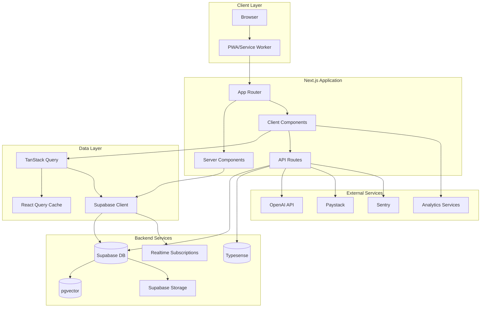
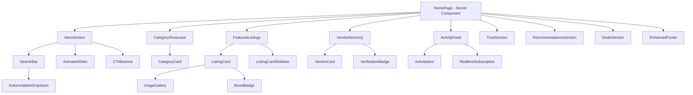
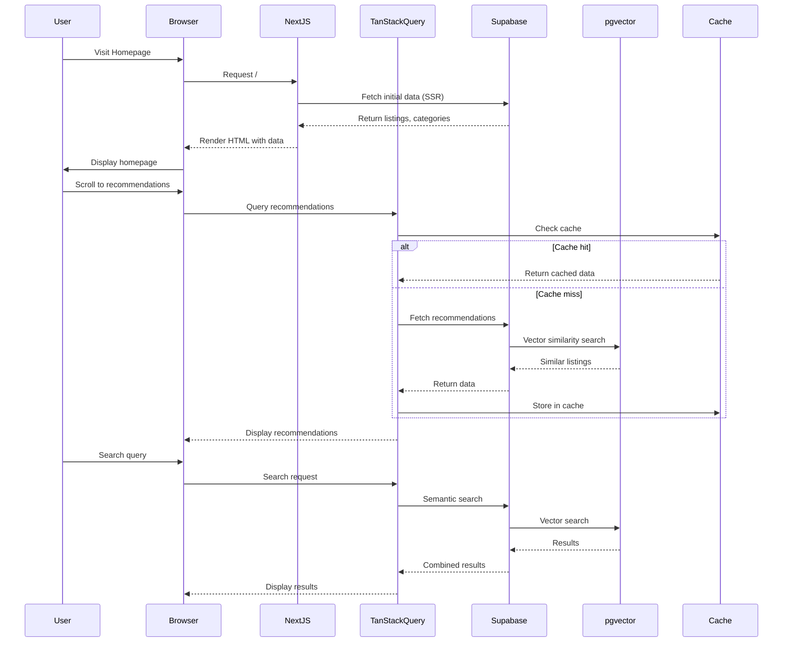

# Design Document: Sophisticated Marketplace Homepage

## Overview

This design document specifies the technical architecture for the FindAm marketplace homepage transformation into a sophisticated, dropshipping-format business directory marketplace. The homepage serves as the primary entry point, showcasing business listings, vendor profiles, and engagement features designed to drive user retention and conversion.

### Design Goals

1. **Performance**: Achieve sub-1.5s FCP and sub-2.5s LCP on 3G connections
2. **Engagement**: Implement retention features (personalized recommendations, activity feeds, saved items)
3. **Discoverability**: Enable semantic search with pgvector and AI-powered recommendations
4. **Conversion**: Optimize for business listing claims, premium upgrades, and vendor signups
5. **Scalability**: Support 10,000+ concurrent users with efficient caching and ISR
6. **Accessibility**: Achieve WCAG 2.1 Level AA compliance
7. **SEO**: Implement comprehensive metadata, structured data, and dynamic OG images

### Technology Stack

- **Framework**: Next.js 14+ (App Router, Server Components, ISR)
- **Database**: Supabase (PostgreSQL with pgvector extension)
- **State Management**: TanStack Query v5 for data fetching and caching
- **Animations**: Framer Motion for micro-interactions and transitions
- **Styling**: Tailwind CSS with custom design system
- **Search**: Typesense for keyword search + pgvector for semantic search
- **Analytics**: Vercel Analytics + PostHog for behavior tracking and A/B testing
- **Payments**: Paystack for subscription processing
- **Error Tracking**: Sentry for monitoring and error reporting
- **Testing**: Vitest (unit), Playwright (E2E), fast-check (property-based)

## Architecture

### High-Level Architecture



### Component Architecture



### Data Flow Architecture



## Components and Interfaces

### Core Components

#### 1. HomePage (Server Component)

**Purpose**: Root page component that orchestrates all homepage sections with server-side data fetching.

**Props**: None (uses searchParams for URL state)

**Data Fetching**:
```typescript
interface HomePageData {
  featuredListings: Listing[];
  categories: Category[];
  featuredVendors: Vendor[];
  recentActivities: Activity[];
  deals: Deal[];
  stats: PlatformStats;
}
```

**Implementation Strategy**:
- Server Component for initial SSR
- Fetch critical data during SSR (featured listings, categories)
- Pass data to client components via props
- Implement ISR with 60-second revalidation

#### 2. HeroSection (Client Component)

**Purpose**: Above-the-fold section with headline, CTA, animated stats, and search bar.

**Props**:
```typescript
interface HeroSectionProps {
  stats: PlatformStats;
  className?: string;
}

interface PlatformStats {
  totalUsers: number;
  totalListings: number;
  averageRating: number;
}
```

**Animations**:
- Staggered fade-in for headline (delay: 0ms, 100ms, 200ms)
- Counting animation for stats (duration: 2000ms, easing: easeOut)
- Floating badges with subtle motion (translateY: -5px to 5px, duration: 3000ms)
- Subtle background pattern with minimal animation

**Accessibility**:
- Semantic HTML (h1 for headline)
- ARIA labels for stats
- Keyboard navigation for CTAs
- Focus visible indicators

#### 3. CategoryShowcase (Client Component)

**Purpose**: Interactive grid of product categories with hover effects and auto-rotation.

**Props**:
```typescript
interface CategoryShowcaseProps {
  categories: Category[];
  className?: string;
}

interface Category {
  id: string;
  name: string;
  slug: string;
  icon: string;
  itemCount: number;
  accentColor: string; // Single accent color instead of gradient
}
```

**State Management**:
```typescript
const [activeCategory, setActiveCategory] = useState<string | null>(null);
const [isAutoRotating, setIsAutoRotating] = useState(true);
```

**Auto-Rotation Logic**:
- Rotate every 3000ms
- Pause on hover
- Resume on mouse leave
- Reset on manual selection

**Responsive Grid**:
- Mobile: 2 columns
- Tablet: 3 columns
- Desktop: 6 columns

#### 4. FeaturedListings (Client Component)

**Purpose**: Display curated listings with lazy loading and skeleton states.

**Props**:
```typescript
interface FeaturedListingsProps {
  initialListings?: Listing[];
  className?: string;
}

interface Listing {
  id: string;
  title: string;
  price: number;
  currency: string;
  location: string;
  thumbnail: string;
  images: string[];
  video?: string;
  views: number;
  likes: number;
  isBoosted: boolean;
  vendor: {
    id: string;
    name: string;
    avatar: string;
    isVerified: boolean;
  };
  createdAt: string;
}
```

**TanStack Query Integration**:
```typescript
const { data, isLoading, error } = useQuery({
  queryKey: ['listings', 'featured'],
  queryFn: () => fetchFeaturedListings(),
  staleTime: 5 * 60 * 1000, // 5 minutes
  placeholderData: initialListings,
});
```

**Lazy Loading**:
- Use Next.js Image component with priority={false}
- Blur-up placeholder with base64 data
- Intersection Observer for viewport detection

#### 5. VendorDirectory (Client Component)

**Purpose**: Showcase verified vendors with ratings and specialties.

**Props**:
```typescript
interface VendorDirectoryProps {
  initialVendors?: Vendor[];
  className?: string;
}

interface Vendor {
  id: string;
  name: string;
  avatar: string;
  rating: number;
  reviewCount: number;
  listingCount: number;
  specialties: string[];
  verification: {
    phone: boolean;
    nin: boolean;
    video: boolean;
  };
  responseTime: number; // in hours
}
```

**Verification Badge Logic**:
```typescript
const isFullyVerified = vendor.verification.phone && 
                        vendor.verification.nin && 
                        vendor.verification.video;
```

#### 6. ActivityFeed (Client Component)

**Purpose**: Real-time display of platform activity using Supabase realtime.

**Props**:
```typescript
interface ActivityFeedProps {
  initialActivities?: Activity[];
  className?: string;
}

interface Activity {
  id: string;
  type: 'listing' | 'purchase' | 'registration' | 'review';
  user: {
    name: string;
    avatar: string;
  };
  description: string;
  timestamp: string;
  metadata?: Record<string, any>;
}
```

**Realtime Subscription**:
```typescript
useEffect(() => {
  const channel = supabase
    .channel('activities')
    .on('postgres_changes', 
      { event: 'INSERT', schema: 'public', table: 'activities' },
      (payload) => {
        setActivities(prev => [payload.new as Activity, ...prev].slice(0, 20));
      }
    )
    .subscribe();
    
  return () => {
    supabase.removeChannel(channel);
  };
}, []);
```

**Animation**:
- Slide in from top with fade (translateY: -20px to 0, opacity: 0 to 1)
- Duration: 300ms
- Stagger delay: 50ms per item

#### 7. SearchBar with Autocomplete (Client Component)

**Purpose**: Prominent search with semantic and keyword autocomplete.

**Props**:
```typescript
interface SearchBarProps {
  placeholder?: string;
  className?: string;
  onSearch?: (query: string) => void;
}

interface AutocompleteResult {
  type: 'listing' | 'category' | 'vendor';
  id: string;
  title: string;
  subtitle?: string;
  thumbnail?: string;
  url: string;
}
```

**Debounced Search**:
```typescript
const debouncedSearch = useDebouncedCallback(
  async (query: string) => {
    if (query.length < 2) return;
    
    const results = await Promise.all([
      searchKeyword(query),
      searchSemantic(query),
    ]);
    
    setAutocompleteResults(mergeResults(results));
  },
  300
);
```

**Semantic Search Integration**:
```typescript
async function searchSemantic(query: string): Promise<AutocompleteResult[]> {
  // Generate embedding for query
  const embedding = await generateEmbedding(query);
  
  // Vector similarity search
  const { data } = await supabase.rpc('match_listings', {
    query_embedding: embedding,
    match_threshold: 0.7,
    match_count: 5,
  });
  
  return data.map(item => ({
    type: 'listing',
    id: item.id,
    title: item.title,
    subtitle: item.location,
    thumbnail: item.thumbnail,
    url: `/listing/${item.id}`,
  }));
}
```

#### 8. RecommendationsSection (Client Component)

**Purpose**: Personalized recommendations using collaborative filtering and vector similarity.

**Props**:
```typescript
interface RecommendationsSectionProps {
  userId?: string;
  className?: string;
}
```

**Recommendation Algorithm**:
```typescript
async function fetchRecommendations(userId?: string): Promise<Listing[]> {
  if (!userId) {
    // Return trending listings for anonymous users
    return fetchTrendingListings();
  }
  
  // Fetch user's browsing history
  const history = await fetchUserHistory(userId);
  
  // Generate embedding from history
  const userEmbedding = await generateUserEmbedding(history);
  
  // Vector similarity search
  const { data } = await supabase.rpc('recommend_listings', {
    user_embedding: userEmbedding,
    user_id: userId,
    match_count: 8,
  });
  
  return data;
}
```

#### 9. DealsSection (Client Component)

**Purpose**: Display time-limited deals with countdown timers.

**Props**:
```typescript
interface DealsSectionProps {
  initialDeals?: Deal[];
  className?: string;
}

interface Deal {
  id: string;
  listing: Listing;
  originalPrice: number;
  discountedPrice: number;
  discountPercentage: number;
  expiresAt: string;
}
```

**Countdown Timer**:
```typescript
function useCountdown(expiresAt: string) {
  const [timeLeft, setTimeLeft] = useState(calculateTimeLeft(expiresAt));
  
  useEffect(() => {
    const timer = setInterval(() => {
      const newTimeLeft = calculateTimeLeft(expiresAt);
      setTimeLeft(newTimeLeft);
      
      if (newTimeLeft.total <= 0) {
        clearInterval(timer);
      }
    }, 1000);
    
    return () => clearInterval(timer);
  }, [expiresAt]);
  
  return timeLeft;
}
```

#### 10. EnhancedFooter (Server Component)

**Purpose**: Multi-column footer with navigation, newsletter signup, and trust indicators.

**Structure**:
```typescript
interface FooterSection {
  title: string;
  links: Array<{
    label: string;
    href: string;
    external?: boolean;
  }>;
}

const footerSections: FooterSection[] = [
  {
    title: 'Quick Links',
    links: [
      { label: 'Browse Listings', href: '/search' },
      { label: 'Sell on FindAm', href: '/create' },
      { label: 'Premium Plans', href: '/premium' },
    ],
  },
  // ... more sections
];
```

**Newsletter Form**:
```typescript
interface NewsletterFormProps {
  onSubmit: (email: string) => Promise<void>;
}

// Email validation
const emailSchema = z.string().email();
```

### Shared Components

#### ListingCard

**Purpose**: Reusable card component for displaying listings across the site.

**Props**:
```typescript
interface ListingCardProps {
  listing: Listing;
  variant?: 'default' | 'compact' | 'featured';
  showVendor?: boolean;
  onLike?: (listingId: string) => void;
  onSave?: (listingId: string) => void;
  className?: string;
}
```

**Hover Effects**:
- Elevation: translateY(-4px)
- Shadow: 0 10px 30px rgba(0,0,0,0.15)
- Overlay: opacity 0 to 1
- Duration: 200ms
- Easing: ease-out

#### VerificationBadge

**Purpose**: Display verification status with tooltips.

**Props**:
```typescript
interface VerificationBadgeProps {
  type: 'phone' | 'nin' | 'video' | 'full';
  size?: 'sm' | 'md' | 'lg';
  showTooltip?: boolean;
}
```

#### BoostBadge

**Purpose**: Indicate boosted listings with subtle accent styling.

**Props**:
```typescript
interface BoostBadgeProps {
  level: 1 | 2 | 3;
  className?: string;
}
```

## Data Models

### Database Schema

#### Listings Table

```sql
CREATE TABLE listings (
  id UUID PRIMARY KEY DEFAULT uuid_generate_v4(),
  title TEXT NOT NULL,
  description TEXT,
  price DECIMAL(10, 2) NOT NULL,
  currency VARCHAR(3) DEFAULT 'NGN',
  location TEXT,
  category_id UUID REFERENCES categories(id),
  vendor_id UUID REFERENCES profiles(id),
  images TEXT[],
  video_url TEXT,
  thumbnail TEXT,
  views INTEGER DEFAULT 0,
  likes INTEGER DEFAULT 0,
  is_boosted BOOLEAN DEFAULT FALSE,
  boost_level INTEGER CHECK (boost_level IN (1, 2, 3)),
  boost_expires_at TIMESTAMP,
  discount_percentage INTEGER CHECK (discount_percentage >= 0 AND discount_percentage <= 100),
  original_price DECIMAL(10, 2),
  deal_expires_at TIMESTAMP,
  embedding VECTOR(1536), -- OpenAI ada-002 embeddings
  status VARCHAR(20) DEFAULT 'active',
  created_at TIMESTAMP DEFAULT NOW(),
  updated_at TIMESTAMP DEFAULT NOW(),
  deleted_at TIMESTAMP
);

-- Indexes
CREATE INDEX idx_listings_category ON listings(category_id);
CREATE INDEX idx_listings_vendor ON listings(vendor_id);
CREATE INDEX idx_listings_status ON listings(status);
CREATE INDEX idx_listings_boosted ON listings(is_boosted, boost_expires_at);
CREATE INDEX idx_listings_deals ON listings(discount_percentage, deal_expires_at);

-- Vector similarity index (HNSW for better performance)
CREATE INDEX idx_listings_embedding ON listings 
USING hnsw (embedding vector_cosine_ops);
```

#### Categories Table

```sql
CREATE TABLE categories (
  id UUID PRIMARY KEY DEFAULT uuid_generate_v4(),
  name TEXT NOT NULL,
  slug TEXT UNIQUE NOT NULL,
  icon TEXT,
  accent_color TEXT, -- Single color instead of gradient
  parent_id UUID REFERENCES categories(id),
  item_count INTEGER DEFAULT 0,
  created_at TIMESTAMP DEFAULT NOW(),
  updated_at TIMESTAMP DEFAULT NOW()
);

CREATE INDEX idx_categories_slug ON categories(slug);
CREATE INDEX idx_categories_parent ON categories(parent_id);
```

#### Profiles Table (Vendors)

```sql
CREATE TABLE profiles (
  id UUID PRIMARY KEY REFERENCES auth.users(id),
  name TEXT NOT NULL,
  avatar TEXT,
  bio TEXT,
  rating DECIMAL(2, 1) CHECK (rating >= 0 AND rating <= 5),
  review_count INTEGER DEFAULT 0,
  listing_count INTEGER DEFAULT 0,
  specialties TEXT[],
  phone_verified BOOLEAN DEFAULT FALSE,
  nin_verified BOOLEAN DEFAULT FALSE,
  video_verified BOOLEAN DEFAULT FALSE,
  is_premium BOOLEAN DEFAULT FALSE,
  premium_tier VARCHAR(20) CHECK (premium_tier IN ('basic', 'pro', 'enterprise')),
  premium_expires_at TIMESTAMP,
  response_time_hours DECIMAL(5, 2),
  total_sales INTEGER DEFAULT 0,
  created_at TIMESTAMP DEFAULT NOW(),
  updated_at TIMESTAMP DEFAULT NOW()
);

CREATE INDEX idx_profiles_verified ON profiles(phone_verified, nin_verified, video_verified);
CREATE INDEX idx_profiles_premium ON profiles(is_premium, premium_expires_at);
```

#### Activities Table

```sql
CREATE TABLE activities (
  id UUID PRIMARY KEY DEFAULT uuid_generate_v4(),
  type VARCHAR(20) NOT NULL CHECK (type IN ('listing', 'purchase', 'registration', 'review')),
  user_id UUID REFERENCES profiles(id),
  user_name TEXT NOT NULL,
  user_avatar TEXT,
  description TEXT NOT NULL,
  metadata JSONB,
  created_at TIMESTAMP DEFAULT NOW()
);

CREATE INDEX idx_activities_type ON activities(type);
CREATE INDEX idx_activities_created ON activities(created_at DESC);
```

#### Reviews Table

```sql
CREATE TABLE reviews (
  id UUID PRIMARY KEY DEFAULT uuid_generate_v4(),
  listing_id UUID REFERENCES listings(id),
  vendor_id UUID REFERENCES profiles(id),
  reviewer_id UUID REFERENCES profiles(id),
  rating INTEGER NOT NULL CHECK (rating >= 1 AND rating <= 5),
  comment TEXT,
  images TEXT[],
  is_verified_purchase BOOLEAN DEFAULT FALSE,
  helpfulness_votes INTEGER DEFAULT 0,
  vendor_response TEXT,
  vendor_responded_at TIMESTAMP,
  created_at TIMESTAMP DEFAULT NOW(),
  updated_at TIMESTAMP DEFAULT NOW()
);

CREATE INDEX idx_reviews_listing ON reviews(listing_id);
CREATE INDEX idx_reviews_vendor ON reviews(vendor_id);
CREATE INDEX idx_reviews_rating ON reviews(rating);
```

#### User Interactions Table

```sql
CREATE TABLE user_interactions (
  id UUID PRIMARY KEY DEFAULT uuid_generate_v4(),
  user_id UUID REFERENCES profiles(id),
  listing_id UUID REFERENCES listings(id),
  interaction_type VARCHAR(20) CHECK (interaction_type IN ('view', 'like', 'save', 'share', 'contact')),
  created_at TIMESTAMP DEFAULT NOW()
);

CREATE INDEX idx_interactions_user ON user_interactions(user_id, created_at DESC);
CREATE INDEX idx_interactions_listing ON user_interactions(listing_id);
CREATE INDEX idx_interactions_type ON user_interactions(interaction_type);
```

#### Subscriptions Table

```sql
CREATE TABLE subscriptions (
  id UUID PRIMARY KEY DEFAULT uuid_generate_v4(),
  user_id UUID REFERENCES profiles(id),
  tier VARCHAR(20) NOT NULL CHECK (tier IN ('basic', 'pro', 'enterprise')),
  status VARCHAR(20) NOT NULL CHECK (status IN ('active', 'cancelled', 'expired', 'grace_period')),
  billing_cycle VARCHAR(10) CHECK (billing_cycle IN ('monthly', 'annual')),
  amount DECIMAL(10, 2) NOT NULL,
  currency VARCHAR(3) DEFAULT 'NGN',
  paystack_subscription_code TEXT,
  current_period_start TIMESTAMP NOT NULL,
  current_period_end TIMESTAMP NOT NULL,
  cancelled_at TIMESTAMP,
  created_at TIMESTAMP DEFAULT NOW(),
  updated_at TIMESTAMP DEFAULT NOW()
);

CREATE INDEX idx_subscriptions_user ON subscriptions(user_id);
CREATE INDEX idx_subscriptions_status ON subscriptions(status);
```

### Database Functions

#### Vector Similarity Search

```sql
CREATE OR REPLACE FUNCTION match_listings(
  query_embedding VECTOR(1536),
  match_threshold FLOAT DEFAULT 0.7,
  match_count INT DEFAULT 10
)
RETURNS TABLE (
  id UUID,
  title TEXT,
  price DECIMAL,
  thumbnail TEXT,
  location TEXT,
  similarity FLOAT
)
LANGUAGE plpgsql
AS $$
BEGIN
  RETURN QUERY
  SELECT
    l.id,
    l.title,
    l.price,
    l.thumbnail,
    l.location,
    1 - (l.embedding <=> query_embedding) AS similarity
  FROM listings l
  WHERE 
    l.status = 'active' 
    AND l.deleted_at IS NULL
    AND 1 - (l.embedding <=> query_embedding) > match_threshold
  ORDER BY l.embedding <=> query_embedding
  LIMIT match_count;
END;
$$;
```

#### Recommendation Function

```sql
CREATE OR REPLACE FUNCTION recommend_listings(
  user_embedding VECTOR(1536),
  user_id UUID,
  match_count INT DEFAULT 8
)
RETURNS TABLE (
  id UUID,
  title TEXT,
  price DECIMAL,
  thumbnail TEXT,
  similarity FLOAT
)
LANGUAGE plpgsql
AS $$
BEGIN
  RETURN QUERY
  SELECT
    l.id,
    l.title,
    l.price,
    l.thumbnail,
    1 - (l.embedding <=> user_embedding) AS similarity
  FROM listings l
  WHERE 
    l.status = 'active'
    AND l.deleted_at IS NULL
    AND l.vendor_id != user_id
    AND l.id NOT IN (
      SELECT listing_id 
      FROM user_interactions 
      WHERE user_id = recommend_listings.user_id 
        AND interaction_type = 'view'
        AND created_at > NOW() - INTERVAL '7 days'
    )
  ORDER BY l.embedding <=> user_embedding
  LIMIT match_count;
END;
$$;
```

#### Update Average Rating Trigger

```sql
CREATE OR REPLACE FUNCTION update_vendor_rating()
RETURNS TRIGGER AS $$
BEGIN
  UPDATE profiles
  SET 
    rating = (
      SELECT AVG(rating)::DECIMAL(2,1)
      FROM reviews
      WHERE vendor_id = NEW.vendor_id
    ),
    review_count = (
      SELECT COUNT(*)
      FROM reviews
      WHERE vendor_id = NEW.vendor_id
    ),
    updated_at = NOW()
  WHERE id = NEW.vendor_id;
  
  RETURN NEW;
END;
$$ LANGUAGE plpgsql;

CREATE TRIGGER trigger_update_vendor_rating
AFTER INSERT OR UPDATE ON reviews
FOR EACH ROW
EXECUTE FUNCTION update_vendor_rating();
```

### Row Level Security (RLS) Policies

```sql
-- Enable RLS
ALTER TABLE listings ENABLE ROW LEVEL SECURITY;
ALTER TABLE profiles ENABLE ROW LEVEL SECURITY;
ALTER TABLE reviews ENABLE ROW LEVEL SECURITY;
ALTER TABLE user_interactions ENABLE ROW LEVEL SECURITY;

-- Listings policies
CREATE POLICY "Public listings are viewable by everyone"
  ON listings FOR SELECT
  USING (status = 'active' AND deleted_at IS NULL);

CREATE POLICY "Users can insert their own listings"
  ON listings FOR INSERT
  WITH CHECK (auth.uid() = vendor_id);

CREATE POLICY "Users can update their own listings"
  ON listings FOR UPDATE
  USING (auth.uid() = vendor_id);

-- Profiles policies
CREATE POLICY "Profiles are viewable by everyone"
  ON profiles FOR SELECT
  USING (true);

CREATE POLICY "Users can update their own profile"
  ON profiles FOR UPDATE
  USING (auth.uid() = id);

-- Reviews policies
CREATE POLICY "Reviews are viewable by everyone"
  ON reviews FOR SELECT
  USING (true);

CREATE POLICY "Authenticated users can insert reviews"
  ON reviews FOR INSERT
  WITH CHECK (auth.uid() = reviewer_id);

-- User interactions policies
CREATE POLICY "Users can view their own interactions"
  ON user_interactions FOR SELECT
  USING (auth.uid() = user_id);

CREATE POLICY "Users can insert their own interactions"
  ON user_interactions FOR INSERT
  WITH CHECK (auth.uid() = user_id);
```

## Correctness Properties

*A property is a characteristic or behavior that should hold true across all valid executions of a system—essentially, a formal statement about what the system should do. Properties serve as the bridge between human-readable specifications and machine-verifiable correctness guarantees.*

Before writing correctness properties, I need to analyze the acceptance criteria using the prework tool:

<function_calls>
<invoke name="prework">
<parameter name="featureName">sophisticated-marketplace-homepage

### Property 1: Configuration Round-Trip Preservation

*For any* valid HomepageConfig object, serializing to JSON then parsing back SHALL produce an equivalent object with all fields preserved.

**Validates: Requirements 21.6**

### Property 2: Configuration Parser Validates Required Fields

*For any* JSON configuration missing required fields (sections, features, performance_settings), parsing SHALL return a validation error identifying the missing fields.

**Validates: Requirements 21.3**

### Property 3: Configuration Parser Applies Defaults

*For any* valid JSON configuration with optional fields omitted, parsing SHALL apply default values for all missing optional fields.

**Validates: Requirements 21.4**

### Property 4: Configuration Parser Validates Enum Values

*For any* JSON configuration with enum fields, parsing SHALL accept only valid enum values and reject invalid values with descriptive errors.

**Validates: Requirements 21.8**

### Property 5: Configuration Parser Validates Value Ranges

*For any* JSON configuration with numeric fields, parsing SHALL validate that values are within specified ranges and return errors for out-of-range values.

**Validates: Requirements 21.9**

### Property 6: Configuration Parser Handles Nested Objects

*For any* valid JSON configuration with nested objects, parsing SHALL correctly preserve the nested structure in the resulting HomepageConfig object.

**Validates: Requirements 21.7**

### Property 7: Configuration Parser Supports JSON5 Comments

*For any* valid JSON5 configuration with comments, parsing SHALL succeed and ignore all comments while preserving the configuration data.

**Validates: Requirements 21.10**

### Property 8: Vector Search Similarity Bounds

*For any* vector similarity search query, all returned similarity scores SHALL be between 0 and 1 inclusive.

**Validates: Requirements 22.10**

### Property 9: Vector Search Results Ordering

*For any* vector similarity search query, the results SHALL be ordered by descending similarity score.

**Validates: Requirements 22.11**

### Property 10: Claim Request State Invariant

*For any* business claim request, the status SHALL be one of: pending, approved, rejected, or expired.

**Validates: Requirements 23.10**

### Property 11: Subscription Billing Cycle Invariant

*For any* subscription, the billing_cycle SHALL be either 'monthly' or 'annual'.

**Validates: Requirements 24.10**

### Property 12: Premium Feature Revocation on Cancellation

*For any* premium subscription, when cancelled, all premium features SHALL be immediately revoked and inaccessible.

**Validates: Requirements 24.11**

### Property 13: Review Rating Range Invariant

*For any* review, the rating value SHALL be an integer between 1 and 5 inclusive.

**Validates: Requirements 25.11**

### Property 14: Average Rating Calculation Correctness

*For any* vendor with reviews, the average rating SHALL equal the arithmetic mean of all review ratings for that vendor.

**Validates: Requirements 25.12**

### Property 15: Image Compression Size Constraint

*For any* uploaded image, after compression, the file size SHALL be under 5MB.

**Validates: Requirements 26.11**

### Property 16: Supplier Response Time Calculation

*For any* supplier profile, the response_time_hours SHALL equal the median response time over the last 30 days.

**Validates: Requirements 27.11**

### Property 17: Structured Data Schema Validation

*For any* generated JSON-LD structured data, the output SHALL validate against schema.org specifications.

**Validates: Requirements 28.11**

### Property 18: Query Cache Invalidation on Mutation

*For any* successful mutation operation, all related TanStack Query caches SHALL be invalidated.

**Validates: Requirements 29.11**

### Property 19: A/B Test Variant Consistency

*For any* user in an A/B test, repeated variant assignments SHALL return the same variant consistently.

**Validates: Requirements 30.11**

### Property 20: Rate Limit Error Response

*For any* API endpoint, when request rate exceeds the configured limit, the response SHALL return HTTP status code 429.

**Validates: Requirements 31.11**

### Property 21: Product Import Idempotence

*For any* product import operation, importing the same product multiple times SHALL result in only one product instance in the database.

**Validates: Requirements 32.11**

## Error Handling

### Error Categories

1. **Network Errors**: Failed API requests, timeout, connection loss
2. **Data Errors**: Invalid data format, missing required fields, constraint violations
3. **Authentication Errors**: Unauthorized access, expired sessions
4. **Rate Limiting Errors**: Too many requests
5. **Server Errors**: 500-level responses, database errors
6. **Client Errors**: Invalid input, validation failures

### Error Handling Strategy

#### Network Error Handling

```typescript
// TanStack Query retry configuration
const queryClient = new QueryClient({
  defaultOptions: {
    queries: {
      retry: (failureCount, error) => {
        // Don't retry on 4xx errors
        if (error instanceof Error && 'status' in error) {
          const status = (error as any).status;
          if (status >= 400 && status < 500) return false;
        }
        // Retry up to 3 times for network errors
        return failureCount < 3;
      },
      retryDelay: (attemptIndex) => Math.min(1000 * 2 ** attemptIndex, 30000),
    },
  },
});
```

#### Graceful Degradation

```typescript
function FeaturedListings({ initialListings }: FeaturedListingsProps) {
  const { data, isLoading, error } = useQuery({
    queryKey: ['listings', 'featured'],
    queryFn: fetchFeaturedListings,
    placeholderData: initialListings, // Show stale data while refetching
  });
  
  if (error) {
    return (
      <ErrorFallback
        error={error}
        onRetry={() => queryClient.invalidateQueries(['listings', 'featured'])}
        fallbackData={initialListings} // Show cached data with warning
      />
    );
  }
  
  return <ListingGrid listings={data ?? initialListings} />;
}
```

#### Error Boundaries

```typescript
// Component-level error boundary
export function ComponentErrorBoundary({ children }: { children: React.ReactNode }) {
  return (
    <ErrorBoundary
      fallback={<ComponentErrorFallback />}
      onError={(error, errorInfo) => {
        Sentry.captureException(error, {
          contexts: { react: errorInfo },
        });
      }}
    >
      {children}
    </ErrorBoundary>
  );
}
```

#### Realtime Connection Error Handling

```typescript
function useRealtimeActivities() {
  const [activities, setActivities] = useState<Activity[]>([]);
  const [connectionStatus, setConnectionStatus] = useState<'connected' | 'disconnected' | 'reconnecting'>('connected');
  
  useEffect(() => {
    const channel = supabase
      .channel('activities')
      .on('postgres_changes', 
        { event: 'INSERT', schema: 'public', table: 'activities' },
        (payload) => setActivities(prev => [payload.new as Activity, ...prev])
      )
      .subscribe((status) => {
        if (status === 'SUBSCRIBED') {
          setConnectionStatus('connected');
        } else if (status === 'CHANNEL_ERROR') {
          setConnectionStatus('disconnected');
          // Fall back to polling
          startPolling();
        }
      });
    
    return () => {
      supabase.removeChannel(channel);
      stopPolling();
    };
  }, []);
  
  return { activities, connectionStatus };
}
```

#### User-Friendly Error Messages

```typescript
const ERROR_MESSAGES: Record<string, string> = {
  NETWORK_ERROR: 'Unable to connect. Please check your internet connection.',
  TIMEOUT_ERROR: 'Request timed out. Please try again.',
  AUTH_ERROR: 'Please log in to continue.',
  RATE_LIMIT_ERROR: 'Too many requests. Please wait a moment and try again.',
  SERVER_ERROR: 'Something went wrong on our end. We\'re working on it.',
  VALIDATION_ERROR: 'Please check your input and try again.',
};

function getErrorMessage(error: unknown): string {
  if (error instanceof Error) {
    return ERROR_MESSAGES[error.name] ?? ERROR_MESSAGES.SERVER_ERROR;
  }
  return ERROR_MESSAGES.SERVER_ERROR;
}
```

### Error Logging

```typescript
// Sentry configuration
Sentry.init({
  dsn: process.env.NEXT_PUBLIC_SENTRY_DSN,
  environment: process.env.NODE_ENV,
  tracesSampleRate: 0.1,
  beforeSend(event, hint) {
    // Filter out non-critical errors
    if (event.level === 'warning') return null;
    
    // Add user context
    if (event.user) {
      event.user = {
        id: event.user.id,
        // Don't send PII
      };
    }
    
    return event;
  },
});

// Error logging utility
export function logError(error: Error, context?: Record<string, any>) {
  Sentry.captureException(error, {
    extra: context,
    tags: {
      component: context?.component,
      action: context?.action,
    },
  });
}
```

## Testing Strategy

### Testing Approach

This feature requires a multi-layered testing strategy combining unit tests, integration tests, E2E tests, and property-based tests. Property-based testing is appropriate for the configuration parser (Requirement 21) and certain data validation logic, but NOT appropriate for UI rendering, animations, or ISR functionality.

### Unit Tests (Vitest)

**Coverage Target**: 80%+ for critical paths

**Test Categories**:

1. **Component Logic Tests**
   - State management
   - Event handlers
   - Data transformations
   - Conditional rendering logic

2. **Utility Function Tests**
   - Data formatting (prices, dates, numbers)
   - Validation functions
   - Calculation functions (ratings, discounts)

3. **Hook Tests**
   - Custom hooks (useCountdown, useDebounce, useIntersectionObserver)
   - TanStack Query hooks

**Example Unit Tests**:

```typescript
// components/deals/useCountdown.test.ts
import { renderHook, act } from '@testing-library/react';
import { useCountdown } from './useCountdown';

describe('useCountdown', () => {
  beforeEach(() => {
    vi.useFakeTimers();
  });
  
  afterEach(() => {
    vi.useRealTimers();
  });
  
  it('should calculate time left correctly', () => {
    const expiresAt = new Date(Date.now() + 3600000).toISOString(); // 1 hour
    const { result } = renderHook(() => useCountdown(expiresAt));
    
    expect(result.current.hours).toBe(1);
    expect(result.current.minutes).toBe(0);
    expect(result.current.seconds).toBe(0);
  });
  
  it('should update every second', () => {
    const expiresAt = new Date(Date.now() + 10000).toISOString(); // 10 seconds
    const { result } = renderHook(() => useCountdown(expiresAt));
    
    act(() => {
      vi.advanceTimersByTime(1000);
    });
    
    expect(result.current.seconds).toBe(9);
  });
  
  it('should stop at zero', () => {
    const expiresAt = new Date(Date.now() + 1000).toISOString(); // 1 second
    const { result } = renderHook(() => useCountdown(expiresAt));
    
    act(() => {
      vi.advanceTimersByTime(2000);
    });
    
    expect(result.current.total).toBe(0);
  });
});
```

### Property-Based Tests (fast-check)

**Applicable To**: Configuration parser, data validation, calculation functions

**Configuration**: Minimum 100 iterations per property test

**Test Tagging**: Each property test must reference its design document property

```typescript
// lib/config/parser.test.ts
import fc from 'fast-check';
import { parseConfig, printConfig, HomepageConfig } from './parser';

describe('Configuration Parser Properties', () => {
  // Property 1: Round-trip preservation
  it('should preserve config through parse-print-parse cycle', () => {
    /**
     * Feature: sophisticated-marketplace-homepage
     * Property 1: Configuration Round-Trip Preservation
     * For any valid HomepageConfig object, serializing to JSON then parsing back
     * SHALL produce an equivalent object with all fields preserved.
     */
    fc.assert(
      fc.property(
        homepageConfigArbitrary(),
        (config) => {
          const json = printConfig(config);
          const parsed = parseConfig(json);
          expect(parsed).toEqual(config);
        }
      ),
      { numRuns: 100 }
    );
  });
  
  // Property 3: Default value application
  it('should apply defaults for missing optional fields', () => {
    /**
     * Feature: sophisticated-marketplace-homepage
     * Property 3: Configuration Parser Applies Defaults
     * For any valid JSON configuration with optional fields omitted,
     * parsing SHALL apply default values for all missing optional fields.
     */
    fc.assert(
      fc.property(
        partialConfigArbitrary(),
        (partialConfig) => {
          const parsed = parseConfig(JSON.stringify(partialConfig));
          
          // Verify defaults are applied
          expect(parsed.performance_settings.fcp_target).toBeDefined();
          expect(parsed.performance_settings.lcp_target).toBeDefined();
          expect(parsed.features.enable_realtime).toBeDefined();
        }
      ),
      { numRuns: 100 }
    );
  });
  
  // Property 8: Vector search similarity bounds
  it('should return similarity scores between 0 and 1', () => {
    /**
     * Feature: sophisticated-marketplace-homepage
     * Property 8: Vector Search Similarity Bounds
     * For any vector similarity search query, all returned similarity scores
     * SHALL be between 0 and 1 inclusive.
     */
    fc.assert(
      fc.property(
        fc.array(fc.float({ min: -1, max: 1 }), { minLength: 1536, maxLength: 1536 }),
        async (queryEmbedding) => {
          const results = await searchSimilar(queryEmbedding);
          
          results.forEach(result => {
            expect(result.similarity).toBeGreaterThanOrEqual(0);
            expect(result.similarity).toBeLessThanOrEqual(1);
          });
        }
      ),
      { numRuns: 100 }
    );
  });
  
  // Property 13: Review rating range invariant
  it('should only accept ratings between 1 and 5', () => {
    /**
     * Feature: sophisticated-marketplace-homepage
     * Property 13: Review Rating Range Invariant
     * For any review, the rating value SHALL be an integer between 1 and 5 inclusive.
     */
    fc.assert(
      fc.property(
        reviewArbitrary(),
        (review) => {
          expect(review.rating).toBeGreaterThanOrEqual(1);
          expect(review.rating).toBeLessThanOrEqual(5);
          expect(Number.isInteger(review.rating)).toBe(true);
        }
      ),
      { numRuns: 100 }
    );
  });
});

// Arbitraries for property-based testing
function homepageConfigArbitrary(): fc.Arbitrary<HomepageConfig> {
  return fc.record({
    sections: fc.array(fc.constantFrom('hero', 'categories', 'featured', 'vendors')),
    features: fc.record({
      enable_realtime: fc.boolean(),
      enable_animations: fc.boolean(),
      enable_pwa: fc.boolean(),
    }),
    performance_settings: fc.record({
      fcp_target: fc.integer({ min: 1000, max: 3000 }),
      lcp_target: fc.integer({ min: 2000, max: 5000 }),
      cls_target: fc.float({ min: 0, max: 0.2 }),
    }),
  });
}

function reviewArbitrary(): fc.Arbitrary<Review> {
  return fc.record({
    id: fc.uuid(),
    rating: fc.integer({ min: 1, max: 5 }),
    comment: fc.string(),
    reviewer_id: fc.uuid(),
    listing_id: fc.uuid(),
  });
}
```

### Integration Tests

**Purpose**: Test interactions between components, API routes, and database

**Test Categories**:

1. **API Route Tests**
   - Request/response handling
   - Authentication/authorization
   - Database operations
   - Error handling

2. **Database Tests**
   - RLS policies
   - Triggers and functions
   - Vector search operations

3. **TanStack Query Integration**
   - Cache behavior
   - Optimistic updates
   - Query invalidation

**Example Integration Test**:

```typescript
// app/api/listings/featured/route.test.ts
import { createMocks } from 'node-mocks-http';
import { GET } from './route';
import { createClient } from '@/lib/supabase/server';

describe('GET /api/listings/featured', () => {
  it('should return featured listings', async () => {
    const { req, res } = createMocks({
      method: 'GET',
    });
    
    const response = await GET(req);
    const data = await response.json();
    
    expect(response.status).toBe(200);
    expect(data.listings).toBeInstanceOf(Array);
    expect(data.listings.length).toBeGreaterThan(0);
  });
  
  it('should respect RLS policies', async () => {
    const supabase = createClient();
    
    const { data, error } = await supabase
      .from('listings')
      .select('*')
      .eq('status', 'draft'); // Should not be accessible
    
    expect(data).toEqual([]);
  });
  
  it('should handle rate limiting', async () => {
    // Make 101 requests (exceeds 100/min limit)
    const requests = Array.from({ length: 101 }, () => 
      fetch('/api/listings/featured')
    );
    
    const responses = await Promise.all(requests);
    const rateLimited = responses.filter(r => r.status === 429);
    
    expect(rateLimited.length).toBeGreaterThan(0);
  });
});
```

### End-to-End Tests (Playwright)

**Purpose**: Test critical user flows from browser perspective

**Critical Flows**:

1. **Homepage Load and Navigation**
   - Page loads within performance budget
   - All sections render correctly
   - Navigation works

2. **Search Flow**
   - Search bar accepts input
   - Autocomplete displays results
   - Selecting result navigates correctly

3. **Listing Interaction**
   - Clicking listing opens detail page
   - Like/save functionality works
   - Share functionality works

4. **Vendor Profile Flow**
   - Clicking vendor opens profile
   - Reviews display correctly
   - Contact form works

**Example E2E Test**:

```typescript
// e2e/homepage.spec.ts
import { test, expect } from '@playwright/test';

test.describe('Homepage', () => {
  test('should load within performance budget', async ({ page }) => {
    const startTime = Date.now();
    await page.goto('/');
    
    // Wait for hero section to be visible
    await page.waitForSelector('[data-testid="hero-section"]');
    const loadTime = Date.now() - startTime;
    
    expect(loadTime).toBeLessThan(1500); // 1.5s FCP target
  });
  
  test('should display all homepage sections', async ({ page }) => {
    await page.goto('/');
    
    await expect(page.locator('[data-testid="hero-section"]')).toBeVisible();
    await expect(page.locator('[data-testid="category-showcase"]')).toBeVisible();
    await expect(page.locator('[data-testid="featured-listings"]')).toBeVisible();
    await expect(page.locator('[data-testid="vendor-directory"]')).toBeVisible();
    await expect(page.locator('[data-testid="activity-feed"]')).toBeVisible();
  });
  
  test('should search and display results', async ({ page }) => {
    await page.goto('/');
    
    // Type in search bar
    await page.fill('[data-testid="search-input"]', 'laptop');
    
    // Wait for autocomplete
    await page.waitForSelector('[data-testid="autocomplete-dropdown"]');
    
    // Verify results
    const results = await page.locator('[data-testid="autocomplete-item"]').count();
    expect(results).toBeGreaterThan(0);
    
    // Click first result
    await page.click('[data-testid="autocomplete-item"]:first-child');
    
    // Verify navigation
    await expect(page).toHaveURL(/\/listing\/.+/);
  });
  
  test('should handle offline mode', async ({ page, context }) => {
    await page.goto('/');
    
    // Wait for page to load
    await page.waitForLoadState('networkidle');
    
    // Go offline
    await context.setOffline(true);
    
    // Verify offline indicator
    await expect(page.locator('[data-testid="offline-indicator"]')).toBeVisible();
    
    // Verify cached content still visible
    await expect(page.locator('[data-testid="featured-listings"]')).toBeVisible();
  });
});
```

### Visual Regression Tests

**Purpose**: Detect unintended UI changes

**Tool**: Playwright with screenshot comparison

```typescript
// e2e/visual.spec.ts
import { test, expect } from '@playwright/test';

test.describe('Visual Regression', () => {
  test('homepage matches snapshot', async ({ page }) => {
    await page.goto('/');
    await page.waitForLoadState('networkidle');
    
    // Take screenshot
    await expect(page).toHaveScreenshot('homepage.png', {
      fullPage: true,
      animations: 'disabled',
    });
  });
  
  test('listing card matches snapshot', async ({ page }) => {
    await page.goto('/');
    
    const card = page.locator('[data-testid="listing-card"]').first();
    await expect(card).toHaveScreenshot('listing-card.png');
  });
});
```

### Performance Tests

**Purpose**: Verify performance requirements are met

**Metrics**:
- First Contentful Paint (FCP) < 1.5s
- Largest Contentful Paint (LCP) < 2.5s
- Cumulative Layout Shift (CLS) < 0.1
- Time to Interactive (TTI) < 3.5s

```typescript
// e2e/performance.spec.ts
import { test, expect } from '@playwright/test';

test.describe('Performance', () => {
  test('should meet Core Web Vitals', async ({ page }) => {
    await page.goto('/');
    
    const metrics = await page.evaluate(() => {
      return new Promise((resolve) => {
        new PerformanceObserver((list) => {
          const entries = list.getEntries();
          const fcp = entries.find(e => e.name === 'first-contentful-paint');
          const lcp = entries.find(e => e.entryType === 'largest-contentful-paint');
          
          resolve({
            fcp: fcp?.startTime,
            lcp: lcp?.startTime,
          });
        }).observe({ entryTypes: ['paint', 'largest-contentful-paint'] });
      });
    });
    
    expect(metrics.fcp).toBeLessThan(1500);
    expect(metrics.lcp).toBeLessThan(2500);
  });
});
```

### Test Data Management

**Strategy**: Use fixtures and factories for consistent test data

```typescript
// tests/fixtures/listings.ts
export const listingFixture: Listing = {
  id: '123e4567-e89b-12d3-a456-426614174000',
  title: 'Test Listing',
  price: 50000,
  currency: 'NGN',
  location: 'Lagos, Nigeria',
  thumbnail: '/test-image.jpg',
  images: ['/test-image.jpg'],
  views: 100,
  likes: 10,
  isBoosted: false,
  vendor: {
    id: '123e4567-e89b-12d3-a456-426614174001',
    name: 'Test Vendor',
    avatar: '/test-avatar.jpg',
    isVerified: true,
  },
  createdAt: '2024-01-01T00:00:00Z',
};

// Factory function for generating test data
export function createListing(overrides?: Partial<Listing>): Listing {
  return {
    ...listingFixture,
    ...overrides,
    id: overrides?.id ?? crypto.randomUUID(),
  };
}
```

### Testing Summary

| Test Type | Tool | Coverage | Purpose |
|-----------|------|----------|---------|
| Unit Tests | Vitest | 80%+ | Component logic, utilities, hooks |
| Property Tests | fast-check | 100 iterations/property | Parser, validation, calculations |
| Integration Tests | Vitest | Critical paths | API routes, database, TanStack Query |
| E2E Tests | Playwright | Critical flows | User journeys, navigation |
| Visual Tests | Playwright | Key components | UI consistency |
| Performance Tests | Playwright | Core Web Vitals | Performance requirements |

**Why Property-Based Testing is Limited**:
- UI rendering and animations are NOT suitable for PBT (use snapshot/visual tests)
- ISR and server-side rendering are NOT suitable for PBT (use integration tests)
- Real-time subscriptions are NOT suitable for PBT (use integration tests with mocks)
- PBT IS suitable for: configuration parsing, data validation, calculation functions, invariants

